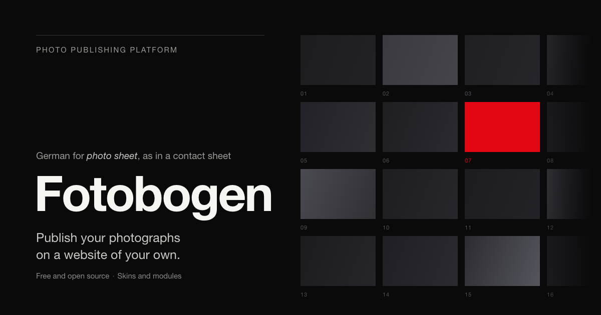
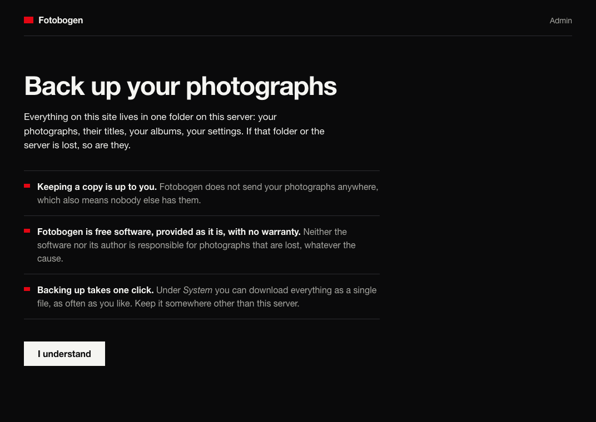
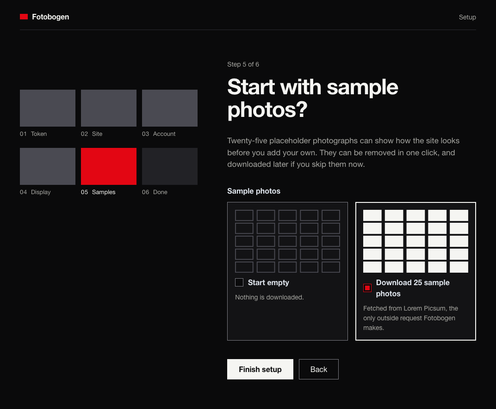
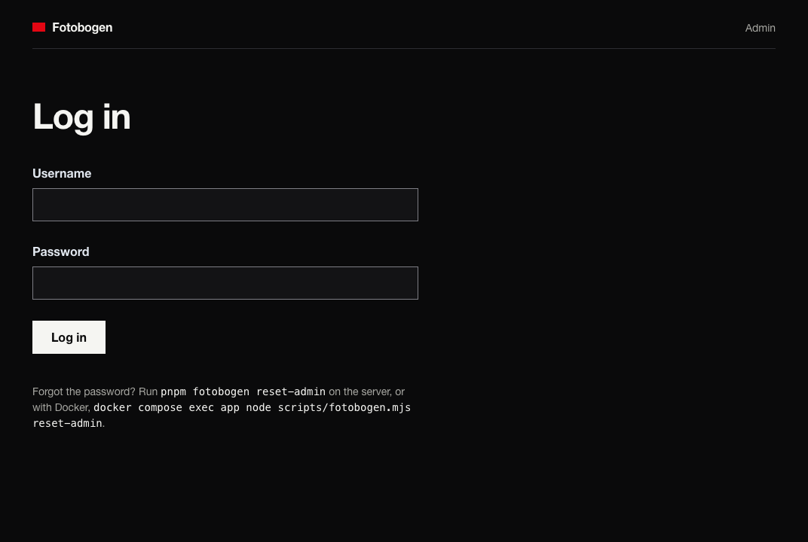
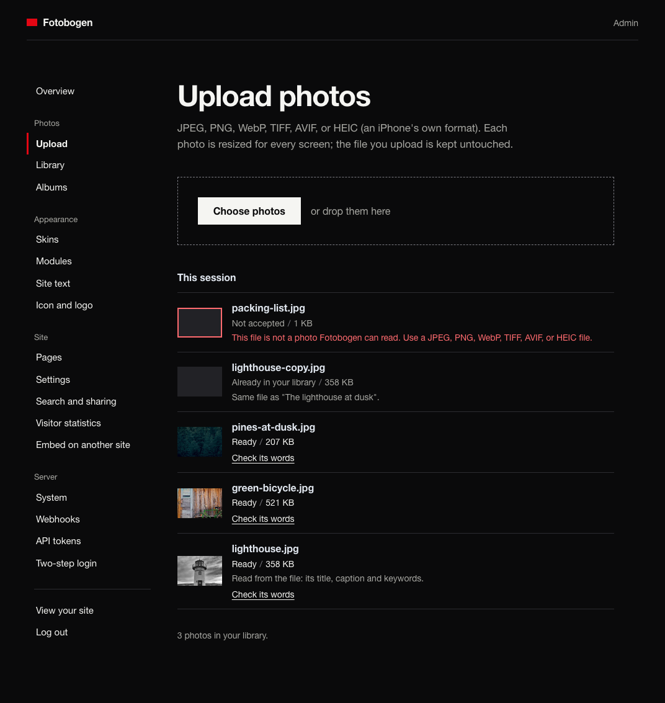
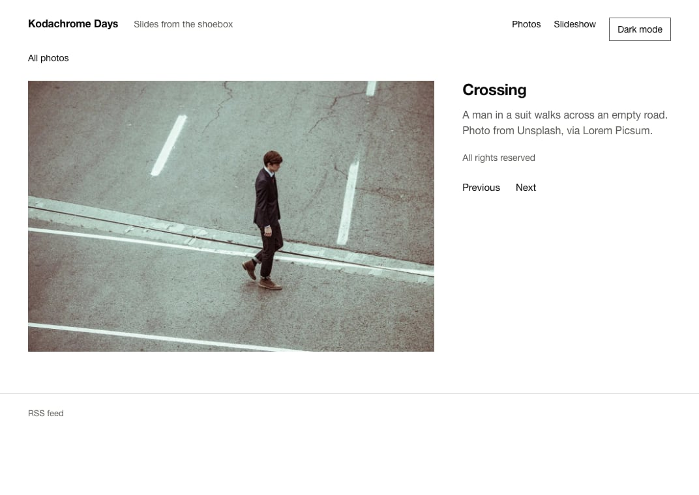

[](https://github.com/cschweda/fotobogen/actions/workflows/ci.yml)
[](LICENSE)

# Fotobogen

A self-hosted publishing platform for photographs: install it on a small
server, answer a few first-run questions, and get a public photo site with an
admin backend. Think "WordPress for photos".

**Version 1.3.0** (16 November 2026). It installs on macOS, Windows, and
Linux; takes your photographs, resizes them for every screen, and publishes
them on a site you can restyle, reword, and put under your own name, with an
admin behind a login. Version 1.0.0 was the first release; 1.1.0 added
updating from the admin; 1.2.0 tells you in the admin when a new version
is out; 1.3.0 asks a few questions at the first start.

- **What is in it:** [CHANGELOG.md](CHANGELOG.md), also published as
  [Releases](https://fotobogen.com/docs/changelog/).
- **How to install and use it:** the
  [documentation](https://fotobogen.com/docs/), or read on.
- **What comes next:** [docs/ROADMAP.md](docs/ROADMAP.md).
- **How it was designed:** [docs/DESIGN.md](docs/DESIGN.md).

A ready-made Docker image is published for each release, at
`ghcr.io/cschweda/fotobogen`, for Intel and ARM machines.

One thing to know: it has not yet been tried on a Laravel Forge server or on
a real 1 GB server; a 1 GB memory limit was tested in Docker. Fotobogen is
free software with no warranty: keep backups of your photographs.

## Contents

- [Screenshots](#screenshots)
- [How it runs](#how-it-runs)
- [Installing on your own computer](#installing-on-your-own-computer)
- [Local development](#local-development)
- [Running the built server](#running-the-built-server)
- [The preflight check](#the-preflight-check)
- [Health check](#health-check)
- [The public site](#the-public-site)
- [Skins](#skins)
- [Uploading photos](#uploading-photos)
- [Managing photos](#managing-photos)
- [Making the site your own](#making-the-site-your-own)
- [API tokens](#api-tokens)
- [Albums and tags](#albums-and-tags)
- [Sample photos](#sample-photos)
- [Modules](#modules)
- [Tests](#tests)
- [Windows](#windows)
- [Docker quick start](#docker-quick-start)
- [Laravel Forge](#laravel-forge)
- [Without Docker (pm2)](#without-docker-pm2)
- [nginx in front of the app](#nginx-in-front-of-the-app)
- [Laravel Forge with pm2 (no Docker)](#laravel-forge-with-pm2-no-docker)
- [An existing droplet with nginx: what to change](#an-existing-droplet-with-nginx-what-to-change)
- [Backup and restore](#backup-and-restore)
- [Updates](#updates)
- [For developers](#for-developers)
- [Resetting the admin password](#resetting-the-admin-password)
- [The data directory](#the-data-directory)
- [Settings](#settings)
- [Demo mode](#demo-mode)
- [Branches](#branches)
- [The fotobogen.com placeholder page](#the-fotobogencom-placeholder-page)
- [Licence](#licence)

## Screenshots

Taken from a local install at the current stage of development. The
photographs are the sample photos Fotobogen can download (Unsplash
photographs, via Lorem Picsum).

What visitors see: the grid, and a photo on its own page.


Editing a photo, with the strip of look previews under it and a film frame
chosen:


The library:


The notice shown once, before the admin opens:



The rest are from the installer and the first run.

The setup wizard opens on first visit and asks for the one-time token the
server printed when it started:


It then creates the single admin account, with a password strength meter:


Grid layout and photo view are picked from diagrams and can be changed later:


Step 5 offers to start empty (the default) or download 25 sample photos:



The last step lists what was chosen and closes the wizard for good. If
samples were asked for, a counter shows them arriving, and the download can
be cancelled:


After setup, the admin area sits behind a login:



The admin opens on Overview, with every other page in the menu down the
side. Sample photos can be downloaded or removed from here at any time:


Each upload shows its progress and result; a duplicate or a file that is not
a photo is explained on its own row. (The pictures here are generated
gradients, not photographs.)



## How it runs

Fotobogen is a server application, like WordPress. It runs on one machine
(a small Linux server, or your own Mac or PC for trying it out) and you use
it from any web browser. The setup wizard is a web page; there is nothing to
install on the computers you browse from.

The machine that hosts it needs **either** Docker **or** Node 24. Its
dependencies ship prebuilt for macOS, Windows, and Linux, so nothing is
compiled during install. Every change is tested on Linux and on Windows
(see [Windows](#windows)). There is no double-click desktop installer.

## Installing on your own computer

The quickest way to try Fotobogen, on a Mac, a Windows PC, or Linux. For a
public site on a server, see [Docker quick start](#docker-quick-start),
[Without Docker (pm2)](#without-docker-pm2), or
[the installation guide](https://fotobogen.com/docs/installation/).

**1. Have Node.js 24 and pnpm 10.**

```bash
node --version      # must print v24 or later
pnpm --version      # must print 10 or later
```

If Node.js is older, install 24 from [nodejs.org](https://nodejs.org), or
with nvm: `nvm install 24` and `nvm use 24`. Then install pnpm:
`npm install -g pnpm@10`.

Two things about nvm that catch people out:

- `nvm use 24` switches **the terminal you are in**. `nvm alias default 24`
  only changes terminals you open afterwards.
- nvm keeps tools such as pnpm **separately for each version** of Node.js.
  After switching, `pnpm: command not found` means it needs installing for
  that version: `npm install -g pnpm@10`.

**2. Get it, build it, start it.**

```bash
git clone https://github.com/cschweda/fotobogen.git
cd fotobogen
pnpm install
pnpm build
pnpm start
```

If Node.js or pnpm is too old, `pnpm install` stops before fetching anything
and prints what to do.

**3. Open the address it prints**, `http://localhost:5150`, in a browser on
the same computer, and enter the setup token shown in the terminal. Use the
`localhost` address: logging in is kept by your browser only on this
computer's own addresses or over https.

Leave the terminal open while you use the site. Control + C stops it, and
`pnpm start` starts it again with everything as you left it.

### In a folder with another name

`git clone` takes the folder's name as a second argument, so an install can
sit beside a copy of the source, or beside another install:

```bash
git clone https://github.com/cschweda/fotobogen.git fotobogen-live
cd fotobogen-live
```

Each folder is its own site, with its own `data` folder. If one copy is
running when you start another, Fotobogen asks whether to run both; the
second takes the next free port and prints its address. To give a copy a
port of its own, put `PORT=5160` in a `.env` file in its folder.

Run the commands from the folder you mean. `cd` into it first and check with
`pwd`; cloning from inside an existing copy puts the new one inside the old.

### Starting over

Everything about a site is in the `data` folder inside the app's folder.
Stop Fotobogen, then:

```bash
rm -rf data         # or, to keep the old site: mv data data-old
pnpm start
```

It starts as a new install, with a new setup token. There is no need to
delete the app's folder or install again.

### If you installed under the wrong Node.js

What was installed for one version of Node.js does not work under another.
After switching versions, install again from the start:

```bash
rm -rf node_modules
pnpm install
pnpm build
pnpm start
```

### Updating

```bash
git pull
pnpm install
pnpm build
pnpm start
```

Your `data` folder is left alone, and changes to the database are applied by
themselves when the new version starts.

## Local development

For working on Fotobogen itself. Requirements: [Node 24](https://nodejs.org)
and [pnpm](https://pnpm.io) 10 (see
[Installing on your own computer](#installing-on-your-own-computer) for
getting them).

```bash
nvm use            # reads .nvmrc (Node 24); switches this terminal only
pnpm install
pnpm dev           # http://localhost:5150
```

On first start the terminal prints a setup token:

```
Fotobogen setup token: 3b213e46bd70894ad18f1357791b1f18
Open the site in a browser and enter this token to finish setup.
```

Open http://localhost:5150, enter the token, and complete the six steps. You
end up logged in at `/admin`. Everything the site stores goes in `./data`;
delete that directory to start over with a fresh install.

After changing `server/db/schema.ts`, generate a migration with
`pnpm db:generate`. Migrations are applied automatically when the server
starts.

## Running the built server

```bash
pnpm build
pnpm start
```

`pnpm start` checks the machine (see below). **The very first time**, in a
terminal, it then asks three questions; press Enter to accept what is
suggested each time:

```
Port to run on? Press Enter for 5150, or the next free one above it:
Site address? Press Enter to skip:
Switch demo mode on? [y/N]
```

The answers are saved to `.env` in Fotobogen's folder, and it does not ask
again. To change them, edit `.env`, or run `pnpm fotobogen init` to be asked
again (your other settings in `.env` are kept); then restart. Nothing is
asked when nobody is at the keyboard: under pm2, in Docker, from a script,
or when `.env` already exists or `PORT`, `SITE_URL`, or `DEMO_MODE` is set.
Whether to start with sample photos is asked in the browser, with the rest
of setup.

It then starts the server and prints its address:

```
Fotobogen is running. Open it in a browser on this computer:

    http://localhost:5150

Logging in works at that address, or over https.
```

Use that address. The web server prints a line of its own underneath
(`Listening on http://0.0.0.0:5150`), which says where it is listening, not
where to browse. Logging in is kept by your browser only on this computer's
own addresses (`localhost`, `127.0.0.1`, `0.0.0.0`) or over https; anywhere
else over plain http, the login page says so instead of letting you in.

Nothing has to be configured. The port is **5150**; if that is taken,
Fotobogen uses the next free port above it and says so. Data goes in
`./data`. Restarting keeps you logged in and does not change the setup token.

To change a setting on one machine, copy `.env.sample` to `.env` and edit
the copy (see [Settings](#settings)). A port you set yourself is used
exactly: if it is taken, Fotobogen stops and tells you, rather than moving.

**More than one copy on a machine.** If Fotobogen is already running when
you start it in a terminal, it asks what you want: run both (the new one
gets its own port), stop the running copy and start this one, or cancel.
Started without a terminal (pm2, a service), a second site simply runs on
the next port. Two copies are never allowed to share one data directory.

## The preflight check

Before it starts, Fotobogen checks that the machine can run it properly, so
an install never half-works. The first time, it prints the whole report:

```
Fotobogen preflight check
  ok   Node.js: version 24.22.3
  ok   Operating system: Ubuntu 26.04 LTS
  ok   Processor: x64
  ok   Memory: 1.9 GB available
  ok   Data directory: /home/you/fotobogen/data
  ok   Disk space: 21.4 GB free
  ok   Image library: reads JPEG, PNG, WebP, TIFF, and AVIF
  ok   Database library: loads
  --   pm2: not installed
        Only needed on a server, to keep Fotobogen running and start it again after a reboot: npm install -g pm2. Not needed on your own computer, or with Docker.
```

Anything marked `FAIL` stops the start, with a line saying what to fix.
A `WARN` lets it run and says what to improve. A line marked `--` is a note,
not a problem: the pm2 line says whether [pm2](#without-docker-pm2) is
installed (it is looked for, never run), and reads `ok` when it is. It is
left out in Docker. After the first run only warnings and failures are
shown.

In a terminal the report is in colour: `ok` in green, `WARN` in yellow,
`FAIL` and anything that stops the start in red. The words are always there
too, so nothing depends on telling the colours apart. Colour is left out
when the output is not a terminal (a log file, pm2, Docker), and can be
switched off with `NO_COLOR=1`. Run it on its own at any time with
`pnpm preflight`.

| Check | Stops the start when | Warns when |
|---|---|---|
| Node.js | older than 24 | |
| Operating system | | not Linux, macOS, or Windows; or a Linux that is not Ubuntu, Debian, or based on them |
| Processor | not x64 or arm64 | |
| Memory | under 900 MB (the container's limit counts, not the host's) | under 2 GB with no swap |
| Data directory | it cannot be created or written | |
| Disk space | under 500 MB free | under 2 GB free |
| Image and database libraries | they do not load, or a photo format is missing | |

Fotobogen is tested on Ubuntu, macOS, and Windows. Other Linux
distributions may well work, but are reported as untested.

## Health check

`/api/health` needs no login and answers `GET` and `HEAD`:

```json
{ "status": "ok", "version": "1.3.0", "database": "ok", "queue": { "depth": 0 }, "uptime": 86400 }
```

It returns `200` when the app and its database are working and `503` when
the database cannot be read. `queue.depth` is the number of photos waiting
to be processed; `uptime` is seconds since the server started.

With [UptimeRobot](https://uptimerobot.com) or a similar monitor: add an
HTTP(S) monitor for `https://your-site.example/api/health`. Watching the
status code is enough. For a stricter check, use a keyword monitor that
expects the text `"status":"ok"`.

## The public site

Visitors see two kinds of page:

- **The grid** at `/`: your photos newest first, in a masonry layout (each
  photo keeps its shape) or equal squares. It is laid out by CSS alone, so
  it works with JavaScript off and photos are read in the order they
  appear. Each tile shows a blurred placeholder until its image loads, and
  nothing shifts as they arrive. Thirty photos a page, with "More photos".
- **A photo** at `/photo/<name>`: the picture, its title, description, date,
  camera details, and size in pixels (if you show camera details), with previous and next links and
  the left and right arrow keys. If the site is set to open photos over the
  grid, the same content appears in a modal; the address still changes, and
  Back, Escape, or Close returns to the grid where you were.
  A **Full screen** button appears over the photo when you point at it (it
  is always there for the keyboard and on a touch screen), and a click on
  the photo does the same: the photo alone on black, as large as the screen
  allows. Escape, the button, or another click leaves it. Beside an upright
  photo the words sit next to the picture rather than across the page.
- **Albums and tags**: `/albums`, `/album/<name>`, and `/tag/<name>` (see
  [Albums and tags](#albums-and-tags)).

- **Slideshow** at `/slideshow`: full screen, one photo after another, for
  the whole site or for one album or tag ("Play as a slideshow"). It loads
  each photo before showing it and cross-fades; it goes round for ever, in
  your order or shuffled afresh each time round. Press a photo to see its
  title and details and hold it there. Pause, step with the buttons or the
  arrow keys, Space to pause, F for full screen, Escape to leave. With
  "reduce motion" on, photos change without the fade. The seconds per photo
  and the order are in Settings. It never shows where a photo was taken.

Only photos that are processed and public are ever shown. Location is never
shown unless you switch that on.

For other programs: the same data is available as a read-only JSON API,
readable from any other site. See [docs/API.md](docs/API.md).

For search engines and sharing: every photo page has social-card tags using
its 1280 px copy, and the site publishes `/feed.xml` (RSS), `/sitemap.xml`,
and `/robots.txt`. Setup, login, and the admin are marked not to be indexed.

## Skins

A skin changes how the public site looks. Four come with Fotobogen, all in
the Swiss manner, and you can switch between them at any time under
**Admin, Skins**:

- **Swiss** (the default): a small site name, hairline gaps, a red accent.
- **Papier**: warm paper, heavy rules, wide margins, photographs set apart
  like prints on a page.
- **Rangefinder Dreams**: black and white throughout. Choosing it also
  shows every photo in black and white, crisply sharpened (you can decline
  that, change it, or switch it off for one photo or all of them).
- **Plakat**: a poster. The site's name set very large, photographs edge
  to edge.

**Every skin has a light and a dark mode.** You choose which one visitors
see first (or let it follow each visitor's device), and a button at the top
of the site lets a visitor switch. All four are tested in both modes, on a
phone and on a wide screen, against WCAG 2.1 level AA: text and headings
have a contrast of at least 4.5:1, nothing scrolls sideways, and everything
works from the keyboard.

Each skin has an accent colour for each mode, a space between photos, and a
number of columns you can change. Changes show at once and nothing is
rebuilt.

| | Light | Dark |
|---|---|---|
| Swiss |  |  |
| Papier |  |  |
| Plakat |  |  |

To add a skin, copy its folder into `data/skins/` and restart.

**Writing one.** A skin is a stylesheet and a short settings file.
[Writing a skin](https://fotobogen.com/docs/writing-a-skin/) is the
step-by-step guide: colours for light and dark, options, the HTML you are
styling with every class name, accessibility, and every error message.
[docs/SKINS.md](docs/SKINS.md) is the reference. The admin's Skins page
links to the guide.
[docs/SKINS.md](docs/SKINS.md) explains how to write one.

## Uploading photos

Log in, then choose **Upload** in the menu. Pick files or drop
them on the page; each one shows its progress and result.

- Accepted: JPEG, PNG, WebP, TIFF, and AVIF. A file is judged by its
  contents, not its name.
- Limits: 50 MB per file and 100 megapixels per image by default
  (see [Settings](#settings)). AVIF is held to 16 megapixels, WebP to 60, and
  interlaced PNG to 40, because those formats need far more memory to open;
  a larger one is refused with a note to upload a JPEG instead.
- The same file is not stored twice; a duplicate is refused and the page
  names the photo that already has it.
- The file you upload is kept untouched in `data/originals/`. Resized WebP
  copies (480 px thumbnail, 480 px square, 1280 px, and 2560 px) go in
  `data/derivatives/`. Nothing is ever enlarged.
- Resizing happens one photo at a time in the background, so a small server
  stays within its memory. A photo that cannot be processed after three
  tries is marked failed, with the reason and a **Try again** button.

Once processed, a photo appears on the public site.

## Managing photos

**Library**, in the admin's menu, holds every photo. The first photo there is the first on
your site.

- **Order:** drag a photo onto another to put it in front, or use each
  photo's Up, Down, and To top buttons, which do the same from the keyboard.
- **Several at once:** tick photos, then Hide, Show, or Delete. Deleting
  asks first, and removes the uploaded file and every resized copy.
- **Find:** show only hidden photos, photos without alt text, or photos
  that could not be processed. Each is also flagged on its card.
- **One photo:** open it to edit its title, description, alt text, web
  address, date taken, and whether it is public or hidden; to see what the
  file recorded (camera, lens, exposure, location); or to delete it.
- **Looks:** under the photo is a strip of small previews, one for each look
  the switched-on modules offer. Choosing one sets it up for that photo,
  with a larger preview, and nothing changes until you save.

**Scheduling and drafts.** On a photo's page, **Publish** has three
choices: public now, public from a date and time you pick (in your own time
zone), or hidden as a draft. A scheduled photo is in your library but not on
the site, the feed, or the sitemap until its time, and then appears by
itself. In Settings you can make every new upload start as a draft.

**Licence and downloads.** Settings has the licence your photos are
published under (all rights reserved by default, or a Creative Commons
licence) and a switch that lets visitors download them (off by default). A
photo can have its own licence and its own download setting on its page. A
download is a large copy (up to 2560 pixels) with all camera data removed.
Only a site that also shows where photos were taken hands out the file
exactly as you uploaded it, because that file carries everything the camera
recorded, the place included.

**Picture quality.** Settings also has how much the copies shown on your
site are compressed: Smaller files, Standard, or High. Changing it makes
every photo's copies again in the background; your uploaded files are never
changed.

**Admin, Settings** holds the site title and tagline, the grid layout,
whether photos open over the grid or on their own page, and the two privacy
switches: camera details (on by default) and location (off by default).

## Making the site your own

Nothing a visitor sees has to say "Fotobogen". Three admin pages make the
site yours:

**Admin, Site text.** The site's title and tagline, the language its text is
in, and every fixed piece of text on the public pages: the links at the top,
the buttons, the labels beside a photo, the slideshow's controls, and the
messages shown when a page cannot be. Each field shows the default wording;
type your own to replace it, or leave it empty to keep the default. There is
also a line of your own for the footer, empty to begin with (a copyright
notice, say). Text is shown as text: markup typed into a field is not run.
The language is a code such as `en` or `de`; it tells screen readers and
search engines what language the words are in, and does not translate
anything.

**Admin, Search and sharing.** What search engines and social networks are
told, with a preview of each:

| Setting | Left alone |
|---|---|
| Title of the home page | The site's title |
| Description of the site | The tagline |
| How other pages' titles are written | `Photo | Site` |
| Picture shown when the site is shared | The newest photo |
| Let search engines list the site | Yes |
| The site's proper address | The address each visitor used |
| Photographer's name, X username | None |
| Google and Bing verification codes | None |

A link to one photo always shows that photo, with its own title,
description, and alt text. Asking search engines not to list the site is a
request the well-known ones honour; it does not make the site private.

**Admin, Icon and logo.** Two optional pictures. The **icon** appears in the
browser tab, in bookmarks, and on a phone's home screen; upload a square
picture (512 by 512 is a good size) and the sizes needed are made from it.
The **logo** is shown at the top of every page in place of the site's name,
which stays as its description for screen readers. A logo can be given for
light mode, dark mode, or both, and its height set from 20 to 120 pixels.
PNG, JPEG, and WebP are accepted, up to 5 MB; SVG is not, because an SVG
file can carry scripts. Each picture is redrawn before it is kept, and both
are stored in the database, so they are in every backup. Fotobogen's own
mark appears only in the admin.

**Admin, Skins** changes how it looks ([Skins](#skins)).

**Links to a photo.** The resized copies of every public photo are served
at `/media/…` with no login, so they can be linked to and shown from
anywhere. No CORS set-up is needed: showing a picture from another site with
`` never needs it, and for a script on another site that wants the
picture's data, Fotobogen already sends `Access-Control-Allow-Origin: *`
with photos and with the public API (the nginx and Caddy files that come
with it do the same when they serve photos from disk). Each
photo's page in the library has a **Links** panel: the full address of the photo's page and of each size of the picture,
and a line of HTML that shows the photo linked to its page, each with a Copy
button. Together with the title, description, and alt text above it, that
page is the photo's entry in the library. The links begin with your site's
address; set it under **Search and sharing** or as `SITE_URL` (see
[Settings](#settings)), or on your own machine they begin with
`http://localhost:5150` and work only there.

## API tokens

**Admin, API tokens** makes tokens that let a script or another program
upload to your site without your password. A token is shown once, when it
is made, and only a hash of it is stored. There are two kinds: **Upload
only** (upload, list, and check photos) and **Manage photos** (also edit,
reorder, hide, and delete photos and manage albums). No token can change
settings, skins, or site text, reach a backup, restore one, or make or
revoke tokens. Revoking a token stops it at once, and the page shows when
each was last used.

```bash
curl -H "Authorization: Bearer fb_YOUR_TOKEN" -F "file=@photo.jpg" https://photos.example.com/api/admin/photos
```

See [docs/API.md](docs/API.md#the-admin-api-with-a-token). Use HTTPS, and
treat a token like a password.

## Albums and tags

Two ways to group photos:

- **Albums** are named sets you arrange yourself. Create them under
  **Admin, Albums**; add photos from the library (tick photos, choose an
  album, **Add to album**) or from a photo's own page. A photo can be in
  several albums. Each public album gets a page at `/album/<name>`, listed
  at `/albums`, with its photos in the order you added them. An album can
  be hidden, and an album with no visible photos is not shown.
- **Tags** are short labels typed on a photo's page, separated by commas,
  or added to several photos at once from the library. Each tag gets a page
  at `/tag/<name>`. A tag exists only while a photo carries it.

Deleting an album never deletes its photos.

## Sample photos

Fotobogen can download 25 placeholder photographs so a new site has
something to show. They come from [Lorem Picsum](https://picsum.photos)
(Unsplash photographs, credited to their photographers) and are never part
of the software itself. This is the only outside request Fotobogen makes,
and only when you ask.

- **During setup**, step 5 offers "Start empty" (the default) or "Download
  25 sample photos". The last step then shows a counter while they arrive.
  Setup is already finished at that point, so you never have to wait.
- **If the download fails**, you can try again or skip. After two failures
  the page leads with skipping, so nobody is stuck retrying a service that
  is down.
- **Later**, Overview always has **Download sample photos**, and
  **Remove sample photos** deletes all of them, and only them, in one click.
- In a source checkout, `pnpm seed:fetch` does the same from the terminal.

See [seed/README.md](seed/README.md) for the list and the licence.

## Modules

Modules change how photos look without touching the files you uploaded. Three
come with Fotobogen, all switched off until you switch them on under
**Admin, Modules**:

- **Film frame** makes a photo look contact printed: the negative's border,
  sprocket holes, and edge markings around it, on white paper. The border
  can be thicker or thinner, its outer edge ragged or straight, and the
  markings and sprocket holes on or off. The stock names are made up.
- **Film looks** gives the tone and grain of a kind of film: classic and
  pushed black-and-white, a saturated colour slide, a soft colour negative,
  with the grain turned up or down. These are impressions, not measured
  emulations of any product.

- **Watermark** prints a line of text, such as your name, in a corner of
  each photo, at a size, opacity, and position you choose. It marks the
  copies visitors see; a downloaded original is untouched.

A transform can be set for all photos at once, or chosen for one photo from
its edit page, with a preview before saving.

Adding a module means copying its folder into `data/modules/` and
restarting; nothing is rebuilt.

**Writing one.** A module is a small folder of plain JavaScript with no
build step. [Writing a module](https://fotobogen.com/docs/writing-a-module/)
is the step-by-step guide, with five worked examples that have each been
run through the module tester; [docs/MODULES.md](docs/MODULES.md) is the
reference. The admin's Modules page links to the guide.

## Tests

```bash
pnpm test                                # unit tests, then tests against the built server
pnpm exec playwright install chromium    # once
pnpm test:e2e                            # browser tests, including axe accessibility checks
pnpm typecheck                           # TypeScript check of app and server code
```

Both commands build the app first. Set `FB_SKIP_BUILD=1` to reuse an
existing build while iterating. The tests never use the network: sample
downloads are pointed at a stand-in server.

## Windows

Fotobogen installs and runs on Windows with Node 24 and pnpm; no compiler or
Visual Studio is needed. In PowerShell:

```powershell
git clone https://github.com/cschweda/fotobogen.git
cd fotobogen
pnpm install
pnpm build
pnpm start                        # checks the machine, prints the address and the setup token
```

CI repeats this on a Windows machine for every change: install, build, the
full test suite, the browser tests, and [scripts/smoke-test.ps1](scripts/smoke-test.ps1),
which starts the built server and walks through setup, login, and a password
reset. You can run that script yourself after `pnpm build`:

```powershell
./scripts/smoke-test.ps1
```

Two differences from Linux and macOS: the `secret` and `setup-token` files
are not restricted to your user by the app (Windows has no equivalent of
file mode `0600`; they inherit the folder's permissions), and the Docker
path needs Docker Desktop or WSL, which is not covered by the Windows test
run.

## Docker quick start

For a server with nothing on it but Docker. This runs Fotobogen behind
[Caddy](https://caddyserver.com), which obtains an HTTPS certificate for your
domain automatically.

The image is downloaded from `ghcr.io/cschweda/fotobogen`; nothing is built
on your server. (To build it yourself instead, uncomment the `build: .` line
in `docker-compose.yml` and add `--build` to the command.)

```bash
git clone https://github.com/cschweda/fotobogen.git
cd fotobogen
mkdir -p data                # so the data directory belongs to you, not root
cp .env.sample .env         # set DOMAIN; leave it unset to try it on http://localhost
docker compose up -d
docker compose logs app      # shows the setup token
```

If your user id is not 1000 (run `id -u`), set `PUID` and `PGID` in `.env`
so the files in `./data` belong to you.

Update with `docker compose pull && docker compose up -d`.

## Laravel Forge

For a Forge-provisioned server, where nginx already owns ports 80 and 443 and
Forge manages the certificate. This section uses Docker; to run it under
pm2 instead, see [Laravel Forge with pm2](#laravel-forge-with-pm2-no-docker).

1. Install Docker on the server and add the `forge` user to the `docker` group.
2. Create the site in Forge and install this repository into it.
3. In the site directory: `mkdir -p data`, then
   `PUID=$(id -u) PGID=$(id -g) docker compose -f docker-compose.forge.yml up -d`.
4. Paste the blocks from [deploy/forge-nginx.conf](deploy/forge-nginx.conf)
   into the site's nginx configuration, adjusting the two marked paths.
5. Issue the certificate through Forge.
6. Use [deploy/forge-deploy.sh](deploy/forge-deploy.sh) as the deploy script.

The app listens on `127.0.0.1:5150` only (`PORT` in `.env` changes the port).

## Without Docker (pm2)

Needs Node 24, pnpm, and [pm2](https://pm2.keymetrics.io) on the server.
Building takes more memory than running; on a 1 GB server, add 2 GB of swap
first.

```bash
git clone https://github.com/cschweda/fotobogen.git
cd fotobogen
pnpm install --frozen-lockfile
pnpm build
pnpm fotobogen init          # optional: asks for the port, the site's address, and demo mode
pm2 start ecosystem.config.cjs
pm2 logs fotobogen           # shows the setup token
```

**There is nothing to edit in `ecosystem.config.cjs`**, and no pm2 file to
write yourself. It takes the port from `PORT` in `.env`, and Fotobogen reads
every other setting from `.env` when it starts. `pnpm fotobogen init` writes
`.env` from your answers; you can also write it by hand.

`ecosystem.config.cjs` starts Fotobogen through its launcher (so the
preflight check runs), names the process `fotobogen`, and sets:

| Setting | Value | Why |
|---|---|---|
| `HOST` | `127.0.0.1` | Only this machine can reach the app; visitors come through nginx |
| `PORT` | `PORT` in `.env`, or `5150` | The port nginx forwards to. To use another, set `PORT` in `.env`, change it in nginx to match, and run `pm2 reload ecosystem.config.cjs --update-env` |
| `DATA_DIR` | `data` beside the app | Where the site keeps everything |
| `TRUST_PROXY` | `1` | nginx is the only client, so the visitor's address is taken from its headers |

**Start it again after a reboot.** pm2 keeps the app running, and restarts
it if it stops, but only comes back after a reboot if you tell it to:

```bash
pm2 save        # remember what is running now
pm2 startup     # prints one command beginning with "sudo"; run that command
```

Check with `pm2 status` after the next reboot. Update with
`scripts/rebuild.sh` (pull, install, build, reload).

Then put nginx in front of it, as below.

## nginx in front of the app

Fotobogen listens on `127.0.0.1:5150`. nginx answers the public on ports 80
and 443 and passes each request to that address. This applies to any install
without Docker: pm2 on a plain server, or pm2 on Laravel Forge.

A complete site file for a plain server (on Forge, see the next section).
Save it as `/etc/nginx/sites-available/photos.example.com`, with your domain
in place of `photos.example.com`:

```nginx
server {
    listen 80;
    listen [::]:80;
    server_name photos.example.com;

    # The largest upload nginx lets through. Keep it equal to MAX_UPLOAD_MB.
    client_max_body_size 50m;

    location / {
        # Where Fotobogen is listening: the HOST and PORT in ecosystem.config.cjs.
        proxy_pass http://127.0.0.1:5150;
        proxy_http_version 1.1;

        # The name and port the visitor asked for. Fotobogen compares it with
        # the Origin of every request that changes something; without this
        # line, saving anything in the admin answers "This request did not
        # come from this site."
        proxy_set_header Host $http_host;

        # The visitor's own address, for the limit on wrong passwords.
        proxy_set_header X-Forwarded-For $proxy_add_x_forwarded_for;

        # Whether the visitor used http or https, so the links Fotobogen
        # writes out begin the right way.
        proxy_set_header X-Forwarded-Proto $scheme;

        # A large upload can take a while to arrive and be checked.
        proxy_read_timeout 120s;
    }
}
```

Switch it on, check it, and reload:

```bash
sudo ln -s /etc/nginx/sites-available/photos.example.com /etc/nginx/sites-enabled/
sudo nginx -t                   # must say "syntax is ok" and "test is successful"
sudo systemctl reload nginx
```

Then add HTTPS, which logging in requires. With
[Certbot](https://certbot.eff.org):

```bash
sudo apt install certbot python3-certbot-nginx
sudo certbot --nginx -d photos.example.com
```

Certbot edits the file to listen on 443 with a certificate, redirects port
80 to it, and renews the certificate by itself.

**Optional: let nginx serve the pictures itself.** The file above sends
everything to the app, which is all that is needed. nginx can instead read
the resized photos straight from disk, which is a little faster on a busy
site. [deploy/forge-nginx.conf](deploy/forge-nginx.conf) has that version:
a `location /media/` block whose `alias` points at your
`data/derivatives/` folder. The user nginx runs as must be able to read
that folder; if photos then answer 403, use the simpler file above.

**If something is wrong:**

| What you see | Cause |
|---|---|
| `502 Bad Gateway` | Fotobogen is not running, or is on another port. `pm2 status`, `pm2 logs fotobogen` |
| Saving in the admin answers "This request did not come from this site" | The `proxy_set_header Host $http_host;` line is missing |
| An upload answers `413 Request Entity Too Large` | `client_max_body_size` is smaller than the file. Raise it and `MAX_UPLOAD_MB` together |
| Logging in returns to the login page | The site is being used over http. Logging in needs https (or `localhost`) |
| Links copied from the admin begin with `http://127.0.0.1:5150` | Set `SITE_URL`, or the address under **Search and sharing** |

## Laravel Forge with pm2 (no Docker)

On a Forge server nginx is already running and Forge manages each site's
nginx file and certificate. Fotobogen runs under pm2 as the `forge` user,
and Forge's nginx forwards to it. This follows Forge's usual way of working,
but has not been tried on a Forge server yet; the Docker route above has the
same standing.

1. **Create the site** in Forge with your domain. Choose a project type with
   no PHP (Static HTML, or Other). Install the repository
   `cschweda/fotobogen`, branch `main`, into it.
2. **Install Node 24, pnpm, and pm2** for the `forge` user. Log in with SSH
   as `forge`:

   ```bash
   node --version                 # if this is not v24, install it:
   curl -o- https://raw.githubusercontent.com/nvm-sh/nvm/master/install.sh | bash
   source ~/.nvm/nvm.sh && nvm install 24 && nvm alias default 24
   npm install -g pnpm@10 pm2
   ```

   On a 1 GB server, add swap before building (see
   [the docs](https://fotobogen.com/docs/installation/#docker-vps)).
3. **Build and start**, in the site's folder:

   ```bash
   cd /home/forge/photos.example.com
   pnpm install --frozen-lockfile
   pnpm build
   pnpm fotobogen init            # the port, the site's address (https://photos.example.com), demo mode
   pm2 start ecosystem.config.cjs
   pm2 logs fotobogen             # shows the setup token; Control + C to leave
   ```

4. **Make it start after a reboot:**

   ```bash
   pm2 save
   pm2 startup                    # run the "sudo ..." command it prints
   ```

5. **Point nginx at it.** In Forge, open the site, **Edit Files, Edit Nginx
   Configuration**. Inside the `server { ... }` block, replace the whole
   `location / { ... }` block with the blocks from
   [deploy/forge-nginx.conf](deploy/forge-nginx.conf), and change the two
   marked lines: the path to your site's `data/derivatives/` folder, and
   the port if you changed it. Leave everything else Forge wrote (the
   `listen` lines, the certificate, its `include` lines) as it is. Save;
   Forge checks the file and reloads nginx.
6. **Issue the certificate**: the site's **SSL** tab, Let's Encrypt.
7. **Set the deploy script** (the site's **Deployments** tab) so that
   "Deploy Now" updates the site:

   ```bash
   cd /home/forge/photos.example.com
   source ~/.nvm/nvm.sh
   git pull origin $FORGE_SITE_BRANCH
   pnpm install --frozen-lockfile
   pnpm build
   pm2 reload ecosystem.config.cjs --update-env
   ```

   The `source` line matters: Forge runs the script without your login
   shell's setup, so Node would not be found without it.

Open `https://photos.example.com` and enter the setup token.

## An existing droplet with nginx: what to change

For a DigitalOcean droplet (or any server) that already runs nginx and other
sites, managed by Laravel Forge or by hand. Fotobogen does not replace
nginx or touch your other sites: it runs as one more program on a port of
its own, reachable only from the server itself, and one site's nginx file is
changed to pass requests to it.

**What changes, and what does not:**

| | |
|---|---|
| nginx itself, its main file, your other sites | Nothing |
| The firewall | Nothing. Fotobogen listens on `127.0.0.1`, so its port is not opened to the internet |
| The certificate | Issued the usual way: Forge's **SSL** tab, or Certbot |
| One site's nginx file | The six changes below |

**In that site's `server { ... }` block.** On Forge: the site, **Edit
Files, Edit Nginx Configuration**. By hand:
`/etc/nginx/sites-available/photos.example.com`.

| # | Change | Why |
|---|---|---|
| 1 | Add `client_max_body_size 50m;` | nginx's own limit is 1 MB, which refuses nearly every photo with `413`. Keep it equal to `MAX_UPLOAD_MB` (50 unless you changed it). Set here, it applies to this site only and wins over any server-wide value |
| 2 | Replace the `location / { ... }` block with one that has `proxy_pass http://127.0.0.1:5150;` | This is the pointer to the app. Use the port Fotobogen runs on: `PORT` in its `.env`, or 5150 if that is not set. A second Fotobogen site on the same droplet needs a different one |
| 3 | In that block: `proxy_set_header Host $http_host;` | Without it, saving anything in the admin answers "This request did not come from this site" |
| 4 | In that block: `proxy_set_header X-Forwarded-Proto $scheme;` and `proxy_set_header X-Forwarded-For $proxy_add_x_forwarded_for;` | So Fotobogen knows the visitor used https, and counts wrong passwords by visitor and not all against nginx |
| 5 | In that block: `proxy_http_version 1.1;` and `proxy_read_timeout 120s;` | A large upload takes longer to arrive and be checked than nginx's 60 seconds |
| 6 | Remove the `location ~ \.php$ { ... }` block, if the site has one | Fotobogen has no PHP. Harmless if left, but nothing uses it |

Leave everything else as it is: the `listen` lines, `server_name`, the
certificate lines, and on Forge every `include forge-conf/...` line. The
`root` line can stay; it is no longer used.

The block for changes 2 to 5, ready to paste:

```nginx
client_max_body_size 50m;

location / {
    proxy_pass http://127.0.0.1:5150;
    proxy_http_version 1.1;
    proxy_set_header Host $http_host;
    proxy_set_header X-Forwarded-For $proxy_add_x_forwarded_for;
    proxy_set_header X-Forwarded-Proto $scheme;
    proxy_read_timeout 120s;
}
```

[deploy/forge-nginx.conf](deploy/forge-nginx.conf) is the same with one
addition: nginx serves the resized photos from disk itself.

Forge checks the file and reloads nginx when you save. By hand:
`sudo nginx -t`, then `sudo systemctl reload nginx`.

**On the app's side**, two settings go with the proxy. Both are already set
in `ecosystem.config.cjs` and the Docker compose files:

- `HOST=127.0.0.1`, so only nginx can reach the app.
- `TRUST_PROXY=1`, so the app believes the headers in change 4. Set it only
  when the app really is reachable through nginx alone.

Also set the site's address, as `SITE_URL=https://photos.example.com` in
`.env` or under **Search and sharing** in the admin, so links to your photos
begin with your domain.

**When you change something later:**

| You change | Also change |
|---|---|
| The app's port (`PORT` in `.env`) | `proxy_pass` in the nginx file; reload nginx, then `pm2 reload ecosystem.config.cjs --update-env` |
| `MAX_UPLOAD_MB` | `client_max_body_size`, to the same number |
| The domain | The site and certificate in Forge (or `server_name` and Certbot), and `SITE_URL` |
| Fotobogen's version (an update) | Nothing in nginx |

**Room on the droplet.** Running, Fotobogen used about 130 MB of memory when
measured idle, and uses more while it resizes photos (the pm2 file restarts
it at 600 MB). Building it (an install or update
without Docker) needs about 2 GB counting swap, for a few minutes; on a
small droplet, [add swap](https://fotobogen.com/docs/installation/#swap)
first, or use the Docker image, which is already built.

## Backup and restore

The first time you open the admin it shows one page before anything else:
keeping a copy of your photographs is up to you, and Fotobogen, being free
software provided as it is, takes no responsibility for lost photos. The
rest of the admin opens when you press **I understand**; the page is not
shown again. The same reminder stays on the System page, beside the backup
button.

A backup is one zip file holding everything that cannot be made again: the
database (titles, albums, tags, settings, your login), your photos exactly
as you uploaded them, and any skins and modules you installed. Resized
copies are left out, because they are rebuilt from the originals. The secret
key that seals logins is left out too, so a backup file does not open your
site.

**To back up:** **Admin, System, Download a backup**. Or on the server:

```bash
pnpm fotobogen backup                    # writes fotobogen-backup-<date>.zip
pnpm fotobogen backup /mnt/disk/site.zip
```

The site can stay running; the database is copied as a consistent snapshot.

**To restore:** **Admin, System**, choose the zip, and **Upload and prepare
restore**. The file is checked and set aside, and the restore happens the
next time Fotobogen starts; until then nothing changes and it can be
cancelled. Or, with Fotobogen stopped:

```bash
pnpm fotobogen restore site.zip
```

Use the command for a large backup: the web server in front of Fotobogen
usually limits upload size.

A restore replaces everything on the site with the backup, including the
login. What was there is **not deleted**: it is moved into a folder named
`before-restore-<time>` in the data directory. After a restore the resized
copies are made again in the background, and photos reappear on the site as
each finishes. A backup made by a newer version of Fotobogen is refused
until you update.

## Updates

Step by step, for every kind of install:
[fotobogen.com/docs/updating](https://fotobogen.com/docs/updating/).

**Hearing about a new version.** Fotobogen does not look for new versions
until you say it may. The first time you open the admin, a note asks **Hear
about new versions?**; it asks once and remembers either answer. After a
yes, it asks GitHub for the latest release at most once a day. The check is
a plain, anonymous request; nothing about your site is sent.

When a newer version exists, a note on every admin page says **Version X is
available**, with a link to the System page. Nothing is installed by itself.
**Close** puts the note away for the rest of the session; it comes back at
the next login for as long as there is a newer version. **Admin, System**
has **Check for updates** and the **Check once a day** box, to look now or
change your answer.

[docs/UPGRADING.md](docs/UPGRADING.md) says what a version number promises
and how to go back. What is in each release is in
[CHANGELOG.md](CHANGELOG.md).

### Updating from the admin

When a newer release is found, the System page offers to install it. What it
can do depends on how Fotobogen was installed:

| Installed with | What the System page does |
|---|---|
| git and pm2 | **Update to version X**: fetches, builds, and restarts by itself |
| git, started with `pnpm start` | **Update to version X**: fetches and builds; you then restart it on the server |
| Docker | Shows the two commands to run on the server; a container cannot replace itself |

Pressing **Update** does this, in order, and shows each step as it happens:

1. Saves a copy of the database in the data folder
   (`before-update-<time>.db`). Changes to the database only go forward, so
   this copy is the way back.
2. Fetches the release from where the copy was cloned from, and checks that
   it is a real, later release that follows on from the one installed.
3. Switches to it and installs its packages.
4. Builds it. This takes a few minutes and needs about 2 GB of memory,
   counting swap. The site may be slow or show an error for a minute or two.
5. Restarts (under pm2), or waits for you to restart it.

**If any step fails, the old version is put back and built again**, and the
site carries on as it was; the page says what went wrong and keeps the
output. Photographs are never touched. Files you changed on the server (a
port in `ecosystem.config.cjs`, say) are left as they are; if one of them
stands in the way of the new version, nothing is changed and the page says
so. Download a backup first all the same.

Only the logged-in owner can update: an API token or a demo visitor cannot.
The version installed is always the one the check found, never one sent by
the page. A copy with commits of its own that the release does not contain
is left alone.

The same from the command line, for an install made with git:

```bash
pnpm fotobogen update            # the latest release
pnpm fotobogen update 1.2.0      # a particular one
```

Then restart Fotobogen.

**Updating from the admin arrived in version 1.1.0.** Version 1.0.0 does not
contain it, so a site on 1.0.0 is brought to 1.1.0 by hand, as below; from
then on the button works. It finds releases on GitHub, where each numbered
release is tagged and published.

### Updating by hand

To update a Docker install: `docker compose pull`, then
`docker compose up -d` (or `git pull` and `docker compose up -d --build` if
you build the image yourself). To update a source install:
`scripts/rebuild.sh` (with pm2), or `git pull`, `pnpm install`,
`pnpm build`, and restart. Download a backup first. Database changes are
applied automatically when the new version starts.

## For developers

| | |
|---|---|
| [docs/API.md](docs/API.md) | The read-only JSON API every site answers, readable from other sites |
| [docs/WEBHOOKS.md](docs/WEBHOOKS.md) | Signed messages sent when a photo is uploaded, goes live, or is deleted |
| [docs/MODULES.md](docs/MODULES.md) | Writing a module: a transform with declared parameters |
| [docs/SKINS.md](docs/SKINS.md) | Writing a skin: a stylesheet for the public pages' fixed markup |
| [docs/UPGRADING.md](docs/UPGRADING.md) | What a version number promises, and the migration policy |
| [docs/ROADMAP.md](docs/ROADMAP.md) | What is built and what is next |
| [docs/DESIGN.md](docs/DESIGN.md) | The design document and the decisions made along the way |

Webhooks are added under **Admin, Webhooks**. They can only call addresses on
the public internet unless `WEBHOOKS_ALLOW_PRIVATE=1` is set.

## Resetting the admin password

There is no password reset by email. On the server:

```bash
pnpm fotobogen reset-admin                                        # native
docker compose exec app node scripts/fotobogen.mjs reset-admin    # Docker
```

It asks for a new password (at least 12 characters) and signs out every
existing session. The app does not need to be stopped.

## The data directory

Everything a site owns lives in one directory. Backing up or moving a site
means copying it.

| Path | What it is |
|---|---|
| `fotobogen.db` | The SQLite database |
| `secret` | The key that seals login cookies. Keep it private; deleting it signs everyone out |
| `setup-token` | The one-time setup token. Exists only until setup is complete |
| `originals/` | The photos exactly as you uploaded them. Back these up |
| `derivatives/` | Resized copies. They can always be made again from the originals |
| `tmp/` | Uploads in progress. Emptied every time the server starts |
| `modules/` | Modules you install, one folder each (see [docs/MODULES.md](docs/MODULES.md)) |
| `skins/` | Skins you install, one folder each (see [docs/SKINS.md](docs/SKINS.md)) |

## Settings

Every app-wide value is written down in one file,
[`fotobogen.config.js`](fotobogen.config.js), with a comment on each. It has
two parts: **okay to change** (port, data directory, upload limits) and
**do not touch** (sizes, limits, and timings the rest of the app is built
around).

What is actually used is decided in this order:

1. Environment variables set when the app is started
2. The `.env` file in the app's folder
3. `fotobogen.config.js`

So to change something on one server, copy `.env.sample` to `.env` and set
it there. `.env` is never committed; `.env.sample` is. The same `.env` is
read by `docker compose`.

| Variable | Default | Meaning |
|---|---|---|
| `DATA_DIR` | `./data` | Where the site keeps its data |
| `PORT` | `5150` | Port the server listens on. Unset, a busy 5150 moves up to the next free port; set, it is used exactly |
| `HOST` | all interfaces | Address the server listens on |
| `SITE_URL` | none | The site's proper address, such as `https://photos.example.com`. Used wherever a full address is written out: a photo's links in the admin, the feed, the sitemap, and what search engines are told. Without it, the address each visitor used is given, which on your own machine is `http://localhost:5150`. It can also be set under **Admin, Search and sharing**; a value here wins |
| `DEMO_MODE` | off | Set to `1` on a site meant to show Fotobogen off. Anyone can then log in as `demo` / `demo` and look round the admin, read-only (see [Demo mode](#demo-mode)) |
| `MAX_UPLOAD_MB` | `50` | Largest upload, in megabytes. If you raise it, raise the proxy's limit too (`max_size` in `deploy/Caddyfile`, `client_max_body_size` in nginx) |
| `MAX_MEGAPIXELS` | `100` | Largest image, in megapixels (width times height) |
| `FOTOBOGEN_NO_QUESTIONS` | off | Set to `1` so the first start in a terminal asks nothing and uses the defaults |
| `NO_COLOR` | off | Set to `1` for plain text with no colour in the terminal |
| `FOTOBOGEN_SKIP_PREFLIGHT` | off | Set to `1` to start even when the preflight check fails. At your own risk |
| `WEBHOOKS_ALLOW_PRIVATE` | off | Set to `1` to let webhooks call this machine or a private network |
| `TRUST_PROXY` | off | Set to `1` only when the app is reachable solely through your own reverse proxy. It makes the login limit use the visitor's address from `X-Forwarded-For`. The shipped Docker and pm2 files set it |

**After changing `.env`, restart; never rebuild.** `.env` is read each time
the app starts: run `pnpm start` again, `pm2 restart fotobogen`, or
`docker compose up -d`. Under pm2, one setting is different: after changing
`PORT`, run `pm2 reload ecosystem.config.cjs --update-env`, because pm2
remembers the port it was started with (and change the port in nginx to
match). `HOST` and `DATA_DIR` are set in `ecosystem.config.cjs` and win over
`.env`. A rebuild
(`pnpm build`) is needed only after updating the software or editing
`fotobogen.config.js`.

Login cookies are marked `Secure`, so logging in works over HTTPS, and over
plain HTTP only on `localhost`.

## Demo mode

For a site whose purpose is to show Fotobogen off. Put `DEMO_MODE=1` in
`.env` and restart. The login page then says the site is a demonstration
and offers a way in: the username `demo` and the password `demo`.

- **A demo visitor can look at everything and change nothing.** Every admin
  page opens. Any request that would save, upload, or delete is refused by
  the server with "This is a demo: you can look at everything, but nothing
  can be changed." Nothing is written, so there is nothing to reset.
- **Your own login is unaffected** and keeps full control; use it to change
  the site.
- **Kept from a demo visitor altogether:** downloading a backup (it holds
  your login and every original file), restoring, API tokens, webhooks, and
  where photos were taken.
- **What a demo visitor does see:** everything else the admin shows,
  including hidden and scheduled photos and your settings. Do not switch it
  on for a site with anything in the admin you would not show a stranger.

A demo login never touches the limit on wrong passwords: it is not counted
as a failure, and it does not clear the count, so it cannot be used to get
more guesses at your password. If your own account is called `demo`, there
is no demo login; the name is yours.

It is set on the server only; there is no switch for it in the admin, so a
site cannot become a demo by accident. What a demo visitor may read is a
short list of named addresses (`server/utils/demo.ts`); anything not on the
list is refused, so a new admin feature is closed to demo visitors until it
is added there. Switching demo mode off ends every demo session at once.

## Branches

- `staging` is where work collects. Feature branches open pull requests
  against `staging` (`gh pr create --base staging`).
- `main` is updated only by one pull request from `staging`, merged with a
  merge commit (never squashed), when a batch is ready. A fix made directly on
  `main` is merged back into `staging`.
- Version tags (`v1.2.3`), which publish the Docker image, are made on `main`.
  Every numbered release is tagged, and has a release on GitHub with its notes.

The batching matters because a push to `main` that changes `site/` or
`netlify.toml` triggers a production deploy of the placeholder page on
Netlify, and each one costs build credits.

## The fotobogen.com placeholder page

`site/` holds what is shown at fotobogen.com: a front page that is a visual
guide to the software, and the documentation at
[fotobogen.com/docs](https://fotobogen.com/docs/) (installation, using it,
skins, modules, and questions).

The documentation's source is `docs/site/`: one HTML file per page in
`docs/site/pages/`, a stylesheet, and a small script. Netlify publishes
`site/` as it is, with no build step, so after changing a page run

```bash
node docs/site/build.mjs
```

and commit what it writes to `site/docs/`. A test fails if the built pages
are out of date, link to something that does not exist, or lose their
structure.

The pages report a few named events to Plausible (`GitHub click`,
`Author click`, `Docs click`, `Theme switch`, `Section viewed`,
`Screenshot viewed`); add those names as goals in Plausible to see them
counted. `netlify.toml` tells Netlify to publish only that folder. The
application itself needs a persistent disk and never runs on Netlify. The
social card is built from `docs/og/og.html` with `node docs/og/render.mjs`.

## Licence

[MIT](LICENSE). Copyright Christopher Schweda.
