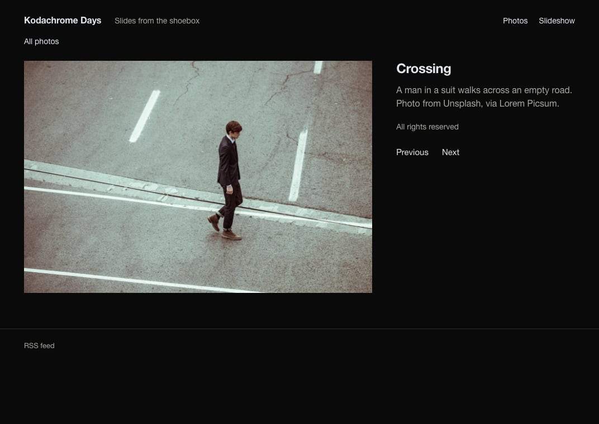
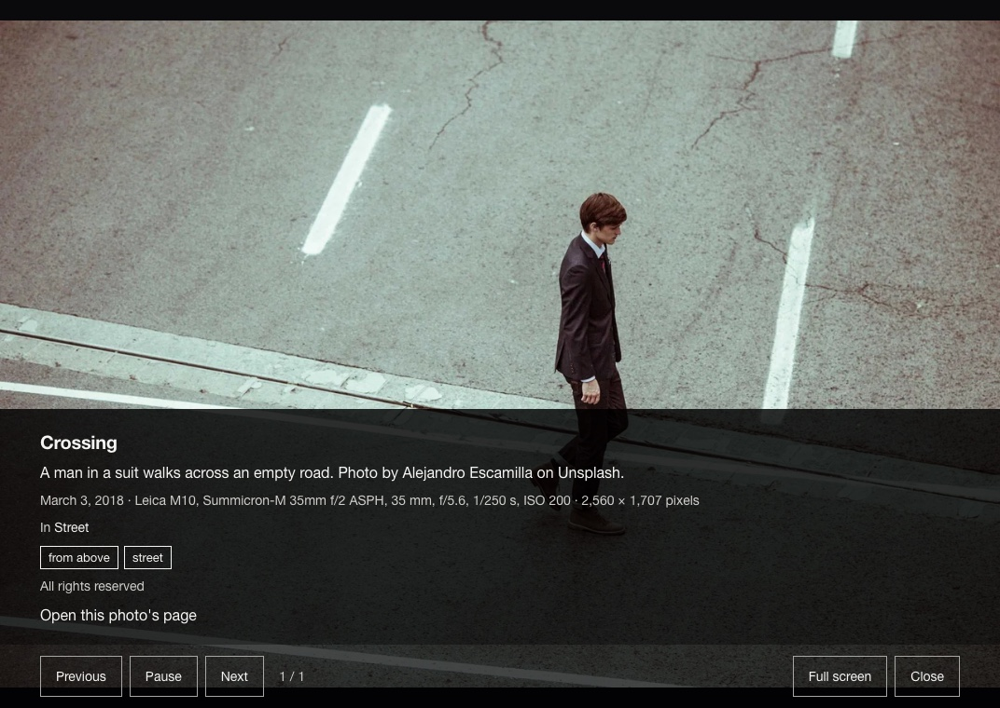
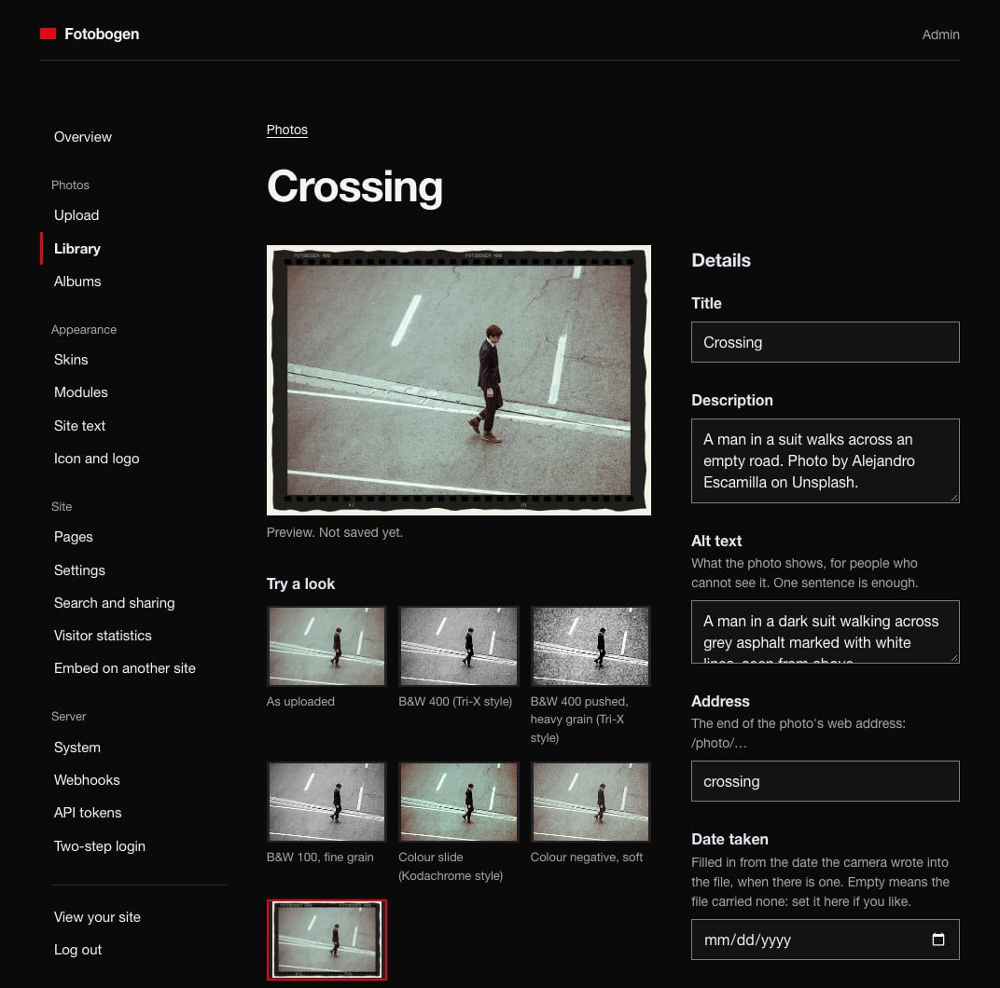
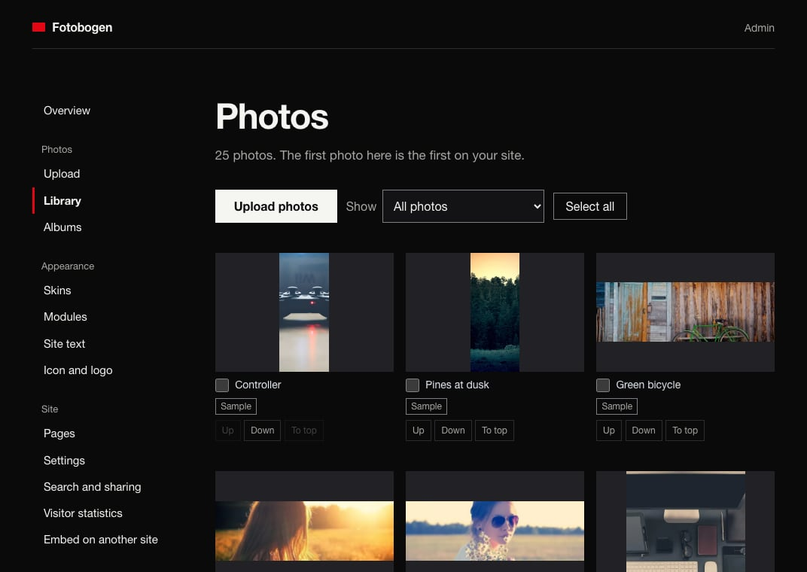
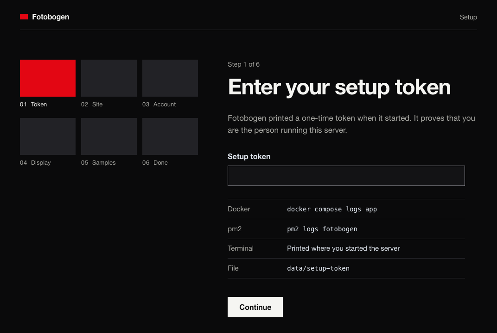
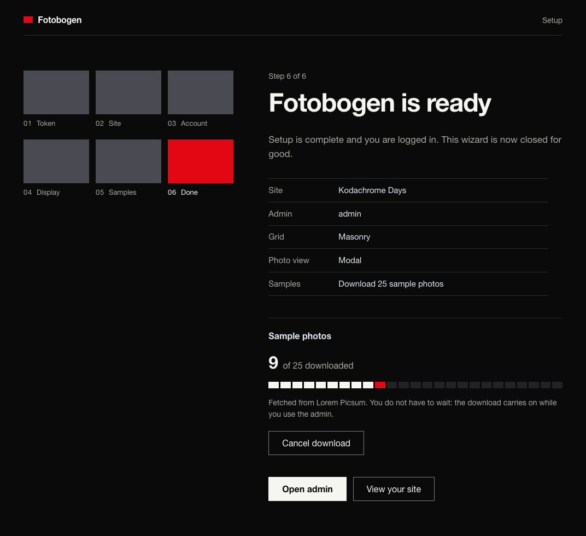
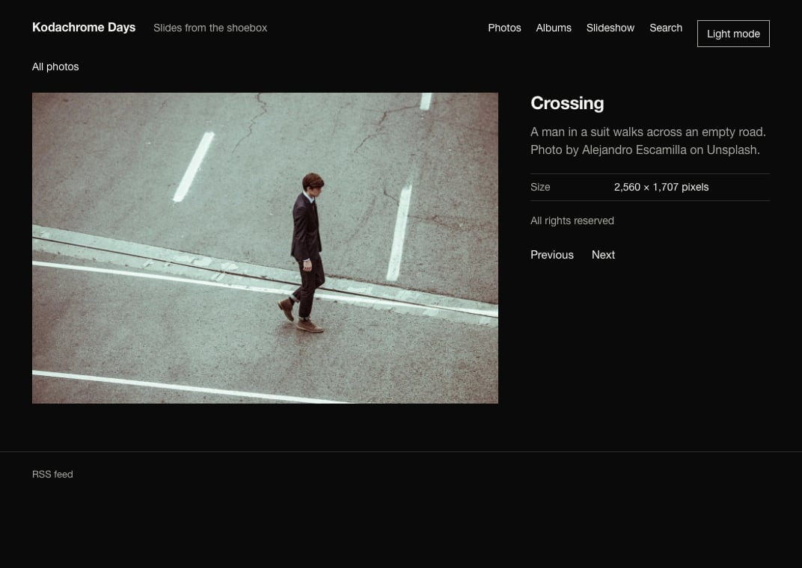

[](https://github.com/cschweda/fotobogen/actions/workflows/ci.yml)
[](LICENSE)

# Fotobogen

A self-hosted publishing platform for photographs: install it on a small
server, answer a few first-run questions, and get a public photo site with an
admin backend. Think "WordPress for photos".

**Version 1.10.0** (17 November 2026). It installs on macOS, Windows, and
Linux; takes your photographs, resizes them for every screen, and publishes
them on a site you can restyle, reword, and put under your own name, with an
admin behind a login. Version 1.0.0 was the first release; 1.1.0 added
updating from the admin; 1.2.0 tells you in the admin when a new version
is out; 1.3.0 asks a few questions at the first start; 1.3.3 followed the
first [security audit](#security-audits); 1.4.0 adds optional visitor
statistics; 1.5.0 lets the admin live at an address of its own; 1.6.0 lets
other sites show a slideshow of your photos; 1.7.0 followed the
second audit and makes the full-screen buttons work; 1.8.0 adds pages,
search, private albums, a trash, albums to choose from on the front page,
and a one-line installer; 1.9.0 adds optional
[two-step login](#two-step-login); 1.10.0 lists a photo's size, albums,
tags and licence in the slideshow's details.

- **What is in it:** [CHANGELOG.md](CHANGELOG.md), also published as
  [Releases](https://fotobogen.com/docs/changelog/).
- **How to install and use it:** the
  [documentation](https://fotobogen.com/docs/), or read on.
- **What comes next:** [docs/ROADMAP.md](docs/ROADMAP.md).
- **How it was designed:** [docs/DESIGN.md](docs/DESIGN.md).

A ready-made Docker image is published for each release, at
`ghcr.io/cschweda/fotobogen`, for Intel and ARM machines.

One thing to know: it has not yet been tried on a Laravel Forge server or on
a real 1 GB server; a 1 GB memory limit was tested in Docker. Fotobogen is
free software with no warranty: keep backups of your photographs.

## Contents

- [Screenshots](#screenshots)
- [How it runs](#how-it-runs)
- [Installing on your own computer](#installing-on-your-own-computer)
- [Local development](#local-development)
- [Running the built server](#running-the-built-server)
- [The preflight check](#the-preflight-check)
- [Health check](#health-check)
- [The public site](#the-public-site)
- [Skins](#skins)
- [Uploading photos](#uploading-photos)
- [Managing photos](#managing-photos)
- [Making the site your own](#making-the-site-your-own)
- [API tokens](#api-tokens)
- [Albums and tags](#albums-and-tags)
- [Sample photos](#sample-photos)
- [Modules](#modules)
- [Tests](#tests)
- [Windows](#windows)
- [Docker quick start](#docker-quick-start)
- [Laravel Forge](#laravel-forge)
- [Without Docker (pm2)](#without-docker-pm2)
- [nginx in front of the app](#nginx-in-front-of-the-app)
- [Laravel Forge with pm2 (no Docker)](#laravel-forge-with-pm2-no-docker)
- [An existing droplet with nginx: what to change](#an-existing-droplet-with-nginx-what-to-change)
- [The admin at its own address](#the-admin-at-its-own-address)
- [Backup and restore](#backup-and-restore)
- [Updates](#updates)
- [For developers](#for-developers)
- [Resetting the admin password](#resetting-the-admin-password)
- [Two-step login](#two-step-login)
- [The data directory](#the-data-directory)
- [Settings](#settings)
- [Demo mode](#demo-mode)
- [Security audits](#security-audits)
- [Branches](#branches)
- [The fotobogen.com site](#the-fotobogencom-site)
- [Licence](#licence)

## Screenshots

Taken from a local install of version 1.10.0 (the grid, the photo page, and
the admin's Overview from 1.9.0, which they match). The
photographs are the sample photos Fotobogen can download (Unsplash
photographs, via Lorem Picsum).

What visitors see: the grid, a photo on its own page, and the slideshow
with a photo's details open.






Editing a photo, with the strip of look previews under it and a film frame
chosen:



The library:



The notice shown once, before the admin opens:


The rest are from the installer and the first run.

The setup wizard opens on first visit and asks for the one-time token the
server printed when it started:



It then creates the single admin account, with a password strength meter:


Grid layout and photo view are picked from diagrams and can be changed later:


Step 5 offers to start empty (the default) or download 25 sample photos:


The last step lists what was chosen and closes the wizard for good. If
samples were asked for, a counter shows them arriving, and the download can
be cancelled:



After setup, the admin area sits behind a login:


The admin opens on Overview, with every other page in the menu down the
side. Sample photos can be downloaded or removed from here at any time:


Each upload shows its progress and result; a duplicate or a file that is not
a photo is explained on its own row.


## How it runs

Fotobogen is a server application, like WordPress. It runs on one machine
(a small Linux server, or your own Mac or PC for trying it out) and you use
it from any web browser. The setup wizard is a web page; there is nothing to
install on the computers you browse from.

The machine that hosts it needs **either** Docker **or** Node 24. Its
dependencies ship prebuilt for macOS, Windows, and Linux, so nothing is
compiled during install. Every change is tested on Linux and on Windows
(see [Windows](#windows)). There is no double-click desktop installer.

## Installing on your own computer

The quickest way to try Fotobogen, on a Mac, a Windows PC, or Linux. For a
public site on a server, see [Docker quick start](#docker-quick-start),
[Without Docker (pm2)](#without-docker-pm2), or
[the installation guide](https://fotobogen.com/docs/installation/).

**The one-line install.** With [Node.js 24](https://nodejs.org) and git on
the machine, one command does everything in this section:

```bash
npx fotobogen@latest
```

It asks which folder to put it in, fetches the newest release, installs its
packages, builds it, and offers to start it. If pnpm is missing it offers to
install that too. It never installs into a folder that already exists. Name
the folder on the command line to skip the question:
`npx fotobogen@latest fotobogen-live`. The npm package `fotobogen` is only
this installer ([`installer/`](installer), two small files with no
dependencies); Fotobogen itself comes from GitHub with git, so updating from
the admin works afterwards. It has been run for real on macOS, and its tests
run on Linux; on Windows, use the steps below for now.

At the end it also says how to run the site under pm2 (a small program that
keeps a site running on a server and starts it again after a restart; see
[Without Docker (pm2)](#without-docker-pm2)), and on a server managed by
Laravel Forge (a service that sets servers up for you) it says what nginx
needs.

The same steps by hand:

**1. Have Node.js 24 and pnpm 10.**

```bash
node --version      # must print v24 or later
pnpm --version      # must print 10 or later
```

If Node.js is older, install 24 from [nodejs.org](https://nodejs.org), or
with nvm: `nvm install 24` and `nvm use 24`. Then install pnpm:
`npm install -g pnpm@10`.

Two things about nvm that catch people out:

- `nvm use 24` switches **the terminal you are in**. `nvm alias default 24`
  only changes terminals you open afterwards.
- nvm keeps tools such as pnpm **separately for each version** of Node.js.
  After switching, `pnpm: command not found` means it needs installing for
  that version: `npm install -g pnpm@10`.

**2. Get it, build it, start it.**

```bash
git clone https://github.com/cschweda/fotobogen.git
cd fotobogen
pnpm install
pnpm build
pnpm start
```

If Node.js or pnpm is too old, `pnpm install` stops before fetching anything
and prints what to do.

**3. Open the address it prints**, `http://localhost:5150`, in a browser on
the same computer, and enter the setup token shown in the terminal. Use the
`localhost` address: logging in is kept by your browser only on this
computer's own addresses or over https.

Leave the terminal open while you use the site. Control + C stops it, and
`pnpm start` starts it again with everything as you left it.

### In a folder with another name

The folder does not have to be called `fotobogen`. With the one-line
install, name it: `npx fotobogen@latest fotobogen-live`. By hand,
`git clone` takes the folder's name as a second argument, and everything
else is the same:

```bash
git clone https://github.com/cschweda/fotobogen.git fotobogen-live
cd fotobogen-live
pnpm install
pnpm build
pnpm start
```

Use this to keep an install beside a copy of the source, or to run several
sites on one machine: `fotobogen-live`, `fotobogen-test`, one for each
client. Nothing in Fotobogen depends on the folder's name.

**Several installs on one machine.** Each folder is a complete site of its
own: its own photos and database (in its own `data` folder), its own login,
its own settings (in its own `.env`, a small text file of settings in its
folder; see [Settings](#settings)), and its own version, updated by
itself. What they must not share:

| Each install needs its own | How |
|---|---|
| Folder | The name you give the installer, or `git clone` |
| Port | Put `PORT=5160` (any free port) in a `.env` file in its folder. Without one, a second copy started in a terminal asks whether to run beside the first, takes the next free port, and prints its address |
| Data folder | Nothing to do: it is `data` inside the install's own folder. Never point two installs at one data folder |
| pm2 name, on a server | Change `name: 'fotobogen'` in its `ecosystem.config.cjs`, to `fotobogen-live`, say ([Without Docker (pm2)](#without-docker-pm2)) |
| Address, on a server | Its own domain and its own nginx `server` block, forwarding to its port ([nginx in front of the app](#nginx-in-front-of-the-app)) |

One thing to know on your own computer: a browser keeps one login for
`localhost`, whatever the port. Logging in to the install at
`http://localhost:5160` logs you out of the one at `http://localhost:5150`.
To be logged in to two at once, open the second at `http://127.0.0.1:5160`
(the browser counts that as a different place), or in another browser or a
private window. On a server, each install has its own domain and this does
not arise.

Run the commands from the folder you mean. `cd` into it first and check with
`pwd`; cloning from inside an existing copy puts the new one inside the old.

### Starting over

Everything about a site is in the `data` folder inside the app's folder.
Stop Fotobogen, then:

```bash
rm -rf data         # or, to keep the old site: mv data data-old
pnpm start
```

It starts as a new install, with a new setup token. There is no need to
delete the app's folder or install again.

### If you installed under the wrong Node.js

What was installed for one version of Node.js does not work under another.
After switching versions, install again from the start:

```bash
rm -rf node_modules
pnpm install
pnpm build
pnpm start
```

### Updating

```bash
git pull
pnpm install
pnpm build
pnpm start
```

Your `data` folder is left alone, and changes to the database are applied by
themselves when the new version starts.

## Local development

For working on Fotobogen itself. Requirements: [Node 24](https://nodejs.org)
and [pnpm](https://pnpm.io) 10 (see
[Installing on your own computer](#installing-on-your-own-computer) for
getting them).

```bash
nvm use            # reads .nvmrc (Node 24); switches this terminal only
pnpm install
pnpm dev           # http://localhost:3000
```

On first start the terminal prints a setup token:

```
Fotobogen setup token: 3b213e46bd70894ad18f1357791b1f18
Open the site in a browser and enter this token to finish setup.
```

Open http://localhost:3000 (`pnpm dev` uses port 3000; `pnpm start` uses
5150), enter the token, and complete the six steps. You
end up logged in, on a short notice about backups to read once, and then at
`/admin`. Everything the site stores goes in `./data`;
delete that directory to start over with a fresh install.

After changing `server/db/schema.ts`, generate a migration with
`pnpm db:generate`. Migrations are applied automatically when the server
starts.

## Running the built server

```bash
pnpm build
pnpm start
```

`pnpm start` checks the machine (see below). **The very first time**, in a
terminal, it then asks three questions; press Enter to accept what is
suggested each time:

```
Port to run on? Press Enter for 5150, or the next free one above it:
Site address? Press Enter to skip:
Switch demo mode on? [y/N]
```

The answers are saved to `.env` in Fotobogen's folder, and it does not ask
again. To change them, edit `.env`, or run `pnpm fotobogen init` to be asked
again (your other settings in `.env` are kept); then restart. Nothing is
asked when nobody is at the keyboard: under pm2, in Docker, from a script,
or in a CI run. Nor is anything asked when `.env` already exists, when the
site already has a database, when `PORT`, `SITE_URL`, or `DEMO_MODE` is
set, or when `FOTOBOGEN_NO_QUESTIONS=1` is. (Demo mode is for a copy that
shows Fotobogen off to strangers; answer no unless that is what you are
building. See [Demo mode](#demo-mode).)
Whether to start with sample photos is asked in the browser, with the rest
of setup.

It then starts the server and prints its address:

```
Fotobogen is running. Open it in a browser on this computer:

    http://localhost:5150

Logging in works at that address, or over https.
```

Use that address. The web server prints a line of its own underneath
(`Listening on http://0.0.0.0:5150`), which says where it is listening, not
where to browse. Logging in is kept by your browser only on this computer's
own addresses (`localhost`, `127.0.0.1`, `0.0.0.0`) or over https; anywhere
else over plain http, the login page says so instead of letting you in.

Nothing has to be configured. The port is **5150**; if that is taken,
Fotobogen uses the next free port above it and says so. Data goes in
`./data`. Restarting keeps you logged in and does not change the setup token.

To change a setting on one machine, copy `.env.sample` to `.env` and edit
the copy (see [Settings](#settings)). A port you set yourself is used
exactly: if it is taken, Fotobogen stops and tells you, rather than moving.

**More than one copy on a machine.** If Fotobogen is already running when
you start it in a terminal, it asks what you want: run both (the new one
gets its own port), stop what is running (every copy you have started, if there are several)
and start this one, or cancel.
Started without a terminal and with no `PORT` set, a second site runs on
the next port. Under pm2 the port is always set (5150 unless `.env` says
otherwise), so give a second site its own `PORT` in its `.env`, and its own
`name` in its `ecosystem.config.cjs`. A copy started with `pnpm start`
refuses a data directory that another copy started the same way, by the same
user, is using. That check does not see copies run by another user or two
Docker containers given the same folder, so never point two at one folder.

## The preflight check

Before it starts, Fotobogen checks that the machine can run it properly, so
an install never half-works. The first time, it prints the whole report:

```
Fotobogen preflight check
  ok   Node.js: version 24.22.3
  ok   Operating system: Ubuntu 26.04 LTS
  ok   Processor: x64
  ok   Memory: 1.9 GB available
  ok   Data directory: /home/you/fotobogen/data
  ok   Disk space: 21.4 GB free
  ok   Image library: reads JPEG, PNG, WebP, TIFF, and AVIF
  ok   Database library: loads
  --   pm2: not installed
        Only needed on a server, to keep Fotobogen running and start it again after a reboot: npm install -g pm2. Not needed on your own computer, or with Docker.
```

Anything marked `FAIL` stops the start, with a line saying what to fix.
A `WARN` lets it run and says what to improve. A line marked `--` is a note,
not a problem: the pm2 line says whether [pm2](#without-docker-pm2) is
installed (it is looked for, never run), and reads `ok` when it is. It is
left out in Docker. After the first run only warnings and failures are
shown.

In a terminal the report is in colour: `ok` in green, `WARN` in yellow,
`FAIL` and anything that stops the start in red. The words are always there
too, so nothing depends on telling the colours apart. Colour is left out
when the output is not a terminal (a log file, pm2, Docker) or the terminal
says it cannot show it (`TERM=dumb`). `NO_COLOR=1` switches it off and
`FORCE_COLOR=1` switches it on, whatever the output is. Run it on its own at any time with
`pnpm preflight`.

| Check | Stops the start when | Warns when |
|---|---|---|
| Node.js | older than 24 | |
| Operating system | | not Linux, macOS, or Windows; or a Linux that is not Ubuntu, Debian, or based on them |
| Processor | not x64 or arm64 | |
| Memory | under 900 MB (the container's limit counts, not the host's) | under 1900 MB with less than 512 MB of swap (swap is read on Linux only, so this warning is never given on macOS or Windows) |
| Data directory | it cannot be created or written | |
| Disk space | under 500 MB free | under 2 GB free |
| Image and database libraries | they do not load, or a photo format is missing | |

Fotobogen's tests run on Ubuntu and Windows for every change, and it is run
by hand on macOS. Debian and systems based on Ubuntu or Debian are treated
the same as Ubuntu. Other Linux
distributions may well work, but are reported as untested.

## Health check

`/api/health` needs no login and answers `GET` and `HEAD`:

```json
{ "status": "ok", "version": "1.10.0", "database": "ok", "queue": { "depth": 0 }, "uptime": 86400 }
```

It returns `200` when the app and its database are working and `503` when
the database cannot be read. `queue.depth` is the number of photos waiting
to be processed; `uptime` is seconds since the server started.

With [UptimeRobot](https://uptimerobot.com) or a similar monitor: add an
HTTP(S) monitor for `https://your-site.example/api/health`. Watching the
status code is enough. For a stricter check, use a keyword monitor that
expects the text `"status":"ok"`.

## The public site

Visitors see these pages:

- **The grid** at `/`: your photos, shuffled afresh for each visit or in the
  order of your library (Admin, Settings), with a row of albums to choose
  from if you offer any; in a masonry layout (each
  photo keeps its shape) or equal squares. It is laid out by CSS alone, so
  it works with JavaScript off and photos are read in the order they
  appear. Each tile shows a blurred placeholder until its image loads, and
  nothing shifts as they arrive. Thirty photos a page, with "More photos".
- **A photo** at `/photo/<name>`: the picture, its title, description, date,
  camera details, and size in pixels (if you show camera details), with previous and next links and
  the left and right arrow keys. If the site is set to open photos over the
  grid, the same content appears in a modal; the address still changes, and
  Back, Escape, or Close returns to the grid where you were.
  A **Full screen** button appears over the photo when you point at it (it
  is always there for the keyboard and on a touch screen), and a click on
  the photo does the same: the photo alone on black, as large as the screen
  allows. Escape, the button, or another click leaves it. Beside an upright
  photo the words sit next to the picture rather than across the page.
- **Albums and tags**: `/albums`, `/album/<name>`, and `/tag/<name>` (see
  [Albums and tags](#albums-and-tags)).

- **Search** at `/search`: a box, and the photos whose title, description,
  alt text, tags, or albums hold every word typed. Only what a visitor can
  already see is searched. It works with JavaScript switched off.
- **Pages** you write (About, Contact) at addresses of their own, such as
  `/about`, and in the menu with any links you add (**Admin, Pages**).
- **Slideshow** at `/slideshow`: full screen, one photo after another, for
  the whole site or for one album or tag ("Play as a slideshow"). It loads
  each photo before showing it and cross-fades; it goes round for ever, in
  your order or shuffled afresh each time round. Press a photo to hold it
  there and see what its own page lists: title, description, date taken,
  camera and exposure, size, albums, tags, and licence (camera details and
  size only when the site shows them). Pause, step with the buttons or the
  arrow keys, Space to pause, F for full screen, Escape to leave. With
  "reduce motion" on, photos change without the fade. The seconds per photo
  and the order are in Settings. It never shows where a photo was taken.

Only photos that are processed and public are ever shown on the site's
pages, the feed, the sitemap, and the public API. Location is never shown
unless you switch that on.

For other programs: the same data is available as a read-only JSON API,
readable from any other site. See [docs/API.md](docs/API.md).

For search engines and sharing: every photo page has social-card tags using
its 1280 px copy, and the site publishes `/feed.xml` (RSS), `/sitemap.xml`,
and `/robots.txt`. Setup, login, and the admin are marked not to be indexed.

## Skins

A skin changes how the public site looks. Four come with Fotobogen, all in
the Swiss manner, and you can switch between them at any time under
**Admin, Skins**:

- **Swiss** (the default): a small site name, hairline gaps, a red accent.
- **Papier**: warm paper, heavy rules, wide margins, photographs set apart
  like prints on a page.
- **Rangefinder Dreams**: black and white throughout. Choosing it also
  shows every photo in black and white, crisply sharpened (you can decline
  that, change it, or switch it off for one photo or all of them).
- **Plakat**: a poster. The site's name set very large, photographs edge
  to edge.

**Every skin has a light and a dark mode.** You choose which one visitors
see first (or let it follow each visitor's device), and a button at the top
of the site lets a visitor switch. All four are tested in both modes, on a
phone and on a wide screen, against WCAG 2.2 level AA: text and headings
have a contrast of at least 4.5:1, nothing scrolls sideways, and everything
works from the keyboard.

Each skin has an accent colour for each mode, a space between photos, and a
number of columns you can change. Changes show at once and nothing is
rebuilt.

| | Light | Dark |
|---|---|---|
| Swiss |  |  |
| Papier |  |  |
| Plakat |  |  |

The fourth skin, Rangefinder Dreams, is not pictured here; choose it under
**Admin, Skins** to see it.

To add a skin, copy its folder into `data/skins/` and restart.

**Writing one.** A skin is a stylesheet and a short settings file.
[Writing a skin](https://fotobogen.com/docs/writing-a-skin/) is the
step-by-step guide: colours for light and dark, options, the HTML you are
styling with every class name, accessibility, and every error message.
[docs/SKINS.md](docs/SKINS.md) is the reference. The admin's Skins page
links to the guide.

## Uploading photos

Log in, then choose **Upload** in the menu. Pick files or drop
them on the page; each one shows its progress and result.

- Accepted: JPEG, PNG, WebP, TIFF, and AVIF. A file is judged by its
  contents, not its name.
- Limits: 50 MB per file and 100 megapixels per image by default
  (see [Settings](#settings)). AVIF is held to 16 megapixels, WebP to 60, and
  interlaced PNG to 40, because those formats need far more memory to open;
  a larger one is refused with a note to upload a JPEG instead.
- The same file is not stored twice; a duplicate is refused and the page
  names the photo that already has it.
- The file you upload is kept untouched in `data/originals/`. Resized WebP
  copies (480 px thumbnail, 480 px square, 1280 px, and 2560 px) go in
  `data/derivatives/`. Nothing is ever enlarged.
- Resizing happens one photo at a time in the background, so a small server
  stays within its memory. A photo that cannot be processed after three
  tries is marked failed, with the reason and a **Try again** button.

Once processed, a photo appears on the public site.

## Managing photos

**Library**, in the admin's menu, holds every photo. The first photo there is the first on
your site.

- **Order:** drag a photo onto another to put it in front, or use each
  photo's Up, Down, and To top buttons, which do the same from the keyboard.
- **Several at once:** tick photos, then Hide, Show, or Delete.
- **Deleting and the trash:** a deleted photo goes to the trash. It is off
  your site at once, and kept for 30 days, file and all, then removed for
  good. Under **Show, Trash** you can restore it, which puts it back as it
  was (same address, albums, and tags), or delete it for good straight
  away, which asks first and removes the uploaded file and every resized
  copy. Uploading a file that is in the trash is refused, with a note
  saying where it is.
- **Show:** only hidden photos, scheduled photos, photos without alt text,
  photos that could not be processed, or the trash. Each is also flagged on
  its card.
- **One photo:** open it to edit its title, description, alt text, web
  address, date taken, and whether it is public or hidden; to see what the
  file recorded (camera, lens, exposure, location); or to delete it (to the
  trash).
- **Looks:** under the photo is a strip of small previews, one for each look
  the switched-on modules offer. Choosing one sets it up for that photo,
  with a larger preview, and nothing changes until you save.

**Scheduling and drafts.** On a photo's page, **Publish** has three
choices: public now, public from a date and time you pick (in your own time
zone), or hidden as a draft. A scheduled photo is in your library but not on
the site, the feed, or the sitemap until its time, and then appears by
itself. In Settings you can make every new upload start as a draft.
Hiding takes a photo off the site; it does not withdraw a picture address
someone already has (see **Links to a photo** below). Nor does the trash,
for the 30 days a photo is kept there. To withdraw the addresses, delete the
photo and then delete it for good from the trash.

**Licence and downloads.** Settings has the licence your photos are
published under (all rights reserved by default, or a Creative Commons
licence) and a switch that lets visitors download them (off by default). A
photo can have its own licence and its own download setting on its page. A
download is a large copy (up to 2560 pixels) with all camera data removed.
Only a site that also shows where photos were taken hands out the file
exactly as you uploaded it, because that file carries everything the camera
recorded, the place included.

**Picture quality.** Settings also has how much the copies shown on your
site are compressed: Smaller files, Standard, or High. Changing it makes
every photo's copies again in the background; your uploaded files are never
changed.

**Admin, Settings** holds the site title and tagline (the same two fields
as on Site text; either page changes them), the grid layout,
whether photos open over the grid or on their own page, and the two privacy
switches: camera details (on by default) and location (off by default).

## Making the site your own

Nothing a visitor sees has to say "Fotobogen". These admin pages make the
site yours:

**Admin, Site text.** The site's title and tagline, the language its text is
in, and every fixed piece of text on the public pages: the links at the top,
the buttons, the labels beside a photo, the slideshow's controls, and the
messages shown when a page cannot be. Each field shows the default wording;
type your own to replace it, or leave it empty to keep the default. There is
also a line of your own for the footer, empty to begin with (a copyright
notice, say). Text is shown as text: markup typed into a field is not run.
The language is a code such as `en` or `de`; it tells screen readers and
search engines what language the words are in, and does not translate
anything.

**Admin, Search and sharing.** What search engines and social networks are
told, with a preview of each:

| Setting | Left alone |
|---|---|
| Title of the home page | The site's title |
| Description of the site | The tagline |
| How other pages' titles are written | `Photo | Site` |
| Picture shown when the site is shared | The newest photo |
| Let search engines list the site | Yes |
| The site's proper address | The address each visitor used |
| Photographer's name, X username | None |
| Google and Bing verification codes | None |

A link to one photo always shows that photo, with its own title,
description, and alt text. Asking search engines not to list the site is a
request the well-known ones honour; it does not make the site private.

**Admin, Icon and logo.** Two optional pictures. The **icon** appears in the
browser tab, in bookmarks, and on a phone's home screen; upload a square
picture (512 by 512 is a good size) and the sizes needed are made from it.
The **logo** is shown at the top of every page in place of the site's name,
which stays as its description for screen readers. A logo can be given for
light mode, dark mode, or both, and its height set from 20 to 120 pixels.
PNG, JPEG, and WebP are accepted, up to 5 MB; SVG is not, because an SVG
file can carry scripts. Each picture is redrawn before it is kept, and both
are stored in the database, so they are in every backup. Fotobogen's own
mark appears only in the admin.

**Admin, Visitor statistics.** Fotobogen counts nothing itself, and until
you choose a service here your pages load nothing from anywhere else. To
count visits, choose **Plausible** (paste the script address from its
snippet), **Google Analytics** (your measurement ID, `G-…`), or **Another
service** that is installed with one script tag, such as Umami, Fathom,
GoatCounter, Simple Analytics, or Cloudflare Web Analytics (its script
address and any `data-` attributes). You give an address or an ID, and
Fotobogen writes the script tag: no code is typed into the admin, and
nothing typed there is ever run as script.

What that means in practice:

- The script is on the public pages only: never on the admin, the login, or
  setup, and never while you are logged in, so your own visits are not
  counted. To check it works, open your site in a private window.
- Your pages may then report to that one service. Everything else stays
  blocked, as before.
- Only the logged-in owner can change it. No API token can, and a demo
  visitor cannot.
- You are trusting the service, with your visitors and with your site. Its
  script runs on every visitor's page, on your site's own address. Fotobogen
  keeps it off the admin and off pages you open while logged in, but it
  cannot fence a script off from the site it runs on: if the service were
  ever hostile or broken into, a public page left open in a browser where
  you are logged in could be used to act as you. Choose a service you would
  trust that far, or close the gap altogether by giving
  [the admin its own address](#the-admin-at-its-own-address).
- The service is told the address of each page viewed. For the search page
  that address holds the words searched for. A private album's pages never
  carry the script, so the service never learns such a link.
- Whether you owe visitors a privacy note or a cookie banner (Google
  Analytics generally does in the EU and UK; cookieless services generally
  do not) is yours to decide. Fotobogen shows no banner.
- Custom JavaScript of your own, or a service that needs code between
  script tags, cannot be added from the admin. That is deliberate: a box for
  pasting script would let anyone who got your password put code in every
  visitor's browser.

**Admin, Pages.** Pages of words beside your photographs: About, Contact,
anything. Give a page a title and it gets an address of its own at the top
of your site (`/about`), which you can change, and a place in your site's
menu unless you take it out. A page can be hidden while you write it.

- **Its text is plain text with a little marking.** An empty line between
  paragraphs; `## ` at the start of a line for a heading; `- ` for a list
  item; `**bold**`, `*italic*`, and `[words](https://example.com)` for a
  link. A web address or an email address written out becomes a link by
  itself, so a contact page can be as simple as your email address. A
  preview under the box shows how it will look.
- **It is never HTML.** Anything typed is shown as text, and a link goes
  only to a web address, an email address, or a page of your site. Someone
  who got your password could not use a page to put a script on your site.
- **Links in your menu.** On the same page, add links of your own after
  your pages: a shop, another site, `mailto:` and your address, or a page of
  this site such as `/album/road-trip`. Up to eight.
- A page cannot take an address the site itself uses (`/albums`, `/admin`,
  and so on). Up to 50 pages. Pages are in the sitemap, and in every backup.
- Only the logged-in owner can change pages and the menu. No API token can.

**Admin, Embed on another site.** Other sites can show a slideshow of your
photos inside their own pages: a blog, a club's site, a portfolio. Switch it
on, choose every photo, one album, or one tag, and a size, and copy the one
line of code the page gives you:

```html
<iframe src="https://photos.example.com/embed/slideshow" width="800" height="600" style="border:0;max-width:100%;height:auto;aspect-ratio:800/600" title="Slideshow: Kodachrome Days" loading="lazy"></iframe>
```

Paste it where the other site lets you add HTML. The slideshow has one bar
of controls (first, back, play or pause, forward, last) with "Powered by
Fotobogen" at the end, linked to fotobogen.com; the arrow keys, Home, End,
and Space work too. The width and height are the largest it will be: on a
narrower page or a phone it shrinks to fit and keeps its shape.

What that means in practice:

- It is off until you switch it on. While it is off, `/embed/slideshow`
  answers "not found"; switching it off again stops it at once on every site
  that has the code.
- Switched on, any site can show it, not only yours. It plays the photos
  anyone can already see on your site and nothing else: never a hidden,
  draft, or scheduled photo, and never where a photo was taken.
- Only this slideshow can be shown inside another site. Every other page
  still refuses to be framed by anyone else, and the admin and the login
  refuse even your own site.
- Pressing a photo opens its page on your site in a new tab.
- It plays as your own slideshow does: the seconds per photo and the order
  are the ones under **Admin, Settings**. It uses its own plain dark look,
  not your skin, because it sits in a page that is not yours.
- Visits to it are not counted: it loads no counting script, whatever is
  set under Visitor statistics.
- Only the logged-in owner can switch it on or off. No API token can, and a
  demo visitor cannot.
- Switching it off does not hide your photos. They stay public on your
  site, and the [public API](docs/API.md) is still readable from any site,
  so someone who writes their own code can show them.
- It plays from your server. Each person who sees it on another site
  fetches it from here, so a busy site that embeds it adds to your server's
  work, and your server's log shows which pages embed it.
- Some hosted site builders remove frames from pasted code. There the
  slideshow cannot be shown; link to its address instead.

**Admin, Skins** changes how it looks ([Skins](#skins)).

**Links to a photo.** The resized copies of every public photo are served
at `/media/…` with no login, so they can be linked to and shown from
anywhere. No CORS set-up is needed: showing a picture from another site with
`` never needs it, and for a script on another site that wants the
picture's data, Fotobogen sends `Access-Control-Allow-Origin: *`
with photos and with the public API (the nginx and Caddy files that come
with it do the same when they serve photos from disk). The files have long
names that cannot be guessed, and nothing checks who asks for one: a
picture's address keeps working for anyone who has it, even after the photo
is hidden or in the trash, until the photo is deleted for good or rendered again. Each
photo's page in the library has a **Links** panel: the full address of the photo's page and of each size of the picture,
and a line of HTML that shows the photo linked to its page, each with a Copy
button. Together with the title, description, and alt text above it, that
page is the photo's entry in the library. The links begin with your site's
address; set it under **Search and sharing** or as `SITE_URL` (see
[Settings](#settings)), or on your own machine they begin with
`http://localhost:5150` and work only there.

## API tokens

**Admin, API tokens** makes tokens that let a script or another program
upload to your site without your password. A token is shown once, when it
is made, and only a hash of it is stored. There are two kinds: **Upload
only** (upload, list, and check photos, and retry one that failed) and **Manage photos** (also edit,
reorder, hide, and delete photos and manage albums). No token can change
visitor statistics, embedding, pages, the menu, settings, skins, or site text, reach a backup, restore one, install an update, read or change two-step login, or make or
revoke tokens. Revoking a token stops it at once, and the page shows when
each was last used.

```bash
curl -H "Authorization: Bearer fb_YOUR_TOKEN" -F "file=@photo.jpg" https://photos.example.com/api/admin/photos
```

See [docs/API.md](docs/API.md#the-admin-api-with-a-token). Use HTTPS, and
treat a token like a password.

## Albums and tags

Two ways to group photos:

- **Albums** are named sets you arrange yourself. Create them under
  **Admin, Albums**; add photos from the library (tick photos, choose an
  album, **Add to album**) or from a photo's own page. A photo can be in
  several albums. Each public album gets a page at `/album/<name>`, listed
  at `/albums`, with its photos in the order you added them. An album can
  be hidden, and an album with no visible photos is not shown.
- **Tags** are short labels typed on a photo's page, separated by commas,
  or added to several photos at once from the library. Each tag gets a page
  at `/tag/<name>`. A tag exists only while a photo carries it.

Deleting an album never deletes its photos.

**Albums on the front page.** Each album has a switch, **Offer it on the
front page** (Admin, Albums, Edit). The albums switched on appear as a row of
names over the photos on your front page: All, then each album. A visitor
who chooses one sees that album alone, in its own order, at an address of
its own (`/?album=travel-photos`); All brings everything back. A new album
is offered there unless you switch it off; with none switched on there is no
row. Only a public album with photos in it is offered.

**The order of the front page** is under Admin, Settings: **shuffled**, a
new order for each visit, or **the order of your library**. A new site
starts shuffled; a site set up before version 1.8.0 keeps the order of its
library until you change it. The slideshow has its own order setting, and
always starts again after the last photo.

**Private albums.** An album can be **private**: for a client, a family, a
few friends. Edit the album, choose **Private**, and it gets a link that
cannot be guessed, such as `https://photos.example.com/private/Qe7…`, which
the album's entry shows with a Copy button.

- Whoever has the link sees the album, and each photo in it, with no
  login. Nobody else does: a private album is not listed at `/albums`, in
  the menu, in search, in the feed or sitemap, or in the public API.
- It can hold **hidden** photos, which stay off your site. That is the
  usual way to use it: upload, hide the photos (or make every upload start
  as a draft, in Settings), add them to the album, make it private, and
  send the link.
- **Make a new link** replaces the link at once; the old one stops working
  for everyone who has it. Making the album public or hidden ends the link
  too.
- A link is only as private as the people who hold it: anyone can pass it
  on. Search engines are told to keep away, the pages are never stored by
  browsers or proxies, the link is not sent on to other sites, and no
  counting script is put on these pages, so a counting service never
  learns the link.
- A private album has no slideshow and offers no downloads, and its photos
  show no tags, other albums, or location.

## Sample photos

Fotobogen can download 25 placeholder photographs so a new site has
something to show. They come from [Lorem Picsum](https://picsum.photos)
(Unsplash photographs, credited to their photographers) and are never part
of the software itself. Fotobogen contacts another server only when you ask
it to: for these photos, to check for or install an update
([Updates](#updates)), and to call a webhook you set up.

- **During setup**, step 5 offers "Start empty" (the default) or "Download
  25 sample photos". The last step then shows a counter while they arrive.
  Setup is already finished at that point, so you never have to wait.
- **If the download fails**, you can try again or skip. After two failures
  the page leads with skipping, so nobody is stuck retrying a service that
  is down.
- **Later**, Overview always has **Download sample photos**, and
  **Remove sample photos** deletes all of them, and only them, in one click.
  They are deleted for good, not moved to the trash.
- **Two sample albums** come with them, "Coast and mountains" and "Desk and
  table", so a new site shows how albums work: on the albums page, and as
  a row to choose from on the front page. Delete either under **Admin,
  Albums** whenever you like; deleting an album never touches its photos.
  Removing the sample photos takes the sample albums with them, unless you
  have put photos of your own into one, which then stays.
- In a source checkout, `pnpm seed:fetch` fetches the photos from the
  terminal (the photos only, without the sample albums).

See [seed/README.md](seed/README.md) for the list and the licence.

## Modules

Modules change how photos look without touching the files you uploaded. Three
come with Fotobogen, all switched off until you switch them on under
**Admin, Modules**:

- **Film frame** makes a photo look contact printed: the negative's border,
  sprocket holes, and edge markings around it, on white paper. The border
  can be thicker or thinner, its outer edge ragged or straight, and the
  markings and sprocket holes on or off. The stock names are made up.
- **Film looks** gives the tone and grain of a kind of film: classic and
  pushed black-and-white, a saturated colour slide, a soft colour negative,
  with the grain turned up or down. These are impressions, not measured
  emulations of any product.

- **Watermark** prints a line of text, such as your name, in a corner of
  each photo, at a size, opacity, and position you choose. It marks the
  copies visitors see; a downloaded original is untouched.

A transform can be set for all photos at once, or chosen for one photo from
its edit page, with a preview before saving.

Adding a module means copying its folder into `data/modules/` and
restarting; nothing is rebuilt.

**Writing one.** A module is a small folder of plain JavaScript with no
build step. [Writing a module](https://fotobogen.com/docs/writing-a-module/)
is the step-by-step guide, with five worked examples that have each been
run through the module tester; [docs/MODULES.md](docs/MODULES.md) is the
reference. The admin's Modules page links to the guide.

## Tests

```bash
pnpm test                                # unit tests, then tests against the built server
pnpm exec playwright install chromium    # once
pnpm test:e2e                            # browser tests, including axe accessibility checks
pnpm typecheck                           # TypeScript check of app and server code
```

`pnpm test` and `pnpm test:e2e` build the app first; the other two do not. Set `FB_SKIP_BUILD=1` to reuse an
existing build while iterating. The tests never use the network: sample
downloads are pointed at a stand-in server.

## Windows

Fotobogen installs and runs on Windows with Node 24 and pnpm; no compiler or
Visual Studio is needed. In PowerShell:

```powershell
git clone https://github.com/cschweda/fotobogen.git
cd fotobogen
pnpm install
pnpm build
pnpm start                        # checks the machine, prints the address and the setup token
```

CI repeats this on a Windows machine for every change: install, build, the
full test suite, the browser tests, and [scripts/smoke-test.ps1](scripts/smoke-test.ps1),
which starts the built server and walks through setup, login, and a password
reset. You can run that script yourself after `pnpm build`:

```powershell
./scripts/smoke-test.ps1
```

Two differences from Linux and macOS: the `secret` and `setup-token` files,
and the two-step login key file in your home folder,
are not restricted to your user by the app (Windows has no equivalent of
file mode `0600`; they inherit the folder's permissions), and the Docker
path needs Docker Desktop or WSL, which is not covered by the Windows test
run.

## Docker quick start

For a server with nothing on it but Docker. This runs Fotobogen behind
[Caddy](https://caddyserver.com), which obtains an HTTPS certificate for your
domain automatically.

The image is downloaded from `ghcr.io/cschweda/fotobogen`; nothing is built
on your server. (To build it yourself instead, uncomment the `build: .` line
in `docker-compose.yml` and add `--build` to the command.)

```bash
git clone https://github.com/cschweda/fotobogen.git
cd fotobogen
mkdir -p data                # so the data directory belongs to you, not root
cp .env.sample .env         # set DOMAIN; leave it unset to try it on http://localhost
docker compose up -d
docker compose logs app      # shows the setup token
```

If your user id is not 1000 (run `id -u`), set `PUID` and `PGID` in `.env`
so the files in `./data` belong to you.

Update with `docker compose pull && docker compose up -d`.

## Laravel Forge

For a Forge-provisioned server, where nginx already owns ports 80 and 443 and
Forge manages the certificate. This section uses Docker; to run it under
pm2 instead, see [Laravel Forge with pm2](#laravel-forge-with-pm2-no-docker).

1. Install Docker on the server and add the `forge` user to the `docker` group.
2. Create the site in Forge and install this repository into it.
3. In the site directory: `mkdir -p data`, then
   `PUID=$(id -u) PGID=$(id -g) docker compose -f docker-compose.forge.yml up -d`.
4. Paste the blocks from [deploy/forge-nginx.conf](deploy/forge-nginx.conf)
   into the site's nginx configuration, adjusting the two marked lines (a path
   and the port).
5. Issue the certificate through Forge.
6. Use [deploy/forge-deploy.sh](deploy/forge-deploy.sh) as the deploy script.

The app listens on `127.0.0.1:5150` only (`PORT` in `.env` changes the port).

## Without Docker (pm2)

Needs Node 24, pnpm, and [pm2](https://pm2.keymetrics.io) on the server.
Building takes more memory than running; on a 1 GB server, add 2 GB of swap
first.

```bash
git clone https://github.com/cschweda/fotobogen.git
cd fotobogen
pnpm install --frozen-lockfile
pnpm build
pnpm fotobogen init          # optional: asks for the port, the site's address, and demo mode
pm2 start ecosystem.config.cjs
pm2 logs fotobogen           # shows the setup token
```

**For one site there is nothing to edit in `ecosystem.config.cjs`**, and no
pm2 file to write yourself. (The file itself sets `HOST`, `DATA_DIR`, and
`TRUST_PROXY`; under pm2 those three in `.env` are ignored, so to move the
data folder, change it in the file.) It takes the port from `PORT` in `.env`, and Fotobogen reads
every other setting from `.env` when it starts. `pnpm fotobogen init` writes
`.env` from your answers; you can also write it by hand.

`ecosystem.config.cjs` starts Fotobogen through its launcher (so the
preflight check runs), names the process `fotobogen`, and sets:

| Setting | Value | Why |
|---|---|---|
| `HOST` | `127.0.0.1` | Only this machine can reach the app; visitors come through nginx |
| `PORT` | `PORT` in `.env`, or `5150` | The port nginx forwards to. To use another, set `PORT` in `.env`, change it in nginx to match, and run `pm2 reload ecosystem.config.cjs --update-env` |
| `DATA_DIR` | `data` beside the app | Where the site keeps everything |
| `TRUST_PROXY` | `1` | nginx is the only client, so the visitor's address is taken from its headers |

**Start it again after a reboot.** pm2 keeps the app running, and restarts
it if it stops, but only comes back after a reboot if you tell it to:

```bash
pm2 save        # remember what is running now
pm2 startup     # prints one command beginning with "sudo"; run that command
```

Check with `pm2 status` after the next reboot. Update with
`scripts/rebuild.sh` (pull, install, build, reload).

Then put nginx in front of it, as below.

## nginx in front of the app

Fotobogen listens on `127.0.0.1:5150`. nginx answers the public on ports 80
and 443 and passes each request to that address. This applies to any install
without Docker: pm2 on a plain server, or pm2 on Laravel Forge.

A complete site file for a plain server (on Forge, see the next section).
Save it as `/etc/nginx/sites-available/photos.example.com`, with your domain
in place of `photos.example.com`:

```nginx
server {
    listen 80;
    listen [::]:80;
    server_name photos.example.com;

    # The largest upload nginx lets through. Keep it equal to MAX_UPLOAD_MB.
    client_max_body_size 50m;

    # Once the site has its certificate: browsers that have visited use https from then on.
    add_header Strict-Transport-Security "max-age=31536000" always;

    location / {
        # Where Fotobogen is listening: the HOST and PORT in ecosystem.config.cjs.
        proxy_pass http://127.0.0.1:5150;
        proxy_http_version 1.1;

        # The name and port the visitor asked for. Fotobogen compares it with
        # the Origin of every request that changes something; without this
        # line, saving anything in the admin answers "This request did not
        # come from this site."
        proxy_set_header Host $http_host;

        # The visitor's own address, for the limit on wrong passwords.
        proxy_set_header X-Forwarded-For $proxy_add_x_forwarded_for;

        # Whether the visitor used http or https, so the links Fotobogen
        # writes out begin the right way.
        proxy_set_header X-Forwarded-Proto $scheme;

        # A large upload can take a while to arrive and be checked.
        proxy_read_timeout 120s;
    }
}
```

Switch it on, check it, and reload:

```bash
sudo ln -s /etc/nginx/sites-available/photos.example.com /etc/nginx/sites-enabled/
sudo nginx -t                   # must say "syntax is ok" and "test is successful"
sudo systemctl reload nginx
```

Then add HTTPS, which logging in requires. With
[Certbot](https://certbot.eff.org):

```bash
sudo apt install certbot python3-certbot-nginx
sudo certbot --nginx -d photos.example.com
```

Certbot edits the file to listen on 443 with a certificate, redirects port
80 to it, and renews the certificate by itself.

**Optional: let nginx serve the pictures itself.** The file above sends
everything to the app, which is all that is needed. nginx can instead read
the resized photos straight from disk, which is a little faster on a busy
site. [deploy/forge-nginx.conf](deploy/forge-nginx.conf) has that version:
a `location /media/` block whose `alias` points at your
`data/derivatives/` folder. The user nginx runs as must be able to read
that folder; if photos then answer 403, use the simpler file above.

**If something is wrong:**

| What you see | Cause |
|---|---|
| `502 Bad Gateway` | Fotobogen is not running, or is on another port. `pm2 status`, `pm2 logs fotobogen` |
| Saving in the admin answers "This request did not come from this site" | The `proxy_set_header Host $http_host;` line is missing |
| An upload answers `413 Request Entity Too Large` | `client_max_body_size` is smaller than the file. Raise it and `MAX_UPLOAD_MB` together |
| Logging in says it needs a secure connection | The site is being used over http. Logging in needs https (or `localhost`) |
| Links copied from the admin, or in the feed, begin with `http://` or with `127.0.0.1:5150` | The `Host` or `X-Forwarded-Proto` line is missing from the nginx file, or `TRUST_PROXY=1` is not set. Setting `SITE_URL`, or the address under **Search and sharing**, fixes the links whatever the proxy sends |

## Laravel Forge with pm2 (no Docker)

On a Forge server nginx is already running and Forge manages each site's
nginx file and certificate. Fotobogen runs under pm2 as the `forge` user,
and Forge's nginx forwards to it. This follows Forge's usual way of working,
but has not been tried on a Forge server yet; the Docker route above has the
same standing.

1. **Create the site** in Forge with your domain. Choose a project type with
   no PHP (Static HTML, or Other). Install the repository
   `cschweda/fotobogen`, branch `main`, into it.
2. **Install Node 24, pnpm, and pm2** for the `forge` user. Log in with SSH
   as `forge`:

   ```bash
   node --version                 # if this is not v24, install it:
   curl -o- https://raw.githubusercontent.com/nvm-sh/nvm/master/install.sh | bash
   source ~/.nvm/nvm.sh && nvm install 24 && nvm alias default 24
   npm install -g pnpm@10 pm2
   ```

   On a 1 GB server, add swap before building (see
   [the docs](https://fotobogen.com/docs/installation/#swap)).
3. **Build and start**, in the site's folder:

   ```bash
   cd /home/forge/photos.example.com
   pnpm install --frozen-lockfile
   pnpm build
   pnpm fotobogen init            # the port, the site's address (https://photos.example.com), demo mode
   pm2 start ecosystem.config.cjs
   pm2 logs fotobogen             # shows the setup token; Control + C to leave
   ```

4. **Make it start after a reboot:**

   ```bash
   pm2 save
   pm2 startup                    # run the "sudo ..." command it prints
   ```

5. **Point nginx at it.** In Forge, open the site, **Edit Files, Edit Nginx
   Configuration**. Inside the `server { ... }` block, replace the whole
   `location / { ... }` block with the blocks from
   [deploy/forge-nginx.conf](deploy/forge-nginx.conf), and change the two
   marked lines: the path to your site's `data/derivatives/` folder, and
   the port if you changed it. Leave everything else Forge wrote (the
   `listen` lines, the certificate, its `include` lines) as it is. Save;
   Forge checks the file and reloads nginx.
6. **Issue the certificate**: the site's **SSL** tab, Let's Encrypt.
7. **Set the deploy script** (the site's **Deployments** tab) so that
   "Deploy Now" updates the site:

   ```bash
   cd /home/forge/photos.example.com
   source ~/.nvm/nvm.sh
   git pull origin $FORGE_SITE_BRANCH
   pnpm install --frozen-lockfile
   pnpm build
   pm2 reload ecosystem.config.cjs --update-env
   ```

   The `source` line matters: Forge runs the script without your login
   shell's setup, so Node would not be found without it.

Open `https://photos.example.com` and enter the setup token.

## An existing droplet with nginx: what to change

For a DigitalOcean droplet (or any server) that already runs nginx and other
sites, managed by Laravel Forge or by hand. Fotobogen does not replace
nginx or touch your other sites: it runs as one more program on a port of
its own, reachable only from the server itself, and one site's nginx file is
changed to pass requests to it.

**What changes, and what does not:**

| | |
|---|---|
| nginx itself, its main file, your other sites | Nothing |
| The firewall | Nothing. Fotobogen listens on `127.0.0.1`, so its port is not opened to the internet |
| The certificate | Issued the usual way: Forge's **SSL** tab, or Certbot |
| One site's nginx file | The six changes below |

**In that site's `server { ... }` block.** On Forge: the site, **Edit
Files, Edit Nginx Configuration**. By hand:
`/etc/nginx/sites-available/photos.example.com`.

| # | Change | Why |
|---|---|---|
| 1 | Add `client_max_body_size 50m;` | nginx's own limit is 1 MB, which refuses nearly every photo with `413`. Keep it equal to `MAX_UPLOAD_MB` (50 unless you changed it). Set here, it applies to this site only and wins over any server-wide value |
| 2 | Replace the `location / { ... }` block with one that has `proxy_pass http://127.0.0.1:5150;` | This is the pointer to the app. Use the port Fotobogen runs on: `PORT` in its `.env`, or 5150 if that is not set. A second Fotobogen site on the same droplet needs a different one |
| 3 | In that block: `proxy_set_header Host $http_host;` | Without it, saving anything in the admin answers "This request did not come from this site" |
| 4 | In that block: `proxy_set_header X-Forwarded-Proto $scheme;` and `proxy_set_header X-Forwarded-For $proxy_add_x_forwarded_for;` | So Fotobogen knows the visitor used https, and counts wrong passwords by visitor and not all against nginx |
| 5 | In that block: `proxy_http_version 1.1;` and `proxy_read_timeout 120s;` | A large upload takes longer to arrive and be checked than nginx's 60 seconds |
| 6 | Remove the `location ~ \.php$ { ... }` block, if the site has one | Fotobogen has no PHP. Harmless if left, but nothing uses it |

Leave everything else as it is: the `listen` lines, `server_name`, the
certificate lines, and on Forge every `include forge-conf/...` line. The
`root` line can stay; it is no longer used.

The block for changes 1 to 5, ready to paste (it also sends the HSTS
header, which is not one of the six changes but belongs on any https site):

```nginx
client_max_body_size 50m;
add_header Strict-Transport-Security "max-age=31536000" always;

location / {
    proxy_pass http://127.0.0.1:5150;
    proxy_http_version 1.1;
    proxy_set_header Host $http_host;
    proxy_set_header X-Forwarded-For $proxy_add_x_forwarded_for;
    proxy_set_header X-Forwarded-Proto $scheme;
    proxy_read_timeout 120s;
}
```

[deploy/forge-nginx.conf](deploy/forge-nginx.conf) is the same with one
addition: nginx serves the resized photos from disk itself.

Forge checks the file and reloads nginx when you save. By hand:
`sudo nginx -t`, then `sudo systemctl reload nginx`.

**On the app's side**, two things go with the proxy. Both are already
arranged in `ecosystem.config.cjs` and the Docker compose files:

- Only nginx can reach the app. With pm2 that is `HOST=127.0.0.1`. In
  Docker the app listens on every address inside its container, and the
  compose files publish its port to the server's own `127.0.0.1` only (or,
  with Caddy, to no port of the server at all).
- `TRUST_PROXY=1`, so the app believes the headers in change 4. Set it only
  when the app really is reachable through nginx alone.

Also set the site's address, as `SITE_URL=https://photos.example.com` in
`.env` or under **Search and sharing** in the admin, so links to your photos
begin with your domain.

**When you change something later:**

| You change | Also change |
|---|---|
| The app's port (`PORT` in `.env`) | `proxy_pass` in the nginx file; reload nginx, then `pm2 reload ecosystem.config.cjs --update-env` |
| `MAX_UPLOAD_MB` | `client_max_body_size`, to the same number |
| The domain | The site and certificate in Forge (or `server_name` and Certbot), and `SITE_URL` |
| Fotobogen's version (an update) | Nothing in nginx |

**Room on the droplet.** Running, Fotobogen used about 130 MB of memory when
measured idle, and uses more while it resizes photos (the pm2 file restarts
it at 600 MB). Building it (an install or update
without Docker) needs about 2 GB counting swap, for a few minutes; on a
small droplet, [add swap](https://fotobogen.com/docs/installation/#swap)
first, or use the Docker image, which is already built.

## The admin at its own address

Normally the admin is part of the site, at `/admin`. It can instead be given
a name of its own, such as `admin.photos.example.com`, with the public site
staying at `photos.example.com`. It is optional, and worth doing if you
switch on [visitor statistics](#making-the-site-your-own).

**Why.** A script from a counting service runs on your public pages, at
your site's address. With the admin at the same address, a hostile or
broken-into service could use a public page, open in a browser where you
are logged in, to act as you. With the admin at its own name the browser
keeps the two apart: your login is kept for the admin's name and is never
sent to the public one, and a script on a public page can neither read from
the admin nor send to it. A test does exactly this in a real browser, with
a hostile script trying five ways in.

**How.** Four things, all on the same server and the same copy of Fotobogen:

1. **DNS:** point `admin.photos.example.com` at the server, like the site's
   own name.
2. **`.env`:** set both, then restart.

   ```bash
   SITE_URL=https://photos.example.com
   ADMIN_HOST=admin.photos.example.com
   ```

3. **The web server:** make it answer for both names.
   - nginx: `server_name photos.example.com admin.photos.example.com;`
   - Laravel Forge: add `admin.photos.example.com` as an alias of the site.
   - The Docker quick start: in `.env`, give both names:
     `DOMAIN=photos.example.com, admin.photos.example.com`, then
     `docker compose up -d`.
4. **The certificate:** issue it again so that it covers both names (Forge
   and Certbot both ask which names; Caddy does it by itself).

**What changes.** You log in at `https://admin.photos.example.com/login`.
`/admin` and `/login` at the public address lead there. The admin's API
(`/api/admin/…`, used by API tokens) is at the admin's name too, so point
any upload script at it. Public pages asked for at the admin's name lead
back to the site. Photo addresses, the public API, and the feed do not
change.

Fotobogen will not start with `ADMIN_HOST` set and `SITE_URL` missing, or
with the two naming the same place, and says which.

Two smaller protections apply whether or not you do this: the admin and
the login cannot be shown inside a frame, and when you log in, pages of
your site open in other tabs load themselves again without the counting
script.

## Backup and restore

The first time you open the admin it shows one page before anything else:
keeping a copy of your photographs is up to you, and Fotobogen, being free
software provided as it is, takes no responsibility for lost photos. The
rest of the admin opens when you press **I understand**; the page is not
shown again. The same reminder stays on the System page, beside the backup
button.

A backup is one zip file holding everything that cannot be made again: the
database (titles, albums, tags, settings, your login), your photos exactly
as you uploaded them, and any skins and modules you installed. Resized
copies are left out, because they are rebuilt from the originals. The secret
key that seals logins is left out too, so a backup file cannot be used to
log in as it stands. So are the [two-step login](#two-step-login) key and
backup codes.

**Keep a backup as private as the server.** It holds every photo, hidden
ones included, your settings, your webhooks' secrets, and your password in
scrambled form. And **only restore a backup you made yourself**: it replaces
the login and the API tokens with its own, and its modules are code. For
that reason a backup uploaded through the admin is restored without its
modules; restored on the server, with the command or as
`restore-pending.zip`, it installs them.

**To back up:** **Admin, System, Download a backup**. Or on the server:

```bash
pnpm fotobogen backup                    # writes fotobogen-backup-<date>.zip
pnpm fotobogen backup /mnt/disk/site.zip
```

The site can stay running; the database is copied as a consistent snapshot.

**To restore:** **Admin, System**, choose the zip, and **Upload and prepare
restore**. The file is checked and set aside, and the restore happens the
next time Fotobogen starts; until then nothing changes and it can be
cancelled. Or, with Fotobogen stopped:

```bash
pnpm fotobogen restore site.zip
```

Use the command for any backup bigger than the upload limit (50 MB unless
you raised it), which is most of them: the web server in front of Fotobogen
refuses a bigger upload.

**With Docker** the commands are run in the container, where the data folder
is `/data`:

```bash
docker compose exec app node scripts/fotobogen.mjs backup /data/site.zip   # appears as data/site.zip
```

To restore, copy the zip into the data folder under the name
`restore-pending.zip` and run `docker compose restart app`. It is checked and
restored as Fotobogen starts; a file that cannot be restored is set aside as
`restore-failed-<time>.zip` and the site starts as it was. On Laravel Forge,
add `-f docker-compose.forge.yml` after `docker compose`.

A restore replaces the site's photos, database, and skins with the backup's,
including the username and password. Two-step login stays as the site has
it (see [Two-step login](#two-step-login)), and a backup uploaded through
the admin leaves the installed modules alone. What was there is **not deleted**: it is moved into a folder named
`before-restore-<time>` in the data directory. After a restore the resized
copies are made again in the background, and photos reappear on the site as
each finishes. A backup made by a newer version of Fotobogen is refused
until you update.

## Updates

Step by step, for every kind of install:
[fotobogen.com/docs/updating](https://fotobogen.com/docs/updating/).

**Hearing about a new version.** Fotobogen does not look for new versions
until you say it may. The first time you open the admin, a note asks **Hear
about new versions?**; it asks once and remembers either answer. After a
yes, it asks GitHub for the latest release at most once a day. The check is
a plain, anonymous request; nothing about your site is sent.

When a newer version exists, a note on every admin page says **Version X is
available**, with a link to the System page. Nothing is installed by itself.
**Close** puts the note away for the rest of the session; it comes back at
the next login for as long as there is a newer version. **Admin, System**
has **Check for updates** and the **Check once a day** box, to look now or
change your answer.

[docs/UPGRADING.md](docs/UPGRADING.md) says what a version number promises
and how to go back. What is in each release is in
[CHANGELOG.md](CHANGELOG.md).

### Updating from the admin

When a newer release is found, the System page offers to install it. What it
can do depends on how Fotobogen was installed:

| Installed with | What the System page does |
|---|---|
| git and pm2 | **Update to version X**: fetches, builds, and restarts by itself |
| git, started with `pnpm start` | **Update to version X**: fetches and builds; you then restart it on the server |
| Docker | Shows the two commands to run on the server; a container cannot replace itself |

Pressing **Update** does this, in order, and shows each step as it happens:

1. Saves a copy of the database in the data folder
   (`before-update-<time>.db`). Changes to the database only go forward, so
   this copy is the way back.
2. Fetches the release from where the copy was cloned from, and checks that
   it is a real, later release that follows on from the one installed.
3. Switches to it and installs its packages.
4. Builds it. This takes a few minutes and needs about 2 GB of memory,
   counting swap. The site may be slow or show an error for a minute or two.
5. Restarts (under pm2), or waits for you to restart it.

**If any step fails, the old version is put back and built again**, and the
site carries on as it was; the page says what went wrong and keeps the
output. Photographs are never touched. Files you changed on the server (a
port in `ecosystem.config.cjs`, say) are left as they are; if one of them
stands in the way of the new version, nothing is changed and the page says
so. Download a backup first all the same.

Only the logged-in owner can update: an API token or a demo visitor cannot.
The version installed is always the one the check found, never one sent by
the page. A copy with commits of its own that the release does not contain
is left alone.

The same from the command line, for an install made with git:

```bash
pnpm fotobogen update            # the latest release
pnpm fotobogen update 1.4.0      # a particular newer one; there is no going back to an older one
```

Then restart Fotobogen.

**Updating from the admin arrived in version 1.1.0.** Version 1.0.0 does not
contain it, so a site on 1.0.0 is brought to 1.1.0 by hand, as below; from
then on the button works. It finds releases on GitHub, where each numbered
release is tagged and published.

### Updating by hand

To update a Docker install: `docker compose pull`, then
`docker compose up -d` (or `git pull` and `docker compose up -d --build` if
you build the image yourself). To update a source install:
`scripts/rebuild.sh` (with pm2), or `git pull`, `pnpm install`,
`pnpm build`, and restart. Download a backup first. Database changes are
applied automatically when the new version starts.

## For developers

| | |
|---|---|
| [docs/API.md](docs/API.md) | The read-only JSON API every site answers, readable from other sites |
| [docs/WEBHOOKS.md](docs/WEBHOOKS.md) | Signed messages sent when a photo is uploaded, goes live, or is deleted |
| [docs/MODULES.md](docs/MODULES.md) | Writing a module: a transform with declared parameters |
| [docs/SKINS.md](docs/SKINS.md) | Writing a skin: a stylesheet for the public pages' fixed markup |
| [docs/UPGRADING.md](docs/UPGRADING.md) | What a version number promises, and the migration policy |
| [docs/ROADMAP.md](docs/ROADMAP.md) | What is built and what is next |
| [docs/DESIGN.md](docs/DESIGN.md) | The design document and the decisions made along the way |

Webhooks are added under **Admin, Webhooks**. They can only call addresses on
the public internet unless `WEBHOOKS_ALLOW_PRIVATE=1` is set.

## Resetting the admin password

There is no password reset by email. On the server:

```bash
pnpm fotobogen reset-admin                                        # native
docker compose exec app node scripts/fotobogen.mjs reset-admin    # Docker
```

It asks for a new password (at least 12 characters) and signs out every
existing session. The app does not need to be stopped.

## Two-step login

An option, off until you switch it on under **Admin, Two-step login**. With it
on, logging in takes your password and then a six-digit code from an
authenticator app on your phone (Google Authenticator, or any other that reads
the usual QR codes). Someone who learns your password still cannot log in.
Nothing is sent by text message or email, and nothing is paid for.

To switch it on: give your password again, scan the QR code with the app (or
type the key), and enter the code the app shows. You are then given **ten
backup codes**. Download them and keep them somewhere other than your phone.

**A lost phone does not lock you out.** There are three ways back in:

1. **A backup code.** Type one where the login page asks for the code. Each
   works once. Once logged in, **Admin, Two-step login** shows the codes
   again after you give your password, marks the used ones, and makes ten
   new ones when you ask.
2. **A new phone.** While you are logged in, the same page shows the QR code
   and the key again, after your password, so the entry can be added to
   another phone.
3. **The server.** With no phone and no codes:

   ```bash
   pnpm fotobogen two-step off                                        # native
   docker compose exec app node scripts/fotobogen.mjs two-step off    # Docker
   ```

   It switches two-step login off and signs out every session. Log in with
   your password and switch it on again. `pnpm fotobogen two-step key`
   (with Docker, `docker compose exec app node scripts/fotobogen.mjs two-step key`)
   prints the key this server keeps, to add to a new phone without logging
   in at all. A site whose data folder was copied here from another server
   still uses the key it came with: use `two-step off` there.

**One entry in your app for the whole server.** The key is kept once for the
account Fotobogen runs under, in `.fotobogen/two-step-key.json` in that
account's home folder, not once per site. Every Fotobogen you install on that
server uses it, so a site you delete and install again, or a second site
beside the first, needs no new entry: the page says the app already has one,
and asks only for a code. The entry is named after the server, `Fotobogen
(your-server-name)`, so an entry from a server you no longer use is easy to
recognise and delete. Each site copies the key into its own database when you
switch two-step login on, so a site goes on working if the file is lost.

In Docker the home folder does not last, so each site keeps a key of its own
in its data folder and the entry is named after the site. To share one entry
between Docker sites, give them the same `TWO_STEP_KEY` (the key as the app
shows it) in each site's `.env`. `TWO_STEP_KEY_FILE` names a different file to keep the key in.

What else to know:

- Each code works once, and codes are accepted for the half minute they
  belong to and the one either side. If a right code is refused, check the
  clock on the phone.
- Five wrong attempts from one address, or ten wrong codes for the account
  from anywhere, and logging in waits fifteen minutes.
- Switching it on signs out every other browser.
- API tokens are not affected, and no token can read or change any of this.
- `reset-admin` changes the password only; two-step login stays as it was.
- A backup file never holds the key or the backup codes, and restoring a
  backup leaves two-step login exactly as the site has it: still on, with
  the same key and codes, or still off. Restored on a new server, a site
  starts with it off; switch it on there.

## The data directory

Everything a site owns lives in one directory. Backing up or moving a site
means copying it. (The few settings in `.env`, such as the port and the
site's address, are in the app's folder, not here.)

| Path | What it is |
|---|---|
| `fotobogen.db` | The SQLite database |
| `secret` | The key that seals login cookies. Keep it private; deleting it signs everyone out |
| `setup-token` | The one-time setup token. Exists only until setup is complete |
| `two-step-key.json` | In Docker, or for an account with no home folder: the key for [two-step login](#two-step-login). Elsewhere it is in `.fotobogen` in the home folder. Never in a backup file; keep it private |
| `originals/` | The photos exactly as you uploaded them. Back these up |
| `derivatives/` | Resized copies. They can always be made again from the originals |
| `tmp/` | Uploads in progress. Emptied every time the server starts |
| `modules/` | Modules you install, one folder each (see [docs/MODULES.md](docs/MODULES.md)) |
| `skins/` | Skins you install, one folder each (see [docs/SKINS.md](docs/SKINS.md)) |
| `before-restore-<time>/` | What was here before a restore, uploaded photos included. Delete it once the restore looks right; nothing removes it for you |
| `before-update-<time>.db` | A copy of the database made before an update. Delete old ones when you like |
| `update-status.json` | What the last update from the admin did |
| `restore-pending.zip`, `restore-pending-from-admin.zip`, `restore-failed-<time>.zip` | A backup waiting to be restored at the next start, and one that could not be |

## Settings

Every app-wide value is written down in one file,
[`fotobogen.config.js`](fotobogen.config.js), with a comment on each. It has
two parts: **okay to change** (port, data directory, upload limits) and
**do not touch** (sizes, limits, and timings the rest of the app is built
around).

What is actually used is decided in this order:

1. Environment variables set when the app is started
2. The `.env` file in the app's folder
3. `fotobogen.config.js`

So to change something on one server, copy `.env.sample` to `.env` and set
it there. `.env` is never committed; `.env.sample` is. `docker compose`
reads the same file, but passes on only `SITE_URL`, `ADMIN_HOST`, `DEMO_MODE`,
`MAX_UPLOAD_MB`, `MAX_MEGAPIXELS`, `WEBHOOKS_ALLOW_PRIVATE`, `TWO_STEP_KEY`,
`TWO_STEP_KEY_FILE`, `PUID`, `PGID`,
`DOMAIN`, and (on Forge) `PORT`; the others in the table do nothing in
Docker. A setting that is switched on with `1` is switched on only by `1`,
not by `true` or `yes`.

| Variable | Default | Meaning |
|---|---|---|
| `DATA_DIR` | `./data` | Where the site keeps its data |
| `PORT` | `5150` | Port the server listens on. Unset, a busy 5150 moves up to the next free port; set, it is used exactly |
| `HOST` | all interfaces | Address the server listens on |
| `SITE_URL` | none | The site's proper address, such as `https://photos.example.com`. Used wherever a full address is written out: a photo's links in the admin, the feed, the sitemap, and what search engines are told. Without it, the address each visitor used is given, which on your own machine is `http://localhost:5150`. It can also be set under **Admin, Search and sharing**; a value here wins |
| `ADMIN_HOST` | none | A name of its own for the admin, such as `admin.photos.example.com`. The admin and login then answer only there, and the public pages only at `SITE_URL`, which must be set too (see [The admin at its own address](#the-admin-at-its-own-address)) |
| `DEMO_MODE` | off | Set to `1` on a site meant to show Fotobogen off. Anyone can then log in as `demo` / `demo` and look round the admin, read-only (see [Demo mode](#demo-mode)) |
| `MAX_UPLOAD_MB` | `50` | Largest upload, in megabytes. If you raise it, raise the proxy's limit too (`max_size` in `deploy/Caddyfile`, `client_max_body_size` in nginx) |
| `MAX_MEGAPIXELS` | `100` | Largest image, in megapixels (width times height) |
| `FOTOBOGEN_NO_QUESTIONS` | off | Set to `1` in the environment (`FOTOBOGEN_NO_QUESTIONS=1 pnpm start`), not in `.env`, so the first start in a terminal asks nothing and uses the defaults. An existing `.env` already means nothing is asked |
| `NO_COLOR` | off | Set to `1` in the environment (`NO_COLOR=1 pnpm start`), not in `.env`, for plain text with no colour in the terminal |
| `FOTOBOGEN_SKIP_PREFLIGHT` | off | Set to `1` to start even when the preflight check fails. At your own risk |
| `WEBHOOKS_ALLOW_PRIVATE` | off | Set to `1` to let webhooks call this machine or a private network |
| `TWO_STEP_KEY` | not set | The key for [two-step login](#two-step-login), instead of one kept in a file. For giving several Docker sites one entry in an authenticator app |
| `TWO_STEP_KEY_FILE` | `.fotobogen/two-step-key.json` in the home folder (in Docker, in the data folder) | Where the key for two-step login is kept |
| `TRUST_PROXY` | off | Set to `1` only when the app is reachable solely through your own reverse proxy. It makes the login limit use the visitor's address from `X-Forwarded-For`, and makes full links (the feed, the sitemap, links in the admin) use `https` when the proxy's `X-Forwarded-Proto` says so. The shipped Docker and pm2 files set it |

**After changing `.env`, restart; never rebuild.** `.env` is read each time
the app starts: run `pnpm start` again, `pm2 restart fotobogen`, or
`docker compose up -d`. Under pm2, one setting is different: after changing
`PORT`, run `pm2 reload ecosystem.config.cjs --update-env`, because pm2
remembers the port it was started with (and change the port in nginx to
match). `HOST`, `DATA_DIR`, and `TRUST_PROXY` are set in `ecosystem.config.cjs` and win over
`.env`. A rebuild
(`pnpm build`) is needed only after updating the software or editing
`fotobogen.config.js`.

Login cookies are marked `Secure`, so logging in works over HTTPS, and over
plain HTTP only on `localhost`.

## Demo mode

For a site whose purpose is to show Fotobogen off. Put `DEMO_MODE=1` in
`.env` and restart. The login page then says the site is a demonstration
and offers a way in: the username `demo` and the password `demo`.

- **A demo visitor can look at almost everything and change nothing.** Every
  admin page opens except the ones listed below. Any request that would save, upload, or delete is refused by
  the server with "This is a demo: you can look at everything, but nothing
  can be changed." Nothing is written, so there is nothing to reset.
- **Your own login is unaffected** and keeps full control; use it to change
  the site.
- **Kept from a demo visitor altogether:** downloading a backup (it holds
  your login and every original file), restoring, API tokens, webhooks,
  two-step login, private albums' links, and where photos were taken.
- **What a demo visitor does see:** everything else the admin shows,
  including hidden and scheduled photos and your settings. Do not switch it
  on for a site with anything in the admin you would not show a stranger.

A demo login never touches the limit on wrong passwords: it is not counted
as a failure, and it does not clear the count, so it cannot be used to get
more guesses at your password. If your own account is called `demo`, there
is no demo login; the name is yours.

It is set on the server only; there is no switch for it in the admin, so a
site cannot become a demo by accident. What a demo visitor may read is a
short list of named addresses (`server/utils/demo.ts`); anything not on the
list is refused, so a new admin feature is closed to demo visitors until it
is added there. Switching demo mode off ends every demo session at once.

## Security audits

Each audit is a red team and blue team exercise: the red team attacks a running copy and reads the code looking for ways in; the blue team fixes what is found. They are carried out with an AI assistant (Claude) at the author's direction, not by an independent security firm, so read them as a careful self-examination and not as a certificate. Every finding is listed, including the ones that were not fixed.

The newest audit is open below; older ones are folded under it. The same record is at [fotobogen.com/docs/security-audits](https://fotobogen.com/docs/security-audits/). To report a problem, open an issue on GitHub. If the details should not be public yet, say only that in the issue and ask for a private way to send them.

<details open>
<summary><strong>17 November 2026, version 1.10.0.</strong> No findings.</summary>

The fifth audit, of one change: the slideshow's details now list a photo's size, its albums, its tags and its licence, as its own page does. One attacker, with a running copy on this machine and the source code, put a public photo into a hidden album and a private album, gave a hidden photo and a scheduled photo tags of their own, named a tag and an album with HTML in them, and then read the slideshow nine ways: for the whole site, for an album, for a tag, at the addresses of the hidden and the private album, at the tags of the hidden and the scheduled photo, as a page, and as the page for other sites. The aims: to read the name of an album a visitor may not see; to read anything of a photo a visitor may not see; to read where a photo was taken; to read a photo's size on a site that hides camera details; and to have a name run as code in the details.

Nothing was found. What was tried and held: the hidden and the private album are named nowhere, and their addresses are not found; the hidden and the scheduled photo are left out, and their tags are not found; no location is given, with locations switched on for photo pages; with camera details switched off, no slide gives a size or a camera; a tag and an album named with HTML arrive as text in the page. Two tests keep it so: one fails if a hidden or private album is named or a size is given with camera details off (checked by breaking the code on purpose), and one opens the details in a browser with an album named in HTML. Not new, and still open from the first audit: the date a photo was taken is shown whatever the camera-details setting says. Not tested: a library of 500 photos, the most a slideshow plays (the copy held 25); browsers other than Chromium.

</details>

<details>
<summary><strong>17 November 2026, version 1.9.0.</strong> 6 findings, none critical, high, or medium: 2 low, 4 informational. Outcome: 2 fixed, 4 accepted.</summary>

The fourth audit, of two-step login alone: the code after the password, the backup codes, the key a server keeps for every Fotobogen on it, the admin page, and the commands on the server. One attacker, with a running copy on this machine and the source code, sent about 60 requests of its own making. The aims: to log in without a code; to read the key or the backup codes without the password; to use one code twice; to switch two-step login on or off from another site or with an API token; and to fetch the key file by a web address. Each finding was shown against the running copy or by a test. Finding 2 was not found by the attacker: an automated review of the finished change raised it afterwards. Both fixes were made with a test that failed first and are in version 1.9.0.

Fixed: closed in this release. Reduced: made harder or documented, not closed. Accepted: left as it is, for the reason given. Open: not yet dealt with.

| # | Severity | What was found | Outcome | What was done |
|---|---|---|---|---|
| 1 | Low | Wrong codes were limited for each address only (five in fifteen minutes). Someone who already had the password could have guessed at the six digits from many addresses at once. | **Fixed** | Wrong codes are also counted for the account, wherever they come from: after ten in fifteen minutes no code is looked at, right or wrong, until the wait is over. |
| 2 | Low | A backup file held the two-step key and the backup codes. The admin shows those only after the password is given again, but a backup is downloaded without it, so a browser left logged in was enough to fetch them. Restoring a backup could also have switched two-step login off, or brought a key of the backup's choosing. | **Fixed** | The key and codes are taken out of every backup, leaving no trace in the file. A restore leaves two-step login exactly as the site has it, whatever the backup holds. If the site's own database is too damaged to read, the restore still goes ahead, leaves two-step login off, and says so in a warning. |
| 3 | Informational | The key and the backup codes are kept readable in the site's own database file. | **Accepted** | The key has to be readable for a code to be checked, and the codes are kept readable so the owner can see them again. Whoever can read that file can read everything else the site holds. |
| 4 | Informational | One key serves every Fotobogen of one server account. Whoever reads one site's database, or the key file, can pass the second step of the others. | **Accepted** | Chosen so that an authenticator app holds one entry for the server. Such a reader still needs each site's password, and can already read whatever that account can. `TWO_STEP_KEY_FILE` gives a site a key of its own. |
| 5 | Informational | The login page says the password was right before it asks for the code. | **Accepted** | It has to, to ask. Guessing at the password is limited as before. |
| 6 | Informational | Someone who has the password can use up the account's ten wrong codes and keep the owner waiting, fifteen minutes at a time. | **Accepted** | It needs the password. The owner changes it on the server with `reset-admin`, which also signs everyone out. |

What was tried and held: requests from another site, with no Origin header, and as plain text are refused; a browser that is already logged in cannot read the key or the codes, make new codes, or switch it off without the password; an API token and a demo visitor are refused everywhere; one code sent eight times at the same moment logs in once, an app code and a backup code alike; numbers, lists, and very long text in place of a code or a password are refused without an error; the key file is not reachable at any address tried, and is not in a backup file; nothing else the admin answers contains the key or a code; every answer is marked not to be kept by a browser or a proxy.

</details>

<details>
<summary><strong>17 November 2026, version 1.8.0.</strong> 11 findings, none critical, high, or medium: 5 low, 6 informational. Outcome: 4 fixed, 6 accepted, 1 open.</summary>

The third audit, of everything added since version 1.7.0: the trash, pages and menu links, search, private albums, the albums offered on the front page and its shuffled order, the sample albums, and the one-line installer. One attacker, with a running copy on this machine and the source code, sent about 150 requests of its own making, raw where a browser would tidy them, and used a real browser where one was needed. The aims: to see a photo, a page, or an album a visitor may not see; to change something without being the owner; to make text typed by an owner run as script; and to learn a private album's link. Each finding was shown against the running copy or measured. The fixes were made with a test that failed first and are in version 1.8.0.

Fixed: closed in this release. Reduced: made harder or documented, not closed. Accepted: left as it is, for the reason given. Open: not yet dealt with.

| # | Severity | What was found | Outcome | What was done |
|---|---|---|---|---|
| 1 | Low | A counting script, once loaded on a public page, could come along into a private album if the visitor arrived there from that page without the server being asked. The script would then report the album's secret link to the counting service. No link on the site makes such a move by itself; it took a call to the site's own router to show it. | **Fixed** | Arriving at a private album from a page that carries the script now asks the server for the page afresh, and the server never puts the script there. A browser test keeps it. |
| 2 | Low | A photo in the trash could still be changed through the admin's API: its title, its place in the order, its tags, whether it was hidden. It is meant to be left exactly as it was. | **Fixed** | Changing or moving a photo in the trash is refused; only restoring it or deleting it for good touches it. |
| 3 | Low | A page whose text had no spaces in it (20,000 letters, say) took about a third of a second to read, on every view. Someone with the owner's password could have made a site's pages slow. | **Fixed** | Addresses are looked for only where a word begins. The longest page a site can hold is read in under a twentieth of a second, whatever it is made of; a test measures it. |
| 4 | Low | The installer checked whether the folder it was given exists by following links. A link of that name leading nowhere passed the check, and git would then have written through it to wherever it pointed. | **Fixed** | Anything at that name counts as there, a link that leads nowhere included. In installer 1.0.1. |
| 5 | Low | The picture files of a photo in the trash, and of photos someone saw through a private album's link before the link was replaced, can still be opened by anyone who kept a picture's own address. | **Accepted** | The same as for a hidden photo (the first audit's finding 10). The addresses cannot be guessed. Deleting the photo for good withdraws them. The admin and the docs say so. |
| 6 | Informational | A private album's link is its whole protection, and a link travels: it is in the server's log, in the browser's history, and wherever it is pasted. | **Accepted** | It is how a link works, and the admin says so beside the link. Make a new link ends the old one. The site sends no referrer, marks the pages never to be stored or listed, and loads no counting script on them. |
| 7 | Informational | With a counting service switched on, the service is told the address of each page viewed. For the search page that address holds the words searched for, if the service records it in full. | **Accepted** | It is within what choosing a counting service already means, and the docs now say it. |
| 8 | Informational | A program with a manage-photos token can read a private album's link and can make an album private. One with an upload-only token can list what is in the trash, as it can the library. | **Accepted** | A token is given only to the owner's own programs. The API guide says what each kind can reach. |
| 9 | Informational | A demo visitor can read pages that are hidden, in the admin. | **Accepted** | A demo site holds nothing private; a demo visitor is not shown private albums' links. |
| 10 | Informational | The publish script hands npm's two-factor code to npm on its command line, where another user of the same computer could see it for a moment. | **Accepted** | The code lasts about 30 seconds and is used at once, on the author's own machine. |
| 11 | Informational | A request that carries no Origin header is told twice over that any site may read the public API. Browsers asking from another site always send that header and are told once, so nothing fails. | **Open** | Not changed in this release. |

**What was attacked and held:**

- **The trash.** A photo in the trash was looked for at seven addresses of its own and in eight lists (the grid, the feed, the sitemap, the slideshow, search, the albums, its album, its tag) and was in none. Restoring and deleting for good were refused from another site, with an upload-only token, and with no login. A photo that is not in the trash cannot be deleted for good.
- **Pages and the menu.** Nineteen spellings of addresses the site uses (capitals, slashes, a circled letter, a null byte) were refused or turned into harmless ones, and the site's own twelve addresses went on answering as themselves. Twelve hostile texts in a page produced no tag and no link that could run script; ten hostile menu links were refused. Neither kind of API token could read or write pages or the menu.
- **Search.** A hidden photo was not found by its title, description, or tag, and no photo by its file name or id. Nine inputs written to break out of the query found nothing and broke nothing. Forty six-word searches at once took 16 milliseconds.
- **Private albums.** Fourteen public addresses were read for any trace of a private album, its name or its link: none. Eight near-misses of a real link all failed. A photo outside the album could not be reached through its link, and a photo in it gave no tags, albums, location, or download. A new link ended the old one at once. The private API carries no permission for other sites to read it.
- **The front page.** Nine malformed requests for a shuffle were refused or answered plainly. Only an album the owner offers can be chosen on the front page: a hidden album, a private one, and names written to break the query all showed the ordinary page. Forty shuffles at once took 14 milliseconds.
- **The installer.** A folder name cannot be read by git as an option, a version is taken only in the form of a release, and nothing typed reaches a command line on Windows.

**Not tested:** Browsers other than Chromium; a private album's link with the admin at an address of its own; search and shuffling on a library of many thousands of photos; the installer on Windows. Findings left open by the earlier audits are still open.

</details>

<details>
<summary><strong>17 November 2026, version 1.7.0.</strong> 7 findings, none critical, high, or medium: 4 low, 3 informational. Outcome: 3 fixed, 1 reduced, 3 accepted, none open.</summary>

This audit covered what is new since the last one, above all the slideshow for other sites (version 1.6.0), the one place where Fotobogen lets another site put one of its pages in a frame. One attacker, with a running copy on this machine and the source code, tried to get any other page into a frame, to steer the frame elsewhere, to switch the slideshow on or off without being the owner, and to make it show something a visitor may not see. It also looked at the changes in 1.7.0: full screen allowed again, and the date read from a photo. Each finding was shown against the running copy. The fixes were made with a test for each and are in version 1.7.0.

Fixed: closed in this release. Reduced: made harder or documented, not closed. Accepted: left as it is, for the reason given. Open: not yet dealt with.

| # | Severity | What was found | Outcome | What was done |
|---|---|---|---|---|
| 1 | Low | At the slideshow's address, a wrong album or tag, a hidden album, an album named twice, and some odd spellings of the address (extra slashes, capital letters) were answered with the site's own "not found" page, menu and links included, or with the slideshow itself. That address is the one whose rules allow framing by other sites. No other site could in fact frame the result, but only because the security layer happens not to apply an address's rules to error pages, which nothing in Fotobogen guaranteed. | **Fixed** | The address is decided before any page is made. It must be spelled exactly, and an album or tag must be one a visitor may see; anything else gets a bare "not available" that cannot be framed. A hidden album answers exactly as a missing one. |
| 2 | Low | The slideshow's page carried no instruction against being stored. A cache between the server and a viewer could have gone on showing it after the owner switched it off. | **Fixed** | It is marked never to be stored, so switching it off takes effect at once. |
| 3 | Low | Once switched on, any site can embed the slideshow, and every viewer's browser fetches it from this server. A busy site that embeds it adds its visitors to this server's load, and there is no limit. | **Accepted** | The photos are public already, and a list of allowed sites was left out on purpose. Switching it off stops it everywhere at once. The admin page and the docs now say this. |
| 4 | Low | Version 1.7.0 allows the site's own pages to go full screen again, which the photo and slideshow buttons need. A counting service's script on a public page could, after a click, put that page full screen and draw anything there, a false login for one. | **Accepted** | It is within the trust already described for a counting service, which is off unless the owner chooses one. Pages framed inside the site get no full screen, and camera, microphone, location, and screen capture stay refused. |
| 5 | Informational | Switching the slideshow off stops the framed page only. The public API stays readable from any site, as documented, so someone can still build their own slideshow of the public photos. | **Reduced** | The admin page and the docs now say so in plain words. |
| 6 | Informational | A photo whose camera data claimed a year below 100 had 1900 added to it. | **Fixed** | The date is kept as written. |
| 7 | Informational | The server's log shows which pages embed the slideshow and the addresses of the people who view it there, as for any frame. | **Accepted** | It is how a frame works. The docs now mention it. |

**What was attacked and held:**

- **Putting any other page in a frame.** Twenty-seven spellings of addresses under /embed were tried as raw requests: dot segments, encoded dots and slashes, doubled slashes, capitals, semicolons, extra path, a null byte, a line break, a payload file. None returned anything another site can frame except the slideshow itself. The home page, the site's slideshow, a photo page, the login, and the admin kept their refusals.
- **Steering the frame.** From a second site in a real browser, the frame was pointed at the home page, the login, the admin, the site's slideshow, a wrong album, and a dot-segment address: each time it showed nothing. The site's own router, told inside the frame to go to the home page, asked the server afresh and was refused. Taking that guard out made the home page appear in the frame, so a test now keeps it in.
- **Switching it on or off.** Refused: a request from another site, with a "null" origin, with no origin, from a lookalike name, sent as plain text, with an API token, and with no login. A plain visit to an address changes nothing. Anything but true or false is refused.
- **What it shows.** A hidden album cannot be told from one that does not exist. With the owner's login sent along, the page is the same and sets no cookie. Hostile markup in a title and alt text came out as text.
- **Counting.** With a counting service switched on, the slideshow page carried no script of it and no permission to report to it.
- **The admin at its own address.** The slideshow is served only at the public address; at the admin's it is sent on, and it cannot be switched from the public address. The code the admin gives points at the public site.

**Not tested:** Pasting the code into real site builders; browsers other than Chromium; a real proxy or CDN in front; heavy load from a busy embedding site. The seven findings left open by the audit of 16 November 2026 are still open.

</details>

<details>
<summary><strong>16 November 2026, version 1.3.3.</strong> 36 findings, none critical: 1 high, 5 medium, 19 low, 11 informational. Outcome: 20 fixed, 3 reduced, 6 accepted, 7 open.</summary>

Four separate attackers, each with its own running copy of version 1.3.3 and the source code, took one area each: login and permissions; files going in and out (uploads, backups, skins, modules); injected text and outbound requests (pages, the feed, webhooks); and the updater, the command line, and the deployment files. Each finding had to be shown working against the running copy or proven from the code. The fixes were then made, with a test for each where one could be written, and released in version 1.3.3: the attackers' copies were that version as it stood before its release.

Fixed: closed in this release. Reduced: made harder or documented, not closed. Accepted: left as it is, for the reason given. Open: not yet dealt with.

| # | Severity | What was found | Outcome | What was done |
|---|---|---|---|---|
| 1 | High | A backup uploaded through the admin could carry a module. A module is code, and it ran on the server at the next start, even while listed as switched off. A stolen admin password was therefore enough to run code on the server. | **Fixed** | A backup uploaded through the admin is restored without its modules, and the page says so. Modules are restored only on the server itself (the command, or a file left in the data folder), by someone who can already run code there. |
| 2 | Medium | A WebP file of a few kilobytes that declared a huge size was fully decoded before the size limit was applied. A handful of such uploads at once, each of them refused, took about 1 GB of memory. An upload-only token was enough. | **Fixed** | The size a WebP declares is read from its first bytes and refused before anything is decoded. Reading a picture's size is done one upload at a time. |
| 3 | Medium | Previews in the photo editor were made in parallel, each decoding the whole photo. Six at once took over 600 MB. On a demo site the public demo login was enough. | **Fixed** | Previews are made one at a time; when four are waiting, the next is told to try again. |
| 4 | Medium | A skin whose skin.css was a link to another file had that file served to every visitor. A crafted skin folder, once installed and chosen, published the login secret. | **Fixed** | Skins read only real files in their own folder, up to 2 MB. Modules refuse a linked entry file. |
| 5 | Medium | The database, the copies made before updates, backups written by the command line, and .env could be read by any other user of the same machine. The database holds the password in scrambled form, API token hashes, and webhook secrets. | **Fixed** | The database, its copies, backups, the update record, and a new .env are readable by their owner only; the folder of uploaded photos likewise. An .env that already exists keeps the permissions it has: run chmod 600 .env. |
| 6 | Medium | An update runs code fetched from the repository the copy was cloned from, without checking a signature. Whoever controls that repository, or changes where "origin" points, can run code on the server at the next update. | **Open** | Not changed. What limits it: only the logged-in owner can start an update; the version comes from Fotobogen, never from the request; a tag must descend from the installed version; a tag that was moved is refused. Signed release tags, checked before the switch, are planned. |
| 7 | Low | The check that a change comes from the site's own pages compared the name but not the scheme, so a page loaded over http could change a site reached over https. Browsers that treat http and https as different sites already block this. | **Fixed** | Only http and https origins are accepted, and https is required when the request is known to have come over https. |
| 8 | Low | The admin, its API, setup, and login are guarded by their paths. Percent-encoded spellings (/api/%61dmin/…) reached the same handlers without passing the first guard. Nothing was exposed, because every handler checks the login itself. | **Fixed** | Encoded spellings of those paths are refused before anything else looks at the request. |
| 9 | Low | A login never expired while it was in use, so a copied cookie could be kept alive for ever. | **Fixed** | A login ends 90 days after it was made, however much it is used. |
| 10 | Low | Hiding a photo takes it off the site, but its picture files can still be fetched by anyone who has their addresses. | **Accepted** | Documented. The addresses cannot be guessed; deleting the photo, or rendering it again, withdraws them. Giving a hidden photo new addresses is planned. |
| 11 | Low | With no site address set, the feed, sitemap, and page links were written with whatever Host header the request carried. | **Reduced** | A Host header that is not a name or address is refused. Setting the site's address (Search and sharing, or SITE_URL) fixes the links entirely, and the docs say to. A valid but wrong Host passed on by a misconfigured proxy is still echoed when no address is set. |
| 12 | Low | Control characters in a photo's title or description made the feed unreadable for every reader. A manage-photos token was enough. | **Fixed** | Characters XML does not allow are left out of the feed and sitemap. |
| 13 | Low | Pages believed the X-Forwarded-Proto header without TRUST_PROXY, so a visitor could flip http and https in a page's own canonical link. | **Open** | Not changed. It affects only the response to the visitor who sent the header, and not at all once the site's address is set. |
| 14 | Low | One range of IPv6 addresses that carry an IPv4 address inside them was missing from the list of private addresses a webhook may not call. | **Fixed** | The range is refused. |
| 15 | Low | With no web server in front, an upload over the limit was refused only after all of it had been read, using memory meanwhile. A login or token was needed. | **Accepted** | The web servers Fotobogen is documented with cut such an upload off themselves. |
| 16 | Low | Restoring a backup has no size limits: a small zip can unpack to fill the disk. Admin only. | **Open** | Not changed in this release. |
| 17 | Low | The documentation said a backup file "does not open your site". It holds the scrambled password, token hashes, and every photo; and a restored backup brings its own login and API tokens. | **Fixed** | The admin, README, and docs now say what a backup holds and to restore only your own. A restore ends every earlier login. |
| 18 | Low | Two updates started at once from the command line both ran, building in the same folder. | **Open** | Not changed. The admin's button was tested and starts only one. |
| 19 | Low | The record of running copies believed any process number written in it, so "stop the running copy" could stop an unrelated process. | **Reduced** | Process numbers below 2 and processes belonging to other users are ignored. A leftover record whose number has been reused by another of your own processes can still be mistaken for a copy. |
| 20 | Low | A version written as 1.4.00 or v1.4.0 on the command line was fetched and then rolled back with a full rebuild. | **Fixed** | The version is put in one spelling first. |
| 21 | Low | The nginx examples did not send the header that keeps browsers on https (HSTS); only the Caddy file did. | **Fixed** | Added to every nginx example. |
| 22 | Low | Publishing an old release's Docker image again by hand moved the "latest" tag back to it. | **Fixed** | "latest" moves only to the newest release. |
| 23 | Low | The build actions are pinned by version tag, not by commit, and Docker images are not signed. | **Open** | Not changed in this release. |
| 24 | Low | pnpm fotobogen backup wrote through a link to another file, and the file could be read by other users. | **Fixed** | A link is refused, and the backup is readable by its owner only. |
| 25 | Low | Two advisories in packages used to build the site (minimatch, esbuild), neither in code that answers visitors. | **Open** | Waiting for the packages that bring them in to update. |
| 26 | Informational | A request carrying anything shaped like an API token skipped the same-site check on every address, not only the admin API where tokens work. | **Fixed** | The token stands in for the check only on the admin API. |
| 27 | Informational | Answers from the admin and the login carried no instruction against being stored by a browser or proxy. | **Fixed** | The admin's pages and everything the admin and the login send back as data are marked never to be stored. (The login form itself, which holds nothing private, is not.) |
| 28 | Informational | A TRACE request, or a Host header that could not be read, produced an error and a long entry in the log. | **Fixed** | Refused at once, quietly. |
| 29 | Informational | The link to a release's notes was checked by how it began, so an address with "../" in it could lead to another project on GitHub. It needed a forged answer from GitHub. | **Fixed** | The address is parsed and must resolve inside the project. |
| 30 | Informational | Site text placeholders such as {constructor} were filled from built-in names. Owner only, and harmless. | **Fixed** | Only the names a text is given are filled in. |
| 31 | Informational | A webhook message can be sent again by someone who captured it: the signature says who wrote it, not when. | **Reduced** | The time sent is inside the signed message; the docs now tell receivers to refuse old ones and to use https. |
| 32 | Informational | /api/health tells anyone the exact version. | **Accepted** | Monitoring uses it, and the software is open source. |
| 33 | Informational | A demo visitor sees hidden photos in the library, and an upload-only token can list the library, location included. | **Accepted** | A demo site holds sample photos; a token is given only to your own programs. |
| 34 | Informational | The date a photo was taken is shown whether or not "show camera details" is on. | **Open** | Not changed in this release. |
| 35 | Informational | An API token has no limit on how much it may upload. | **Accepted** | A token is given only to your own programs, and can be revoked. |
| 36 | Informational | fotobogen.com, the project's own website, loads its visit counter from Plausible without a content security policy. | **Accepted** | It is a static page with no login. Installed sites load nothing from elsewhere. |

**What was attacked and held:**

- **Login and permissions.** No way was found to act as the owner, to make an API token do more than its kind allows, or to make a demo visitor change or read what it should not. Setup cannot be run twice. The limit on wrong passwords held against parallel guesses and forged addresses. Nothing told a real username from a wrong one. Every admin address checks the login itself.
- **Changes from another site.** Requests with no origin, a "null" origin, another port, or a lookalike name were all refused. No address changes anything on a plain visit.
- **Text on pages.** Hostile markup in titles, descriptions, tags, album names, file names, camera details, and every settings field never ran as script, in a real browser, on 8 public and 12 admin pages. The site's content policy refused injected scripts and links.
- **Database.** Every query binds its values; no way was found to inject SQL.
- **Uploads.** Files that are not photos, SVG, disguised files, and oversized images were refused. File names cannot reach the disk. Nothing from the camera survives in the copies visitors see.
- **Reading files.** No path was found to read a file outside the resized copies, by any encoding. Addresses of a photo hidden from the start cannot be guessed.
- **Restore.** Entries with "../", absolute paths, and links inside a backup were refused or written as plain files; the login secret cannot be replaced.
- **Webhooks.** Every spelling of this machine or a private network that was tried was refused, both when saved and again when called, so a name cannot be switched between the two. Redirects are not followed.
- **Updates.** Nothing in a request, a GitHub answer, or a tag name reached a command line. A demo visitor or a token cannot start an update. Forty simultaneous presses started exactly one.
- **Settings file.** Answers to the first-start questions cannot add lines to .env.
- **Docker.** The image runs as an ordinary user and holds no .env, no git history, and no data.

**Not tested:** A real nginx, Caddy, or Docker (their files were read, not run); Windows; browsers other than Chromium; attacks from the network such as flooding; and the 90-day login limit, which has no automated test.

</details>

## Branches

- `staging` is where work collects. Feature branches open pull requests
  against `staging` (`gh pr create --base staging`).
- `main` is updated only by one pull request from `staging`, merged with a
  merge commit (never squashed), when a batch is ready. A fix made directly on
  `main` is merged back into `staging`.
- Version tags (`v1.2.3`), which publish the Docker image, are made on `main`.
  Every numbered release is tagged, and has a release on GitHub with its notes.

The batching matters because a push to `main` that changes `site/` or
`netlify.toml` triggers a production deploy of fotobogen.com (the guide and
the documentation in `site/`) on Netlify, and each one costs build credits.

## The fotobogen.com site

`site/` holds what is shown at fotobogen.com: a front page that is a visual
guide to the software, and the documentation at
[fotobogen.com/docs](https://fotobogen.com/docs/) (installation, using it,
configuration, customization, updating, skins, modules, security audits,
the changelog, and questions).

The documentation's source is `docs/site/`: one HTML file per page in
`docs/site/pages/`, a stylesheet, and a small script. Netlify publishes
`site/` as it is, with no build step, so after changing a page run

```bash
node docs/site/build.mjs
```

and commit what it writes to `site/docs/`. A test fails if the built pages
are out of date, link to something that does not exist, or lose their
structure.

The pages report a few named events to Plausible (`GitHub click`,
`Author click`, `Docs click`, `Theme switch`, `Section viewed`,
`Screenshot viewed`); add those names as goals in Plausible to see them
counted. `netlify.toml` tells Netlify to publish only that folder. The
application itself needs a persistent disk and never runs on Netlify. The
social card is built from `docs/og/og.html` with `node docs/og/render.mjs`.

## Licence

[MIT](LICENSE). Copyright Christopher Schweda.
