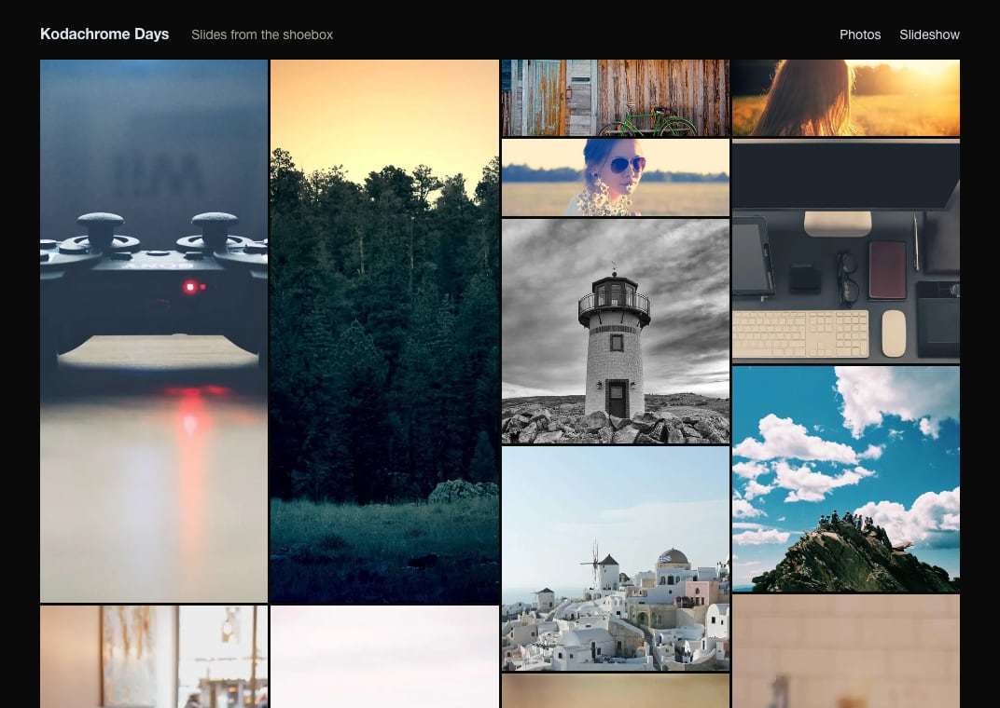
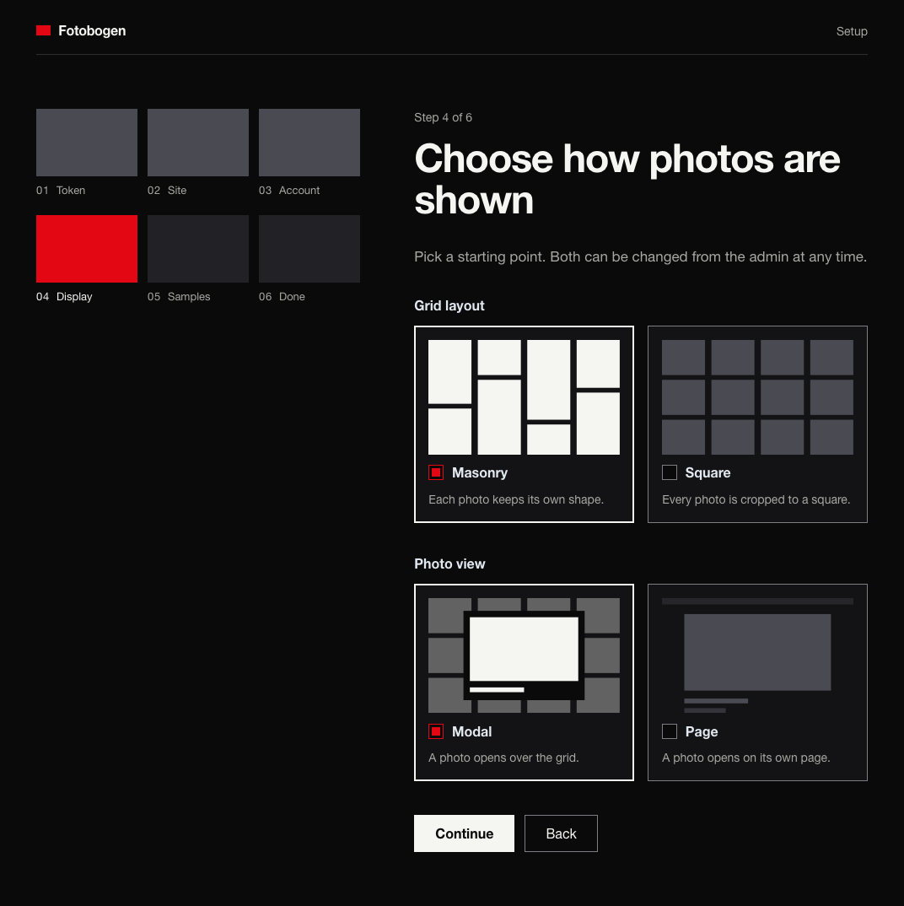

[](https://github.com/cschweda/fotobogen/actions/workflows/ci.yml)
[](LICENSE)

# Fotobogen

A self-hosted publishing platform for photographs: install it on a small
server, answer a few first-run questions, and get a public photo site with an
admin backend. Think "WordPress for photos".

**Status: early development.** What exists today: the app boots, creates its
data directory, can be claimed once through a token-protected setup wizard,
and guards an admin area behind a login. From the admin you can upload
photographs, which are checked, stored, and resized for every screen, and
download or remove 25 sample photos, and apply modules (a film frame and
film looks). Visitors get a photo grid and a page for each photo, styled by
a skin. Editing titles and captions, albums, and more are on the
[roadmap](docs/ROADMAP.md). The full
plan is in [docs/DESIGN.md](docs/DESIGN.md); changes are recorded in
[CHANGELOG.md](CHANGELOG.md).

## Contents

- [Screenshots](#screenshots)
- [How it runs](#how-it-runs)
- [Local development](#local-development)
- [Running the built server](#running-the-built-server)
- [The preflight check](#the-preflight-check)
- [Health check](#health-check)
- [The public site](#the-public-site)
- [Skins](#skins)
- [Uploading photos](#uploading-photos)
- [Managing photos](#managing-photos)
- [Albums and tags](#albums-and-tags)
- [Sample photos](#sample-photos)
- [Modules](#modules)
- [Tests](#tests)
- [Windows](#windows)
- [Docker quick start](#docker-quick-start)
- [Laravel Forge](#laravel-forge)
- [Without Docker (pm2)](#without-docker-pm2)
- [Backup and restore](#backup-and-restore)
- [Updates](#updates)
- [Resetting the admin password](#resetting-the-admin-password)
- [The data directory](#the-data-directory)
- [Settings](#settings)
- [Branches](#branches)
- [The fotobogen.com placeholder page](#the-fotobogencom-placeholder-page)
- [Licence](#licence)

## Screenshots

Taken from a local install at the current stage of development. The
photographs are the sample photos Fotobogen can download (Unsplash
photographs, via Lorem Picsum).

What visitors see: the grid, and a photo on its own page.




Editing a photo, with the strip of look previews under it and a film frame
chosen:


The library:


The notice shown once, before the admin opens:


The rest are from the installer and the first run.

The setup wizard opens on first visit and asks for the one-time token the
server printed when it started:


It then creates the single admin account, with a password strength meter:


Grid layout and photo view are picked from diagrams and can be changed later:



Step 5 offers to start empty (the default) or download 25 sample photos:


The last step lists what was chosen and closes the wizard for good. If
samples were asked for, a counter shows them arriving, and the download can
be cancelled:


After setup, the admin area sits behind a login:


The dashboard leads to uploading and can download or remove the sample
photos at any time:


Each upload shows its progress and result; a duplicate or a file that is not
a photo is explained on its own row. (The pictures here are generated
gradients, not photographs.)


## How it runs

Fotobogen is a server application, like WordPress. It runs on one machine
(a small Linux server, or your own Mac or PC for trying it out) and you use
it from any web browser. The setup wizard is a web page; there is nothing to
install on the computers you browse from.

The machine that hosts it needs **either** Docker **or** Node 24. Its
dependencies ship prebuilt for macOS, Windows, and Linux, so nothing is
compiled during install. Every change is tested on Linux and on Windows
(see [Windows](#windows)). There is no double-click desktop installer.

## Local development

Requirements: [Node 24](https://nodejs.org) and [pnpm](https://pnpm.io) 10.

```bash
nvm use            # reads .nvmrc (Node 24)
pnpm install
pnpm dev           # http://localhost:5150
```

On first start the terminal prints a setup token:

```
Fotobogen setup token: 3b213e46bd70894ad18f1357791b1f18
Open the site in a browser and enter this token to finish setup.
```

Open http://localhost:5150, enter the token, and complete the six steps. You
end up logged in at `/admin`. Everything the site stores goes in `./data`;
delete that directory to start over with a fresh install.

After changing `server/db/schema.ts`, generate a migration with
`pnpm db:generate`. Migrations are applied automatically when the server
starts.

## Running the built server

```bash
pnpm build
pnpm start
```

`pnpm start` checks the machine (see below), then starts the server and
prints its address:

```
Fotobogen is running at http://localhost:5150
```

Nothing has to be configured. The port is **5150**; if that is taken,
Fotobogen uses the next free port above it and says so. Data goes in
`./data`. Restarting keeps you logged in and does not change the setup token.

To change a setting on one machine, copy `.env.sample` to `.env` and edit
the copy (see [Settings](#settings)). A port you set yourself is used
exactly: if it is taken, Fotobogen stops and tells you, rather than moving.

**More than one copy on a machine.** If Fotobogen is already running when
you start it in a terminal, it asks what you want: run both (the new one
gets its own port), stop the running copy and start this one, or cancel.
Started without a terminal (pm2, a service), a second site simply runs on
the next port. Two copies are never allowed to share one data directory.

## The preflight check

Before it starts, Fotobogen checks that the machine can run it properly, so
an install never half-works. The first time, it prints the whole report:

```
Fotobogen preflight check
  ok   Node.js: version 24.22.3
  ok   Operating system: Ubuntu 26.04 LTS
  ok   Processor: x64
  ok   Memory: 1.9 GB available
  ok   Data directory: /home/you/fotobogen/data
  ok   Disk space: 21.4 GB free
  ok   Image library: reads JPEG, PNG, WebP, TIFF, and AVIF
  ok   Database library: loads
```

Anything marked `FAIL` stops the start, with a line saying what to fix.
A `WARN` lets it run and says what to improve. After the first run only
warnings and failures are shown. Run it on its own at any time with
`pnpm preflight`.

| Check | Stops the start when | Warns when |
|---|---|---|
| Node.js | older than 24 | |
| Operating system | | not Linux, macOS, or Windows; or a Linux that is not Ubuntu, Debian, or based on them |
| Processor | not x64 or arm64 | |
| Memory | under 900 MB (the container's limit counts, not the host's) | under 2 GB with no swap |
| Data directory | it cannot be created or written | |
| Disk space | under 500 MB free | under 2 GB free |
| Image and database libraries | they do not load, or a photo format is missing | |

Fotobogen is tested on Ubuntu, macOS, and Windows. Other Linux
distributions may well work, but are reported as untested.

## Health check

`/api/health` needs no login and answers `GET` and `HEAD`:

```json
{ "status": "ok", "version": "0.1.0", "database": "ok", "queue": { "depth": 0 }, "uptime": 86400 }
```

It returns `200` when the app and its database are working and `503` when
the database cannot be read. `queue.depth` is the number of photos waiting
to be processed; `uptime` is seconds since the server started.

With [UptimeRobot](https://uptimerobot.com) or a similar monitor: add an
HTTP(S) monitor for `https://your-site.example/api/health`. Watching the
status code is enough. For a stricter check, use a keyword monitor that
expects the text `"status":"ok"`.

## The public site

Visitors see two kinds of page:

- **The grid** at `/`: your photos newest first, in a masonry layout (each
  photo keeps its shape) or equal squares. It is laid out by CSS alone, so
  it works with JavaScript off and photos are read in the order they
  appear. Each tile shows a blurred placeholder until its image loads, and
  nothing shifts as they arrive. Thirty photos a page, with "More photos".
- **A photo** at `/photo/<name>`: the picture, its title, description, date,
  and camera details (if you show them), with previous and next links and
  the left and right arrow keys. If the site is set to open photos over the
  grid, the same content appears in a modal; the address still changes, and
  Back, Escape, or Close returns to the grid where you were.
- **Albums and tags**: `/albums`, `/album/<name>`, and `/tag/<name>` (see
  [Albums and tags](#albums-and-tags)).

- **Slideshow** at `/slideshow`: full screen, one photo after another, for
  the whole site or for one album or tag ("Play as a slideshow"). It loads
  each photo before showing it and cross-fades; it goes round for ever, in
  your order or shuffled afresh each time round. Press a photo to see its
  title and details and hold it there. Pause, step with the buttons or the
  arrow keys, Space to pause, F for full screen, Escape to leave. With
  "reduce motion" on, photos change without the fade. The seconds per photo
  and the order are in Settings. It never shows where a photo was taken.

Only photos that are processed and public are ever shown. Location is never
shown unless you switch that on.

For search engines and sharing: every photo page has social-card tags using
its 1280 px copy, and the site publishes `/feed.xml` (RSS), `/sitemap.xml`,
and `/robots.txt`. Setup, login, and the admin are marked not to be indexed.

## Skins

A skin changes how the public site looks. **Swiss**, which comes with
Fotobogen, is dark with one red accent; its accent colour, the space
between photos, and the number of columns can be changed under **Admin,
Skins**. Changes show at once and nothing is rebuilt.

To add a skin, copy its folder into `data/skins/` and restart.
[docs/SKINS.md](docs/SKINS.md) explains how to write one.

## Uploading photos

Log in, then choose **Upload photos** on the dashboard. Pick files or drop
them on the page; each one shows its progress and result.

- Accepted: JPEG, PNG, WebP, TIFF, and AVIF. A file is judged by its
  contents, not its name.
- Limits: 50 MB per file and 100 megapixels per image by default
  (see [Settings](#settings)). AVIF is held to 16 megapixels, WebP to 60, and
  interlaced PNG to 40, because those formats need far more memory to open;
  a larger one is refused with a note to upload a JPEG instead.
- The same file is not stored twice; a duplicate is refused and the page
  names the photo that already has it.
- The file you upload is kept untouched in `data/originals/`. Resized WebP
  copies (480 px thumbnail, 480 px square, 1280 px, and 2560 px) go in
  `data/derivatives/`. Nothing is ever enlarged.
- Resizing happens one photo at a time in the background, so a small server
  stays within its memory. A photo that cannot be processed after three
  tries is marked failed, with the reason and a **Try again** button.

Once processed, a photo appears on the public site.

## Managing photos

**Admin, Photos** is the library. The first photo there is the first on
your site.

- **Order:** drag a photo onto another to put it in front, or use each
  photo's Up, Down, and To top buttons, which do the same from the keyboard.
- **Several at once:** tick photos, then Hide, Show, or Delete. Deleting
  asks first, and removes the uploaded file and every resized copy.
- **Find:** show only hidden photos, photos without alt text, or photos
  that could not be processed. Each is also flagged on its card.
- **One photo:** open it to edit its title, description, alt text, web
  address, date taken, and whether it is public or hidden; to see what the
  file recorded (camera, lens, exposure, location); or to delete it.
- **Looks:** under the photo is a strip of small previews, one for each look
  the switched-on modules offer. Choosing one sets it up for that photo,
  with a larger preview, and nothing changes until you save.

**Scheduling and drafts.** On a photo's page, **Publish** has three
choices: public now, public from a date and time you pick (in your own time
zone), or hidden as a draft. A scheduled photo is in your library but not on
the site, the feed, or the sitemap until its time, and then appears by
itself. In Settings you can make every new upload start as a draft.

**Licence and downloads.** Settings has the licence your photos are
published under (all rights reserved by default, or a Creative Commons
licence) and a switch that lets visitors download them (off by default). A
photo can have its own licence and its own download setting on its page. A
download is a large copy (up to 2560 pixels) with all camera data removed.
Only a site that also shows where photos were taken hands out the file
exactly as you uploaded it, because that file carries everything the camera
recorded, the place included.

**Admin, Settings** holds the site title and tagline, the grid layout,
whether photos open over the grid or on their own page, and the two privacy
switches: camera details (on by default) and location (off by default).

## Albums and tags

Two ways to group photos:

- **Albums** are named sets you arrange yourself. Create them under
  **Admin, Albums**; add photos from the library (tick photos, choose an
  album, **Add to album**) or from a photo's own page. A photo can be in
  several albums. Each public album gets a page at `/album/<name>`, listed
  at `/albums`, with its photos in the order you added them. An album can
  be hidden, and an album with no visible photos is not shown.
- **Tags** are short labels typed on a photo's page, separated by commas,
  or added to several photos at once from the library. Each tag gets a page
  at `/tag/<name>`. A tag exists only while a photo carries it.

Deleting an album never deletes its photos.

## Sample photos

Fotobogen can download 25 placeholder photographs so a new site has
something to show. They come from [Lorem Picsum](https://picsum.photos)
(Unsplash photographs, credited to their photographers) and are never part
of the software itself. This is the only outside request Fotobogen makes,
and only when you ask.

- **During setup**, step 5 offers "Start empty" (the default) or "Download
  25 sample photos". The last step then shows a counter while they arrive.
  Setup is already finished at that point, so you never have to wait.
- **If the download fails**, you can try again or skip. After two failures
  the page leads with skipping, so nobody is stuck retrying a service that
  is down.
- **Later**, the dashboard always has **Download sample photos**, and
  **Remove sample photos** deletes all of them, and only them, in one click.
- In a source checkout, `pnpm seed:fetch` does the same from the terminal.

See [seed/README.md](seed/README.md) for the list and the licence.

## Modules

Modules change how photos look without touching the files you uploaded. Three
come with Fotobogen, all switched off until you switch them on under
**Admin, Modules**:

- **Film frame** makes a photo look contact printed: the negative's border,
  sprocket holes, and edge markings around it, on white paper. The border
  can be thicker or thinner, its outer edge ragged or straight, and the
  markings and sprocket holes on or off. The stock names are made up.
- **Film looks** gives the tone and grain of a kind of film: classic and
  pushed black-and-white, a saturated colour slide, a soft colour negative,
  with the grain turned up or down. These are impressions, not measured
  emulations of any product.

- **Watermark** prints a line of text, such as your name, in a corner of
  each photo, at a size, opacity, and position you choose. It marks the
  copies visitors see; a downloaded original is untouched.

A transform can be set for all photos at once, or chosen for one photo from
its edit page, with a preview before saving.

Adding a module means copying its folder into `data/modules/` and
restarting; nothing is rebuilt. [docs/MODULES.md](docs/MODULES.md) explains
how to write one, using the two bundled modules as examples.

## Tests

```bash
pnpm test                                # unit tests, then tests against the built server
pnpm exec playwright install chromium    # once
pnpm test:e2e                            # browser tests, including axe accessibility checks
pnpm typecheck                           # TypeScript check of app and server code
```

Both commands build the app first. Set `FB_SKIP_BUILD=1` to reuse an
existing build while iterating. The tests never use the network: sample
downloads are pointed at a stand-in server.

## Windows

Fotobogen installs and runs on Windows with Node 24 and pnpm; no compiler or
Visual Studio is needed. In PowerShell:

```powershell
git clone https://github.com/cschweda/fotobogen.git
cd fotobogen
pnpm install
pnpm build
pnpm start                        # checks the machine, prints the address and the setup token
```

CI repeats this on a Windows machine for every change: install, build, the
full test suite, the browser tests, and [scripts/smoke-test.ps1](scripts/smoke-test.ps1),
which starts the built server and walks through setup, login, and a password
reset. You can run that script yourself after `pnpm build`:

```powershell
./scripts/smoke-test.ps1
```

Two differences from Linux and macOS: the `secret` and `setup-token` files
are not restricted to your user by the app (Windows has no equivalent of
file mode `0600`; they inherit the folder's permissions), and the Docker
path needs Docker Desktop or WSL, which is not covered by the Windows test
run.

## Docker quick start

For a server with nothing on it but Docker. This runs Fotobogen behind
[Caddy](https://caddyserver.com), which obtains an HTTPS certificate for your
domain automatically.

> No image has been published yet. Until the first release, uncomment the
> `build: .` line in `docker-compose.yml` to build the image locally.

```bash
git clone https://github.com/cschweda/fotobogen.git
cd fotobogen
mkdir -p data                # so the data directory belongs to you, not root
cp .env.example .env         # set DOMAIN; leave it unset to try it on http://localhost
docker compose up -d
docker compose logs app      # shows the setup token
```

If your user id is not 1000 (run `id -u`), set `PUID` and `PGID` in `.env`
so the files in `./data` belong to you.

Update with `docker compose pull && docker compose up -d`.

## Laravel Forge

For a Forge-provisioned server, where nginx already owns ports 80 and 443 and
Forge manages the certificate.

1. Install Docker on the server and add the `forge` user to the `docker` group.
2. Create the site in Forge and install this repository into it.
3. In the site directory: `mkdir -p data`, then
   `PUID=$(id -u) PGID=$(id -g) docker compose -f docker-compose.forge.yml up -d`.
4. Paste the blocks from [deploy/forge-nginx.conf](deploy/forge-nginx.conf)
   into the site's nginx configuration, adjusting the two marked paths.
5. Issue the certificate through Forge.
6. Use [deploy/forge-deploy.sh](deploy/forge-deploy.sh) as the deploy script.

The app listens on `127.0.0.1:5150` only (`PORT` in `.env` changes the port).

## Without Docker (pm2)

Needs Node 24, pnpm, and [pm2](https://pm2.keymetrics.io) on the server.
Building takes more memory than running; on a 1 GB server, add 2 GB of swap
first.

```bash
git clone https://github.com/cschweda/fotobogen.git
cd fotobogen
pnpm install --frozen-lockfile
pnpm build
pm2 start ecosystem.config.cjs
pm2 logs fotobogen           # shows the setup token
```

Put nginx in front of it with [deploy/forge-nginx.conf](deploy/forge-nginx.conf).
Update with `scripts/rebuild.sh`.

## Backup and restore

The first time you open the admin it shows one page before anything else:
keeping a copy of your photographs is up to you, and Fotobogen, being free
software provided as it is, takes no responsibility for lost photos. The
rest of the admin opens when you press **I understand**; the page is not
shown again. The same reminder stays on the System page, beside the backup
button.

A backup is one zip file holding everything that cannot be made again: the
database (titles, albums, tags, settings, your login), your photos exactly
as you uploaded them, and any skins and modules you installed. Resized
copies are left out, because they are rebuilt from the originals. The secret
key that seals logins is left out too, so a backup file does not open your
site.

**To back up:** **Admin, System, Download a backup**. Or on the server:

```bash
pnpm fotobogen backup                    # writes fotobogen-backup-<date>.zip
pnpm fotobogen backup /mnt/disk/site.zip
```

The site can stay running; the database is copied as a consistent snapshot.

**To restore:** **Admin, System**, choose the zip, and **Upload and prepare
restore**. The file is checked and set aside, and the restore happens the
next time Fotobogen starts; until then nothing changes and it can be
cancelled. Or, with Fotobogen stopped:

```bash
pnpm fotobogen restore site.zip
```

Use the command for a large backup: the web server in front of Fotobogen
usually limits upload size.

A restore replaces everything on the site with the backup, including the
login. What was there is **not deleted**: it is moved into a folder named
`before-restore-<time>` in the data directory. After a restore the resized
copies are made again in the background, and photos reappear on the site as
each finishes. A backup made by a newer version of Fotobogen is refused
until you update.

## Updates

**Admin, System, Check for updates** asks GitHub whether a newer version of
Fotobogen has been released, and the dashboard then says so until you have
updated. Fotobogen does not check by itself unless you tick **Check once a
day**. The check is a plain request for the latest release; nothing about
your site is sent.

To update a Docker install: `docker compose pull && docker compose up -d`.
To update a source install: `scripts/rebuild.sh`, or `git pull`, `pnpm
install`, `pnpm build`, and restart. Download a backup first. Database
changes are applied automatically when the new version starts.

## Resetting the admin password

There is no password reset by email. On the server:

```bash
pnpm fotobogen reset-admin                                        # native
docker compose exec app node scripts/fotobogen.mjs reset-admin    # Docker
```

It asks for a new password (at least 12 characters) and signs out every
existing session. The app does not need to be stopped.

## The data directory

Everything a site owns lives in one directory. Backing up or moving a site
means copying it.

| Path | What it is |
|---|---|
| `fotobogen.db` | The SQLite database |
| `secret` | The key that seals login cookies. Keep it private; deleting it signs everyone out |
| `setup-token` | The one-time setup token. Exists only until setup is complete |
| `originals/` | The photos exactly as you uploaded them. Back these up |
| `derivatives/` | Resized copies. They can always be made again from the originals |
| `tmp/` | Uploads in progress. Emptied every time the server starts |
| `modules/` | Modules you install, one folder each (see [docs/MODULES.md](docs/MODULES.md)) |
| `skins/` | Skins you install, one folder each (see [docs/SKINS.md](docs/SKINS.md)) |

## Settings

Every app-wide value is written down in one file,
[`fotobogen.config.js`](fotobogen.config.js), with a comment on each. It has
two parts: **okay to change** (port, data directory, upload limits) and
**do not touch** (sizes, limits, and timings the rest of the app is built
around).

What is actually used is decided in this order:

1. Environment variables set when the app is started
2. The `.env` file in the app's folder
3. `fotobogen.config.js`

So to change something on one server, copy `.env.sample` to `.env` and set
it there. `.env` is never committed; `.env.sample` is. The same `.env` is
read by `docker compose`.

| Variable | Default | Meaning |
|---|---|---|
| `DATA_DIR` | `./data` | Where the site keeps its data |
| `PORT` | `5150` | Port the server listens on. Unset, a busy 5150 moves up to the next free port; set, it is used exactly |
| `HOST` | all interfaces | Address the server listens on |
| `MAX_UPLOAD_MB` | `50` | Largest upload, in megabytes. If you raise it, raise the proxy's limit too (`max_size` in `deploy/Caddyfile`, `client_max_body_size` in nginx) |
| `MAX_MEGAPIXELS` | `100` | Largest image, in megapixels (width times height) |
| `FOTOBOGEN_SKIP_PREFLIGHT` | off | Set to `1` to start even when the preflight check fails. At your own risk |
| `TRUST_PROXY` | off | Set to `1` only when the app is reachable solely through your own reverse proxy. It makes the login limit use the visitor's address from `X-Forwarded-For`. The shipped Docker and pm2 files set it |

Login cookies are marked `Secure`, so logging in works over HTTPS, and over
plain HTTP only on `localhost`.

## Branches

- `staging` is where work collects. Feature branches open pull requests
  against `staging` (`gh pr create --base staging`).
- `main` is updated only by one pull request from `staging`, merged with a
  merge commit (never squashed), when a batch is ready. A fix made directly on
  `main` is merged back into `staging`.
- Version tags (`v1.2.3`), which publish the Docker image, are made on `main`.

The batching matters because a push to `main` that changes `site/` or
`netlify.toml` triggers a production deploy of the placeholder page on
Netlify, and each one costs build credits.

## The fotobogen.com placeholder page

`site/` holds the single page shown at fotobogen.com: a visual guide to the
software, with screens from the current build. It reports a few named
events to Plausible (`GitHub click`, `Author click`, `Theme switch`,
`Section viewed`, `Screenshot viewed`); add those names as goals in
Plausible to see them counted. `netlify.toml` tells Netlify
to publish only that folder. The application itself needs a persistent disk
and never runs on Netlify. The social card is built from
`docs/og/og.html` with `node docs/og/render.mjs`.

## Licence

[MIT](LICENSE). Copyright Christopher Schweda.
