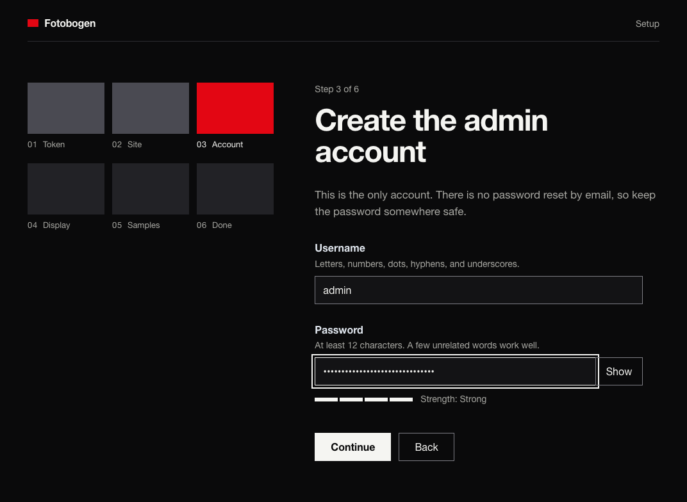
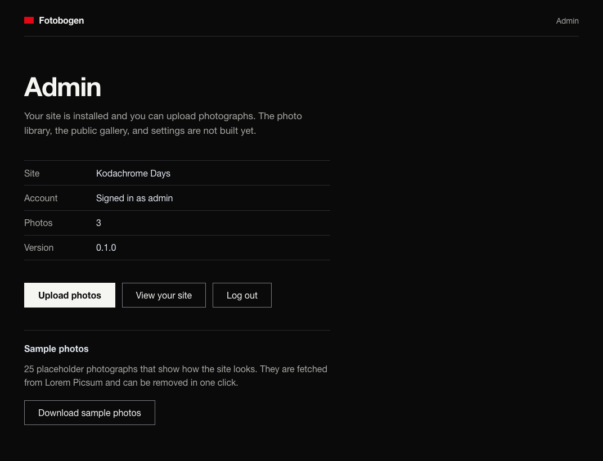

[](https://github.com/cschweda/fotobogen/actions/workflows/ci.yml)
[](LICENSE)

# Fotobogen

A self-hosted publishing platform for photographs: install it on a small
server, answer a few first-run questions, and get a public photo site with an
admin backend. Think "WordPress for photos".

**Status: early development.** What exists today: the app boots, creates its
data directory, can be claimed once through a token-protected setup wizard,
and guards an admin area behind a login. From the admin you can upload
photographs, which are checked, stored, and resized for every screen, and
download or remove 25 sample photos. The public photo grid, the photo
library, skins, and modules are not built yet. The full
plan is in [docs/DESIGN.md](docs/DESIGN.md); changes are recorded in
[CHANGELOG.md](CHANGELOG.md).

## Contents

- [Screenshots](#screenshots)
- [How it runs](#how-it-runs)
- [Local development](#local-development)
- [Running the built server](#running-the-built-server)
- [Uploading photos](#uploading-photos)
- [Sample photos](#sample-photos)
- [Tests](#tests)
- [Windows](#windows)
- [Docker quick start](#docker-quick-start)
- [Laravel Forge](#laravel-forge)
- [Without Docker (pm2)](#without-docker-pm2)
- [Resetting the admin password](#resetting-the-admin-password)
- [The data directory](#the-data-directory)
- [Settings](#settings)
- [Branches](#branches)
- [The fotobogen.com placeholder page](#the-fotobogencom-placeholder-page)
- [Licence](#licence)

## Screenshots

Taken from a local install at the current stage of development.

The setup wizard opens on first visit and asks for the one-time token the
server printed when it started:


It then creates the single admin account, with a password strength meter:



Grid layout and photo view are picked from diagrams and can be changed later:


Step 5 offers to start empty (the default) or download 25 sample photos:


The last step lists what was chosen and closes the wizard for good. If
samples were asked for, a counter shows them arriving, and the download can
be cancelled:


After setup, the admin area sits behind a login:


The dashboard leads to uploading and can download or remove the sample
photos at any time:



Each upload shows its progress and result; a duplicate or a file that is not
a photo is explained on its own row. (The pictures here are generated
gradients, not photographs.)


## How it runs

Fotobogen is a server application, like WordPress. It runs on one machine
(a small Linux server, or your own Mac or PC for trying it out) and you use
it from any web browser. The setup wizard is a web page; there is nothing to
install on the computers you browse from.

The machine that hosts it needs **either** Docker **or** Node 24. Its
dependencies ship prebuilt for macOS, Windows, and Linux, so nothing is
compiled during install. Every change is tested on Linux and on Windows
(see [Windows](#windows)). There is no double-click desktop installer.

## Local development

Requirements: [Node 24](https://nodejs.org) and [pnpm](https://pnpm.io) 10.

```bash
nvm use            # reads .nvmrc (Node 24)
pnpm install
pnpm dev           # http://localhost:3000
```

On first start the terminal prints a setup token:

```
Fotobogen setup token: 3b213e46bd70894ad18f1357791b1f18
Open the site in a browser and enter this token to finish setup.
```

Open http://localhost:3000, enter the token, and complete the six steps. You
end up logged in at `/admin`. Everything the site stores goes in `./data`;
delete that directory to start over with a fresh install.

After changing `server/db/schema.ts`, generate a migration with
`pnpm db:generate`. Migrations are applied automatically when the server
starts.

## Running the built server

```bash
pnpm build
node .output/server/index.mjs
```

No environment variables are required. The server listens on port 3000
(`PORT` changes it) and keeps its data in `./data` (`DATA_DIR` changes it).
Restarting keeps you logged in and does not change the setup token.

## Uploading photos

Log in, then choose **Upload photos** on the dashboard. Pick files or drop
them on the page; each one shows its progress and result.

- Accepted: JPEG, PNG, WebP, TIFF, and AVIF. A file is judged by its
  contents, not its name.
- Limits: 50 MB per file and 100 megapixels per image by default
  (see [Settings](#settings)).
- The same file is not stored twice; a duplicate is refused and the page
  names the photo that already has it.
- The file you upload is kept untouched in `data/originals/`. Resized WebP
  copies (480 px thumbnail, 480 px square, 1280 px, and 2560 px) go in
  `data/derivatives/`. Nothing is ever enlarged.
- Resizing happens one photo at a time in the background, so a small server
  stays within its memory. A photo that cannot be processed after three
  tries is marked failed, with the reason and a **Try again** button.

The public gallery that shows these photos is the next stage; for now the
upload page shows each thumbnail once it is ready.

## Sample photos

Fotobogen can download 25 placeholder photographs so a new site has
something to show. They come from [Lorem Picsum](https://picsum.photos)
(Unsplash photographs, credited to their photographers) and are never part
of the software itself. This is the only outside request Fotobogen makes,
and only when you ask.

- **During setup**, step 5 offers "Start empty" (the default) or "Download
  25 sample photos". The last step then shows a counter while they arrive.
  Setup is already finished at that point, so you never have to wait.
- **If the download fails**, you can try again or skip. After two failures
  the page leads with skipping, so nobody is stuck retrying a service that
  is down.
- **Later**, the dashboard always has **Download sample photos**, and
  **Remove sample photos** deletes all of them, and only them, in one click.
- In a source checkout, `pnpm seed:fetch` does the same from the terminal.

See [seed/README.md](seed/README.md) for the list and the licence.

## Tests

```bash
pnpm test                                # unit tests, then tests against the built server
pnpm exec playwright install chromium    # once
pnpm test:e2e                            # browser tests, including axe accessibility checks
pnpm typecheck                           # TypeScript check of app and server code
```

Both commands build the app first. Set `FB_SKIP_BUILD=1` to reuse an
existing build while iterating. The tests never use the network: sample
downloads are pointed at a stand-in server.

## Windows

Fotobogen installs and runs on Windows with Node 24 and pnpm; no compiler or
Visual Studio is needed. In PowerShell:

```powershell
git clone https://github.com/cschweda/fotobogen.git
cd fotobogen
pnpm install
pnpm build
node .output/server/index.mjs     # prints the setup token; open http://localhost:3000
```

CI repeats this on a Windows machine for every change: install, build, the
full test suite, the browser tests, and [scripts/smoke-test.ps1](scripts/smoke-test.ps1),
which starts the built server and walks through setup, login, and a password
reset. You can run that script yourself after `pnpm build`:

```powershell
./scripts/smoke-test.ps1
```

Two differences from Linux and macOS: the `secret` and `setup-token` files
are not restricted to your user by the app (Windows has no equivalent of
file mode `0600`; they inherit the folder's permissions), and the Docker
path needs Docker Desktop or WSL, which is not covered by the Windows test
run.

## Docker quick start

For a server with nothing on it but Docker. This runs Fotobogen behind
[Caddy](https://caddyserver.com), which obtains an HTTPS certificate for your
domain automatically.

> No image has been published yet. Until the first release, uncomment the
> `build: .` line in `docker-compose.yml` to build the image locally.

```bash
git clone https://github.com/cschweda/fotobogen.git
cd fotobogen
mkdir -p data                # so the data directory belongs to you, not root
cp .env.example .env         # set DOMAIN; leave it unset to try it on http://localhost
docker compose up -d
docker compose logs app      # shows the setup token
```

If your user id is not 1000 (run `id -u`), set `PUID` and `PGID` in `.env`
so the files in `./data` belong to you.

Update with `docker compose pull && docker compose up -d`.

## Laravel Forge

For a Forge-provisioned server, where nginx already owns ports 80 and 443 and
Forge manages the certificate.

1. Install Docker on the server and add the `forge` user to the `docker` group.
2. Create the site in Forge and install this repository into it.
3. In the site directory: `mkdir -p data`, then
   `PUID=$(id -u) PGID=$(id -g) docker compose -f docker-compose.forge.yml up -d`.
4. Paste the blocks from [deploy/forge-nginx.conf](deploy/forge-nginx.conf)
   into the site's nginx configuration, adjusting the two marked paths.
5. Issue the certificate through Forge.
6. Use [deploy/forge-deploy.sh](deploy/forge-deploy.sh) as the deploy script.

The app listens on `127.0.0.1:3000` only (`PORT` in `.env` changes the port).

## Without Docker (pm2)

Needs Node 24, pnpm, and [pm2](https://pm2.keymetrics.io) on the server.
Building takes more memory than running; on a 1 GB server, add 2 GB of swap
first.

```bash
git clone https://github.com/cschweda/fotobogen.git
cd fotobogen
pnpm install --frozen-lockfile
pnpm build
pm2 start ecosystem.config.cjs
pm2 logs fotobogen           # shows the setup token
```

Put nginx in front of it with [deploy/forge-nginx.conf](deploy/forge-nginx.conf).
Update with `scripts/rebuild.sh`.

## Resetting the admin password

There is no password reset by email. On the server:

```bash
pnpm fotobogen reset-admin                                        # native
docker compose exec app node scripts/fotobogen.mjs reset-admin    # Docker
```

It asks for a new password (at least 12 characters) and signs out every
existing session. The app does not need to be stopped.

## The data directory

Everything a site owns lives in one directory. Backing up or moving a site
means copying it.

| Path | What it is |
|---|---|
| `fotobogen.db` | The SQLite database |
| `secret` | The key that seals login cookies. Keep it private; deleting it signs everyone out |
| `setup-token` | The one-time setup token. Exists only until setup is complete |
| `originals/` | The photos exactly as you uploaded them. Back these up |
| `derivatives/` | Resized copies. They can always be made again from the originals |
| `tmp/` | Uploads in progress. Emptied every time the server starts |
| `skins/`, `modules/` | Skins and modules you install (later versions) |

## Settings

All optional.

| Variable | Default | Meaning |
|---|---|---|
| `DATA_DIR` | `./data` | Where the site keeps its data |
| `PORT` | `3000` | Port the server listens on |
| `HOST` | all interfaces | Address the server listens on |
| `MAX_UPLOAD_MB` | `50` | Largest upload, in megabytes. If you raise it, raise the proxy's limit too (`max_size` in `deploy/Caddyfile`, `client_max_body_size` in nginx) |
| `MAX_MEGAPIXELS` | `100` | Largest image, in megapixels (width times height) |
| `TRUST_PROXY` | off | Set to `1` only when the app is reachable solely through your own reverse proxy. It makes the login limit use the visitor's address from `X-Forwarded-For`. The shipped Docker and pm2 files set it |

Login cookies are marked `Secure`, so logging in works over HTTPS, and over
plain HTTP only on `localhost`.

## Branches

- `staging` is where work collects. Feature branches open pull requests
  against `staging` (`gh pr create --base staging`).
- `main` is updated only by one pull request from `staging`, merged with a
  merge commit (never squashed), when a batch is ready. A fix made directly on
  `main` is merged back into `staging`.
- Version tags (`v1.2.3`), which publish the Docker image, are made on `main`.

The batching matters because a push to `main` that changes `site/` or
`netlify.toml` triggers a production deploy of the placeholder page on
Netlify, and each one costs build credits.

## The fotobogen.com placeholder page

`site/` holds the single page shown at fotobogen.com: a visual guide to the
software, with screens from the current build. `netlify.toml` tells Netlify
to publish only that folder. The application itself needs a persistent disk
and never runs on Netlify. The social card is built from
`docs/og/og.html` with `node docs/og/render.mjs`.

## Licence

[MIT](LICENSE). Copyright Christopher Schweda.
