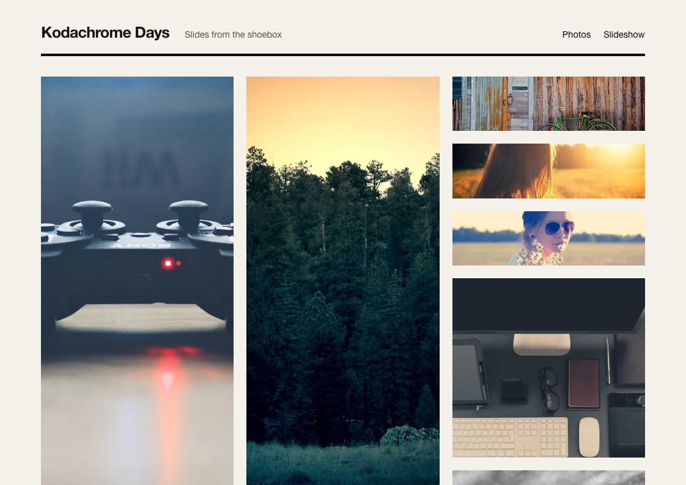
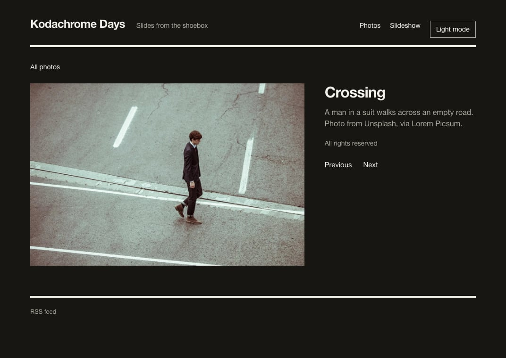
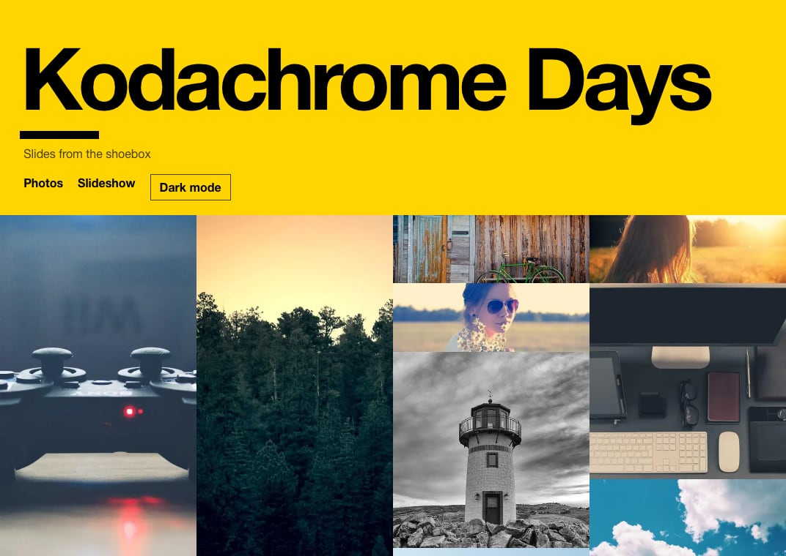

# Writing and installing a skin

A skin changes how the public site looks. It is a stylesheet and a short description file; it does not change the pages' markup, so switching skins needs no rebuild. The skin that comes with Fotobogen, [`skins/swiss`](../skins/swiss/skin.css), is the worked example.

## Contents

- [The skins that come with Fotobogen](#the-skins-that-come-with-fotobogen)
- [Light and dark](#light-and-dark)
- [Making your own from one of them](#making-your-own-from-one-of-them)
- [Installing a skin](#installing-a-skin)
- [What a skin is](#what-a-skin-is)
- [Options](#options)
- [The contrast check](#the-contrast-check)
- [The markup you are styling](#the-markup-you-are-styling)
- [The slideshow](#the-slideshow)
- [The grid](#the-grid)
- [What a skin cannot do](#what-a-skin-cannot-do)

## The skins that come with Fotobogen

Three, all in the Swiss manner: one typeface, a strict grid, flat colour, no rounded corners or shadows. **Each has a light and a dark mode.** Switch skins at any time under **Admin, Skins**; nothing is rebuilt and no photo is touched.

| Skin | Shows first | Light | Dark |
|---|---|---|---|
| **Swiss** (the default) | dark | Black on white | Off-white on near-black. A small site name, hairline gaps between photos, a red accent. |
| **Papier** | light | Black on warm white paper, heavy black rules above and below, wide margins and wide gaps, so photos sit like prints on a page. | The same page reversed: warm white on warm black. |
| **Plakat** | dark | Black on poster yellow | White on pure black with a bar of yellow. The site's name is set very large and tight like a poster headline, and photographs run edge to edge. |








Each has the same three options: accent colour (one for each mode), space between photos, and columns on a wide screen.

## Light and dark

Every skin can be seen in both modes. This is a rule, not an option: a skin that names colours for only one mode is not loaded, and the Skins page says why.

- **The owner chooses what visitors see first**, under **Admin, Skins, Light or dark**: the skin's own choice, light, dark, or whatever each visitor's device is set to.
- **A visitor can switch** with the button in the site's header. Their choice is kept in a cookie named `fb-mode`, holding the one word `light` or `dark`, so the next page arrives in the right colours with no flash. Nothing else is stored and nothing identifies the visitor.
- **How it reaches your stylesheet.** The `<html>` element carries `data-fb-mode="light"`, `"dark"`, or `"auto"`. You do not need to read it. Fotobogen writes your colours from `skin.json` after your stylesheet, once for each mode, as the custom properties `--fb-<name>`. Use `var(--fb-ground)`, `var(--fb-text)`, and so on, and both modes work.

What Fotobogen appends to `skin.css` looks like this:

```css
:root.fb-public { --fb-ground: #f4f1ea; --fb-text: #111111; /* … */ color-scheme: light; }
:root.fb-public[data-fb-mode="dark"] { --fb-ground: #171613; --fb-text: #f4f1ea; /* … */ color-scheme: dark; }
@media (prefers-color-scheme: dark) { :root.fb-public[data-fb-mode="auto"] { /* the dark colours again */ } }
```

So: **never write a colour for the page into `skin.css`.** Write `var(--fb-…)`. A fixed `#111111` would be right in one mode and unreadable in the other. (The slideshow is the exception: it is a black stage in both modes, like a darkened room.)

## Making your own from one of them

Papier and Plakat are worked examples of the quickest way to make a skin: **take Swiss, change its colours and measures, and add a few rules at the end.** Their stylesheets say so in their first lines, and each ends with a section headed "What makes this Papier rather than Swiss".

1. Copy `skins/swiss/` to `data/skins/mine/` and change `"name"` in `skin.json` to `mine`.
2. In `skin.json`, give the colours for both modes, and say which mode the skin shows first:

   ```json
   "mode": "light",
   "modes": {
     "light": { "ground": "#f4f1ea", "text": "#111111", "muted": "#55554f", "line": "#d6d2c8", "accent": "#d4040f" },
     "dark":  { "ground": "#171613", "text": "#f4f1ea", "muted": "#aca89d", "line": "#37352f", "accent": "#ff5a4f" }
   },
   "contrast": [["text", "ground"], ["muted", "ground"]]
   ```

   | Colour | Used for |
   |---|---|
   | `ground` | the page |
   | `text` | words, headings, links, focus rings |
   | `muted` | quieter words: the tagline, dates, the footer |
   | `line` | rules, and the space behind a photo while it loads |
   | `accent` | marks a hovered link; bars and underlines |

   Both modes must name the same colours. You may add your own (`"panel": "#…"` arrives as `--fb-panel`).

3. In `skin.css`, change the measures in the first block:

   ```css
   :root.fb-public {
     --fb-gutter: 1.25rem;   /* space between photos */
     --fb-columns: 3;        /* columns on a wide screen */
     --fb-margin: clamp(1.25rem, 6vw, 5rem);   /* space at the sides */
   }
   ```

   and set each option's `default` in `skin.json` to match.

4. Add your own rules at the end. Papier's are about fifteen lines:

   ```css
   .fb-site-header { margin: 0 var(--fb-margin) 2rem; padding: 2rem 0 1rem; border-bottom: 4px solid var(--fb-text); }
   .fb-site-title { font-size: 1.5rem; letter-spacing: -0.03em; }
   ```

   Plakat's make the site's name a headline:

   ```css
   .fb-site-title { font-size: clamp(2.75rem, 11vw, 8.5rem); line-height: 0.88; letter-spacing: -0.055em; overflow-wrap: anywhere; }
   .fb-site-title::after { content: ""; display: block; width: 7rem; height: 0.7rem; background: var(--fb-accent); }
   ```

5. Restart, choose it under **Admin, Skins**, and look at the grid, a photo page, an album, and the slideshow, **in both modes, on a phone and on a wide screen.**

### What to get right

The bundled skins are tested, in both modes, at 320 and 1280 pixels wide, against WCAG 2.1 level AA. A skin of yours should hold to the same:

- **Readable text (1.4.3).** Text, headings, and links need a contrast of at least 4.5:1 with the page, in both modes. List the pairs under `contrast` and the Skins page warns you when one falls short. Do not use the accent as a text colour unless it passes; the bundled skins use it for underlines and bars.
- **Set the text colour on the body** (`.fb-public body { color: var(--fb-text) }`), as the bundled skins do. The admin's stylesheet is loaded on the same pages and gives the body a pale colour of its own; without this line, headings and links on a light page are nearly invisible.
- **Start every rule from `.fb-public`** (or `:root.fb-public`). A bare `a { … }` or `body { … }` would fight with the admin or leak into it.
- **No sideways scrolling at 320 pixels (1.4.10).** Size large type with `clamp()` and a viewport unit, and let a long name wrap (`overflow-wrap: anywhere`).
- **A visible focus ring (2.4.7)** in the text colour, which contrasts with the page in both modes: `.fb-public :focus-visible { outline: 2px solid var(--fb-text); }`.
- **Respect reduced motion**: keep the `prefers-reduced-motion` block at the end of the Swiss stylesheet.
- **Style the switch**, `.fb-mode`, a `<button>` in the header's navigation.

## Installing a skin

1. Copy the skin's folder into `data/skins/` on the server, so that you have `data/skins/<name>/skin.json` and `skin.css`.
2. Restart Fotobogen.
3. Open **Admin, Skins**, choose it, and save.

Nothing is rebuilt. The active skin's stylesheet is served at `/skin.css`, and the pages link to it with a version in the address that changes whenever the skin or its options change.

## What a skin is

```
data/skins/paper/
├── skin.json
└── skin.css
```

```json
{
  "name": "paper",
  "version": "1.0.0",
  "label": "Paper",
  "description": "Black on white, with wide margins.",
  "mode": "light",
  "modes": {
    "light": { "ground": "#ffffff", "text": "#111111", "muted": "#555555" },
    "dark": { "ground": "#111111", "text": "#f2f2f2", "muted": "#a6a6a6" }
  },
  "contrast": [["text", "ground"], ["muted", "ground"]],
  "options": {
    "accent": { "type": "color", "label": "Accent colour", "default": { "light": "#0044cc", "dark": "#7fb0ff" } }
  }
}
```

`name` must be the folder's name. `modes` is required, with a `light` and a `dark` set naming the same colours; `mode` says which a visitor sees first unless the owner chooses otherwise (`light` if you leave it out).

`skin.css` is an ordinary stylesheet. Public pages carry the class `fb-public` on the `<html>` element; **start every rule from it** so your skin and the admin never interfere, and take every colour from a custom property:

```css
:root.fb-public { background: var(--fb-ground); color: var(--fb-text); }
.fb-public body { background: var(--fb-ground); color: var(--fb-text); }
.fb-public a:hover { text-decoration-color: var(--fb-accent); }
```

## Options

Options are settings the site's owner can change under **Admin, Skins**. Each one becomes a custom property named `--fb-<option>`, written after your stylesheet, so it overrides the value you set.

| Type | Declaration | Control | Becomes |
|---|---|---|---|
| `color` | `{ "type": "color", "default": { "light": "#e30613", "dark": "#ff5a4f" } }` | Two colour pickers, one for each mode | `--fb-accent: #e30613` in light, `#ff5a4f` in dark |
| `select` | `{ "type": "select", "options": ["none", "wide"], "default": "none", "values": { "none": "0px", "wide": "1.25rem" } }` | Menu | `--fb-gutter: 1.25rem` |
| `range` | `{ "type": "range", "min": 2, "max": 6, "step": 1, "default": 4 }` | Slider | `--fb-columns: 4` |

A `color` default may also be a single colour, used in both modes. A `select` shows the names in `options`; `values` maps each name to what is written into the stylesheet. Without `values`, the name itself is written.

## The contrast check

`modes` names the colours your skin uses, and `contrast` lists which are text on which background. When the skin loads, and whenever a colour option changes, Fotobogen measures each pair in light and in dark. Anything under 4.5:1 (the WCAG AA minimum for text) is shown as a warning on the Skins page. A colour option with the same name as a colour in `modes` replaces it, in the check and on the page.

## The markup you are styling

These class names are stable. A skin may rely on them.

```html
<html class="fb-public">
  <a class="fb-skip">Skip to content</a>
  <header class="fb-site-header">
    <p class="fb-site-title"><a>Site title</a></p>
    <p class="fb-site-tagline">Tagline</p>
    <nav class="fb-nav"><a>Photos</a><a>Albums</a><a>Slideshow</a></nav>
  </header>
  <main class="fb-main">

    <!-- The grid page -->
    <div class="fb-grid-wrap">
      <ul class="fb-grid fb-grid--masonry">   <!-- or fb-grid--square -->
        <li class="fb-tile" style="--fb-span: 13; background-image: url(...)">
          <a class="fb-tile__link"></a>
        </li>
      </ul>
    </div>
    <nav class="fb-pager"><a class="fb-pager__more">More photos</a></nav>
    <p class="fb-empty">No photographs have been published yet.</p>

    <!-- A photo, on its own page or inside the modal -->
    <p class="fb-photo__back"><a>All photos</a></p>
    <article class="fb-photo">
      <figure class="fb-photo__figure"></figure>
      <div class="fb-photo__text">
        <h1 class="fb-photo__title">Title</h1>
        <p class="fb-photo__description">Description</p>
        <dl class="fb-photo__facts">
          <div class="fb-photo__fact"><dt>Camera</dt><dd>…</dd></div>
        </dl>
        <nav class="fb-photo__nav"><a class="fb-photo__prev">Previous</a><a class="fb-photo__next">Next</a></nav>
      </div>
    </article>

    <!-- An album or tag page: a heading, then the same grid -->
    <h1 class="fb-page-title">Album name</h1>
    <p class="fb-page-description">Description</p>

    <!-- The list of albums -->
    <ul class="fb-albums">
      <li class="fb-album">
        <a class="fb-album__link">
          <span class="fb-album__cover"></span>
          <span class="fb-album__title">Album name</span>
          <span class="fb-album__count">12 photos</span>
        </a>
      </li>
    </ul>

    <!-- Inside .fb-photo__text, when the photo has them -->
    <p class="fb-photo__albums">In <a>Album name</a></p>
    <ul class="fb-tags"><li><a class="fb-tag">tag</a></li></ul>
    <p class="fb-photo__licence">All rights reserved</p>
    <p class="fb-photo__download"><a>Download the original</a></p>

    <dialog class="fb-modal">
      <button class="fb-modal__close">Close</button>
      <article class="fb-photo">…</article>
    </dialog>

  </main>
  <footer class="fb-site-footer"><a>RSS feed</a></footer>
</html>
```

Each tile's inline `background-image` is a tiny blurred version of the photo, shown until the real image loads. Keep `background-size: cover` on `.fb-tile` so it fills the tile.

## The slideshow

`/slideshow` has its own page, without the site's header and footer:

```html
<main class="fb-slideshow">
  <button class="fb-slideshow__photo">
    
    
  </button>
  <div class="fb-slideshow__details">
    <h2 class="fb-slideshow__title">Title</h2>
    <p class="fb-slideshow__description">Description</p>
    <p class="fb-slideshow__facts">Date · camera</p>
  </div>
  <nav class="fb-slideshow__controls">
    <button class="fb-slideshow__control">Previous</button>
    <span class="fb-slideshow__count">3 / 25</span>
    <a class="fb-slideshow__control">Close</a>
  </nav>
</main>
```

Two images are stacked; the one with `--front` is showing, and the skin makes the change between them (Swiss fades `opacity` over a second, and not at all under `prefers-reduced-motion`). Stack them with `position: absolute` and show only the front one, or both will be visible.

## The grid

Both grid layouts are CSS grid, with no JavaScript, so photos are read in the order they appear.

- **Square** (`.fb-grid--square`): give `.fb-tile` `aspect-ratio: 1`.
- **Masonry** (`.fb-grid--masonry`): each tile carries `--fb-span`, the number of rows its shape needs when **one row is a twentieth of a column's width**. Your skin must set `grid-auto-rows` to that, as Swiss does:

  ```css
  .fb-grid-wrap { container-type: inline-size; }
  .fb-grid--masonry {
    grid-auto-rows: calc((100cqw - (var(--fb-cols) - 1) * var(--fb-gutter)) / var(--fb-cols) / 20);
  }
  .fb-grid--masonry .fb-tile { grid-row: span var(--fb-span); }
  ```

  Put the space between rows inside the tile (a border or padding), not in `row-gap`, or the arithmetic drifts.

## What a skin cannot do

It cannot change the markup, add pages, or run scripts; it is CSS only. It styles the public site, not the admin. Fonts can be used if the font files are served from your own site; the pages' security policy does not allow loading fonts or anything else from another address.
